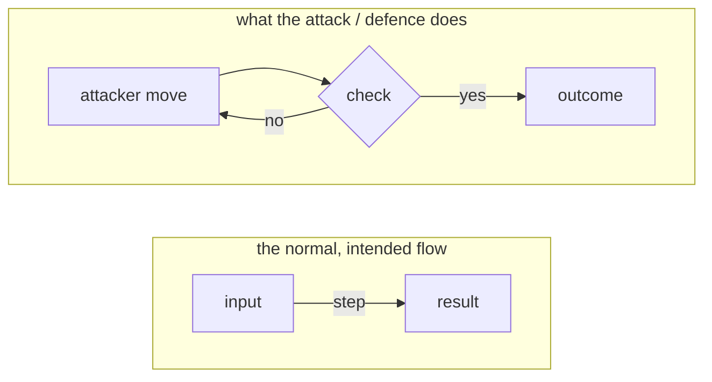

<!-- kicker: Lab NN · attack then defend · Information System Security -->
# Lab NN — Title of the lab

*One sentence on what students do, shown under the title.*

`~90 min` · `Kali · tools` · `level: intro` · `submit: Merlin`

> [!WARNING]
> **Ethics & scope.** Work only against the included practice target, in your lab environment. The same techniques against real systems are a criminal offence.

**Scenario.** A short, concrete situation (the "Flicker" company) that explains why this lab matters.

- **Offensive:** what you attack.
- **Defensive:** what you fix or detect.

## Learning outcomes

- What students can do after the lab (3–4 bullets, start with a verb).

## Prerequisites

- [ ] [Lab 00](../lab-00-setup/README.md) completed — Kali (+ Docker) working.
- [ ] Your student ID (matični broj).

## Setup · ~10 min

```bash
docker compose up -d   # if the lab has a target
```

Enter your student ID where the lab says, so the target computes **your** flag.

## Background — <topic> in one minute

Two short paragraphs (≤6 sentences each) giving the *why* before the *how*: the one core idea, where it shows up in the real world (verify any named incident/number against a live source — no years), and the one decision the attack/defence turns on. End with exactly one diagram.



Keep diagrams small (≤2 subgraphs, ≤8 nodes), labels in the file's language. Validate before committing with `npx -y -p @mermaid-js/mermaid-cli mmdc -p puppeteer.json -i d.mmd -o /tmp/d.svg` (puppeteer.json points `executablePath` at the system Chrome).

## Part 1 — Offensive: … · ~40 min

### 1.1 First step

Explain the step, then the command.

```bash
command --flag value
```

After a key command, add 1–3 sentences of inline *why* (what just happened and what it means) — match the density of the Cloud labs, not after every command, only where understanding jumps.

> [!NOTE]
> **Expected.** What the student should see.

> [!TIP]
> **Common pitfall.** What goes wrong and how to fix it.

**In the report:** what the student records here, including **your flag**.

## Part 2 — Defensive: … · ~30 min

### 2.1 Why it worked, and the fix

What to explain and the concrete mitigation.

### Bonus

- Optional stretch task.

## Submission

- `labNN_<ID>.pdf` — report with your flag and the required steps.
- An **[asciinema](https://asciinema.org/) recording** of your work — the proof of work (required).

## Grading

| Item | Points |
|---|:-:|
| … | 3 |
| … | 3 |
| … | 3 |
| … | 1 |
| Bonus | +1 |
