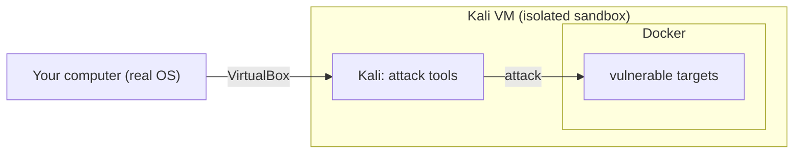

**Language:** English · [Hrvatski](README.hr.md)

<!-- kicker: Lab 00 · setup · Information System Security -->
# Lab 00 — Set up your lab

*An isolated Kali as the attacker, Docker for the vulnerable targets. Set it up once — use it all semester.*

`~45–60 min` · `VirtualBox · Docker` · `once at the start` · `prerequisite for Lab 01`

In this course you run both offensive and defensive techniques, but **never on real systems**. So you build a closed lab: Kali Linux as the attacker machine and Docker containers as deliberately vulnerable targets. Everything stays on your computer and touches nothing outside it.

## Learning outcomes

- Run Kali Linux in VirtualBox and log in.
- Verify that the security tools and wordlists are available.
- Install Docker inside Kali and bring up your first vulnerable target (OWASP Juice Shop).
- Take a clean-state snapshot to roll back to.

## Prerequisites

- [ ] An x86-64 computer with ≥ 8 GB RAM and ≥ 40 GB free disk.
- [ ] Virtualization (VT-x / AMD-V) enabled in BIOS/UEFI.
- [ ] Internet for the first download (works offline afterwards).
- [ ] [VirtualBox](https://www.virtualbox.org/wiki/Downloads) installed.

> [!NOTE]
> On the Aspira lab machines the environment is usually prepared already. If you work on your own laptop, follow the steps from the start.

## Background — your lab in one minute

This whole setup exists to give everyone an identical, throwaway environment they can safely attack in. Kali is the machine you attack *from* — a Linux distribution that already ships with the offensive and defensive tools these labs use, so nobody has to hunt down and install hashcat, nmap or Wireshark one at a time. The targets you attack are deliberately vulnerable apps, and they run as Docker containers *inside* the VM: each is a single image you bring up with one command and throw away when you're done. Because a target never leaves the VM, attacking it can't reach your real files, your home network, or anyone else — the damage is contained by design.

The VM is the fault boundary: it isolates everything you do here from your real operating system, and a `clean` snapshot lets you roll the whole machine back to a known-good state in seconds instead of reinstalling. One thing you'll meet from Lab 01 on: each lab gives you a personal flag tied to your **student ID (matični broj)**, so a flag copied from a classmate simply won't match your own — copying can't pass, because the answer is different for every student.



You stand this picture up once here — Part 1 brings up the Kali VM, Part 2 puts Docker inside it — and every later lab attacks from within that box, never outside it.

## Part 1 — Kali in VirtualBox · ~25 min

1. At [kali.org/get-kali](https://www.kali.org/get-kali/) → **Virtual Machines**, download the prebuilt VirtualBox image (`.7z`, e.g. `kali-linux-2026.2-virtualbox-amd64.7z`).
2. Extract the `.7z`. You get a folder with a `.vbox` and a `.vdi` file.
3. In VirtualBox: **Machine → Add…** and select the `.vbox` file. (This is a ready-made machine — do *not* use "Import Appliance" or "New".)
4. **Give the machine enough resources.** Select it → **Settings → System**: on **Motherboard** set **Base Memory to at least 4096 MB (4 GB)**, and on **Processor** set **at least 2 CPUs**. The prebuilt image often defaults to 2 GB / 1 CPU, which is **not enough** — the Docker targets and hashcat will crash, hang, or run out of memory.
5. Start the machine and log in — user **kali**, password **kali**.
6. Open a terminal and check the tools are present:

```bash
hashcat --version
john --version
nmap --version
```

> [!TIP]
> **Common pitfall.** If the machine won't start or is slow, enable virtualization (VT-x / AMD-V) in BIOS/UEFI. If a tool is missing, pull the default set: `sudo apt update && sudo apt install -y kali-linux-default`.

7. **Clean-state snapshot** (so you can always roll back): in VirtualBox, with the machine running → **Machine → Take Snapshot…**, name it `clean`.

Take the snapshot now, while the install is fresh and nothing is broken: it freezes the VM's whole disk at this moment, so whenever a later lab clutters Kali or an experiment goes wrong, restoring `clean` is one click and a few seconds — not a full reinstall.

## Part 2 — Docker inside Kali · ~20 min

Targets (from Lab 03 onward) run as Docker containers inside Kali.

Docker is what keeps those targets disposable and contained: each vulnerable app is a prebuilt image you bring up with a single `docker run` / `docker compose` command and discard afterwards (`--rm` deletes it on exit), and because the container runs *inside* the Kali VM, even a target you are actively exploiting can't reach your host or the real network. That's why the labs hand you a `docker` command instead of asking you to install each vulnerable app by hand.

1. Install Docker and start the service:

```bash
sudo apt update && sudo apt install -y docker.io docker-compose-v2
sudo systemctl enable docker --now
sudo usermod -aG docker $USER
```

2. **Log out and back in** (to apply the `docker` group), then check:

```bash
docker run hello-world
```

3. Smoke-test a real target — bring up OWASP Juice Shop, open `http://localhost:3000`, then stop it with `Ctrl-C`:

```bash
docker run --rm -p 3000:3000 bkimminich/juice-shop
```

4. Prepare the password-cracking tools (used from Lab 01). A VM has **no GPU**, so hashcat needs a CPU backend (`pocl-opencl-icd`), and the `rockyou` wordlist must be unpacked:

```bash
sudo apt install -y hashcat wordlists pocl-opencl-icd
sudo gunzip -kf /usr/share/wordlists/rockyou.txt.gz
hashcat -I            # should list a device (Type: CPU), not "No devices found/left"
```

> [!TIP]
> **Common pitfall.** `permission denied` on `docker` → you didn't log out/in after `usermod` (or run with `sudo`). Port 3000 busy → use `-p 3001:3000` and open `:3001`. hashcat says **`No devices found/left`** → you're in a VM without a GPU; install `pocl-opencl-icd` (above) for a CPU device.

## Stay up to date (optional, 1 min)

On the [course repository](https://github.com/aprojic/Information-System-Security), top right:

1. Click **⭐ Star** — a bookmark, so the labs are always under *Your stars* on your profile.
2. Click **Watch → Custom**, tick **Releases**, then **Apply** — GitHub emails you when a new lab is published. (A star alone sends no notifications.)

## Check — are you ready for Lab 01

- [ ] Kali boots and you log in (`kali`/`kali`).
- [ ] `hashcat --version` and `john --version` print a version, and `hashcat -I` lists a device.
- [ ] `/usr/share/wordlists/rockyou.txt` exists (unpacked).
- [ ] `docker run hello-world` passes.
- [ ] Juice Shop opens at `http://localhost:3000`.
- [ ] A `clean` snapshot exists.
- [ ] (Optional) You starred the repo and watch its releases.

Lab 00 is not graded, but it is a **prerequisite** for Lab 01. If something doesn't work, tell the instructor at the start of the session.
