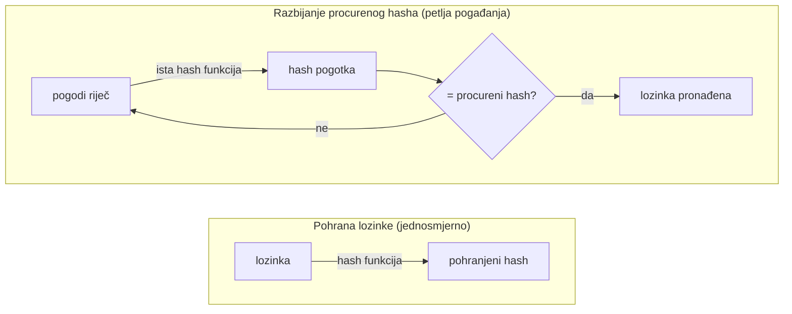

**Jezik:** [English](README.md) · Hrvatski

<!-- kicker: Vježba 01 · napadni pa obrani · Sigurnost informacijskih sustava -->
# Vježba 01 — Hashiranje i razbijanje lozinki

*Kako curenje baze lozinki pretvoriti iz katastrofe u neugodnost — sve ovisi o jednoj inženjerskoj odluci.*

`~90 min` · `Kali · hashcat · john` · `razina: početna` · `predaja: Merlin`

> [!WARNING]
> **Etika i opseg.** Radi se isključivo na hashevima koje dobiješ u ovoj vježbi, u lab okruženju. Razbijanje tuđih lozinki je kazneno djelo.

**Scenarij.** Startup **Flicker** doživio je curenje baze — netko je objavio datoteku s hashevima lozinki korisnika. Večeras si prvo **napadač** koji pokazuje koliko je to loše, a onda **inženjer** koji mijenja pohranu tako da isti dump sljedeći put bude bezvrijedan.

- **Ofenzivno:** razbijaš hasheve iz Flickerovog dumpa dictionary i mask napadom.
- **Defenzivno:** pokazuješ da isti napad ne prolazi protiv bcrypta i popravljaš pohranu.

## Ishodi učenja

- Prepoznati tip hasha i procijeniti je li pogodan za pohranu lozinki.
- Izvesti dictionary i mask napad hashcatom i razbiti slabe hasheve.
- Objasniti zašto *sol* i *spora* hash funkcija (bcrypt/argon2) poražavaju isti napad.
- Dati konkretne preporuke za sigurnu pohranu lozinki u web aplikaciji.

## Preduvjeti

- [ ] [Vježba 00](../lab-00-setup/README.hr.md) odrađena — Kali radi.
- [ ] Alati `hashcat`, `hashid`, `john` i wordlista `rockyou.txt` (standardno na Kaliju).
- [ ] Tvoj **matični broj studenta**.

## Priprema · ~10 min

S Merlina preuzmi **svoju** datoteku `hashes_<MB>.txt` (pet hasheva iz Flickerovog dumpa) i provjeri alate:

```bash
hashcat --version
ls -l /usr/share/wordlists/rockyou.txt   # po potrebi: sudo gunzip /usr/share/wordlists/rockyou.txt.gz
```

## Pozadina — hashiranje u minuti

Web stranica mora provjeriti tvoju lozinku, a da je nikad *ne pohrani*, jer svaka baza može procuriti. Zato umjesto lozinke sprema **hash**: jednosmjerni otisak koji računa funkcija poput MD5 ili bcrypta. Isti ulaz uvijek daje isti hash, ali nema „undo" — funkciju ne možeš pokrenuti unatrag da vratiš lozinku. Pri prijavi stranica hashira ono što si upisao i usporedi dva otiska.

Zato razbijanje procurenog hasha znači **pogađanje**: hashiraš kandidata, provjeriš poklapa li se otisak, ponoviš. Koliko je curenje zapravo opasno ovisi o jednoj stvari — koliko *brzo* napadač može vrtjeti tu petlju — a to je inženjerska odluka koju je stranica donijela biranjem hash funkcije. **Brza** funkcija (MD5, SHA-1) napadaču omogućuje milijarde pokušaja u sekundi; namjerno **spora** (bcrypt, argon2) samo nekoliko tisuća. Nije akademski: curenja LinkedIna (2012.) i Adobea objavila su stotine milijuna loše hashiranih lozinki koje su razbijene masovno. U ovoj vježbi igraš obje strane — MD5 hasheve isprazniš u sekundama, pa gledaš kako isti napad zapinje na bcryptu.



Brzina hash funkcije *je* brzina petlje: brzi MD5 napadač vrti milijarde puta u sekundi, spori bcrypt samo desetke. Upravo tu razliku mjeriš u Dijelu 2.

## Dio 1 — Ofenzivno: razbijanje lozinki · ~40 min

### 1.1 Identifikacija hasheva

Za svaki od pet hasheva odredi vjerojatni tip sa `hashid '<hash>'`. **U izvještaj:** tablica s pet redaka (redni broj, hash, tip, hashcat mode `-m`). Jedan je bcrypt (`$2b$...`), ostali MD5.

Identifikacija tipa je prvi potez pravog napadača, ne formalnost: svaki algoritam ima svoju cijenu napada, a hashcatu treba točan broj modea (`-m`) da uopće krene. Tip čitaš iz oblika — goli niz od 32 heksadekadska znaka je MD5; niz koji počinje s `$2b$` je bcrypt, koji sol i cost faktor nosi u sebi.

### 1.2 Dictionary napad na slabe hasheve

```bash
hashcat -m 0 -a 0 hashes_<MB>.txt /usr/share/wordlists/rockyou.txt
hashcat -m 0 -a 0 hashes_<MB>.txt /usr/share/wordlists/rockyou.txt --show
```

Dictionary napad (`-a 0`) jednostavno hashira svaku riječ iz ogromne liste stvarnih lozinki i svaku usporedi s tvojim hashevima. `rockyou.txt` je ~14 milijuna lozinki procurjelih iz stvarnog curenja 2009. — ako je korisnik izabrao bilo što uobičajeno, tu je. Protiv brzog hasha poput MD5 cijela lista prođe za manje od sekunde, i upravo zato se MD5 nikad ne smije koristiti za pohranu lozinki.

> [!NOTE]
> **Očekivano.** Tri MD5 hasha pucaju gotovo trenutno. hashcat ovdje ignorira bcrypt hash (nije mode 0); za taj redak može javiti `Token length exception` — to je u redu, bcrypt se preskače.

### 1.3 Mask napad na osobni FLAG

Jedan MD5 hash je tvoj osobni flag, oblika `ASPIRA{sis_XXXXXX}`, gdje je `XXXXXX` 6 heksadekadskih znakova (`0-9`, `a-f`). Format je poznat, pa koristi mask napad:

```bash
hashcat -m 0 -a 3 hashes_<MB>.txt 'ASPIRA{sis_?h?h?h?h?h?h}'
```

Mask napad (`-a 3`) je ciljani brute force: umjesto pogađanja riječi iz rječnika, nabrajaš *samo* nizove koji odgovaraju uzorku koji već znaš. Kako je oblik flaga fiksan, a varira samo 6 heks znakova, cijela pretraga je 16⁶ ≈ 17 milijuna kandidata — sekunde za MD5. To je opća pouka: sve što odaš o strukturi tajne smanjuje napadačevu pretragu, često drastično.

> [!TIP]
> **Čest problem.** `?h` je hashcatov skup znakova za mala heksadekadska slova. Svih 16⁶ kombinacija je nekoliko sekundi za MD5. "Token length exception" → višak razmaka u retku.

**U izvještaj:** tri razbijene lozinke i **tvoj flag**; priloži `hashcat --show` izlaz kao log procesa.

## Dio 2 — Defenzivno: sigurna pohrana · ~30 min

### 2.1 Isti napad protiv bcrypta

Peti hash (`$2b$...`) je bcrypt jake lozinke — tako bi Flicker trebao pohranjivati. Pokrećeš *isti* dictionary napad kao prije; promijenila se samo hash funkcija. Ta jedna promjena je cijela poanta vježbe.

```bash
hashcat -m 3200 -a 0 hashes_<MB>.txt /usr/share/wordlists/rockyou.txt
```

Pusti ~1 minutu, pa prekini (`q`). Zabilježi broj pokušaja u sekundi i usporedi s MD5-om. bcrypt je spor *namjerno*: njegov cost faktor prisiljava tisuće internih rundi po pokušaju, pa isti hardver koji je testirao milijarde MD5 pokušaja u sekundi sad stiže samo desetke.

> [!NOTE]
> **Očekivano.** MD5: milijuni/milijarde H/s → trenutno. bcrypt: desetci H/s → rječnik od 14 milijuna lozinki trajao bi danima. Hash se **ne razbije** u vremenu vježbe.

### 2.2 Zašto obrana radi

Kratko (3–5 rečenica), koristeći svoja mjerenja, objasni **sol** (onemogućuje unaprijed izračunate/rainbow tablice) i **sporu funkciju / work factor** (bcrypt/argon2 namjerno troše resurse i mijenjaju ekonomiju napada).

### 2.3 Popravak pohrane

**U izvještaj:** 3 konkretne preporuke za pohranu lozinki u web aplikaciji; za barem jednu navedi konkretan parametar (npr. argon2id, bcrypt cost ≥ 12).

### Za brze — bonus

- Iz izmjerene bcrypt brzine procijeni koliko bi godina trajao potpuni napad na slučajnu 10-znakovnu lozinku iz `[a-z0-9]`. Pokaži račun.
- Uključi rule-based napad (`-r /usr/share/hashcat/rules/best64.rule`) na MD5 hasheve i vidi razbija li još koju varijantu.

## Predaja

- `vjezba01_<MB>.pdf` — izvještaj s objema tablicama, flagom, `hashcat --show` izlazom, usporedbom brzina, obrambenim osvrtom.

## Bodovanje

| Stavka | Bodovi |
|---|:-:|
| Identifikacija hasheva (tablica, točan mode) | 2 |
| Razbijene slabe lozinke + osobni flag | 3 |
| bcrypt usporedba brzina (s mjerenjima) | 3 |
| Obrambeni osvrt i preporuke | 2 |
| Bonus | +1 |
