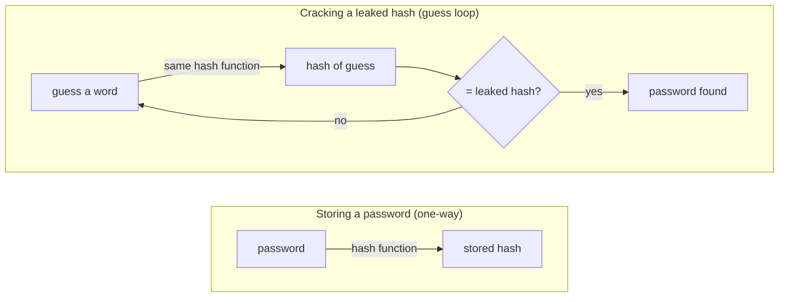

**Language:** English · [Hrvatski](README.hr.md)

<!-- kicker: Lab 01 · attack then defend · Information System Security -->
# Lab 01 — Password Hashing & Cracking

*How to turn a leaked password database from a disaster into a nuisance — it all comes down to one engineering decision.*

`~90 min` · `Kali · hashcat · john` · `level: intro` · `submit: Merlin`

> [!WARNING]
> **Ethics & scope.** Work only on the hashes you are given in this lab, inside the lab environment. Cracking other people's passwords is a criminal offence.

**Scenario.** The startup **Flicker** has been breached — someone dumped a file of its users' password hashes. You're first the **attacker** who shows how bad that is, then the **engineer** who changes the storage so the next dump is worthless.

- **Offensive:** crack the hashes from Flicker's dump with dictionary and mask attacks.
- **Defensive:** show the same attack fails against bcrypt and fix the storage.

## Learning outcomes

- Identify a hash type and judge whether it's fit for storing passwords.
- Run dictionary and mask attacks with hashcat and crack weak hashes.
- Explain why a *salt* and a *slow* hash function (bcrypt/argon2) defeat the same attack.
- Give concrete recommendations for storing passwords in a web application.

## Prerequisites

- [ ] [Lab 00](../lab-00-setup/README.md) completed — Kali working.
- [ ] Tools `hashcat`, `hashid`, `john` and the `rockyou.txt` wordlist (standard on Kali).
- [ ] Your **student ID (matični broj)**.

## Setup · ~10 min

Download **your** file `hashes_<ID>.txt` from Merlin (five hashes from Flicker's dump) and check the tools:

```bash
hashcat --version
ls -l /usr/share/wordlists/rockyou.txt   # if needed: sudo gunzip /usr/share/wordlists/rockyou.txt.gz
```

## Background — hashing in one minute

A website must check your password without ever *storing* it, because any database can leak. So instead of the password it stores a **hash**: a one-way fingerprint computed by a function such as MD5 or bcrypt. The same input always produces the same hash, but there is no "undo" — you can't run the function backwards to recover the password. At login the site hashes what you typed and compares the two fingerprints.

That is why cracking a leaked hash means **guessing**: hash a candidate word, check if its fingerprint matches, repeat. How dangerous a leak really is comes down to one thing — how *fast* an attacker can run that loop — and that was an engineering decision the site made when it chose the hash function. A **fast** function (MD5, SHA-1) lets an attacker test billions of guesses per second; a deliberately **slow** one (bcrypt, argon2) only a few thousand. This is not academic: the LinkedIn breach leaked millions of **unsalted SHA-1** password hashes, and hundreds of thousands were cracked within days. In this lab you play both sides — you'll empty the MD5 hashes in seconds, then watch the exact same attack stall against bcrypt.



The hash function's speed *is* the loop's speed: fast MD5 lets the attacker run it billions of times a second, slow bcrypt only dozens. That single difference is what you measure in Part 2.

## Part 1 — Offensive: cracking passwords · ~40 min

### 1.1 Identify the hashes

For each of the five hashes, determine the likely type with `hashid '<hash>'`. **In the report:** a five-row table (index, hash, type, hashcat mode `-m`). One is bcrypt (`$2b$...`), the rest MD5.

Identifying the type is the real attacker's first move, not a formality: each algorithm has its own attack cost, and hashcat needs the right mode number (`-m`) to even start. You read the type from the shape — a bare 32-hex string is MD5; a string starting `$2b$` is bcrypt, which carries its salt and cost factor inside it.

### 1.2 Dictionary attack on the weak hashes

```bash
hashcat -m 0 -a 0 hashes_<ID>.txt /usr/share/wordlists/rockyou.txt
hashcat -m 0 -a 0 hashes_<ID>.txt /usr/share/wordlists/rockyou.txt --show
```

A dictionary attack (`-a 0`) simply hashes every word in a huge list of real passwords and compares each one against your hashes. `rockyou.txt` is ~14 million passwords leaked from a real website breach — if a user picked anything common, it's in there. Against a fast hash like MD5 the whole list runs in under a second, which is exactly why MD5 must never be used to store passwords.

> [!NOTE]
> **Expected.** The three MD5 hashes fall almost instantly. hashcat ignores the bcrypt hash here (it isn't mode 0); you may see a `Token length exception` for that line — expected, it's the bcrypt hash being skipped.

### 1.3 Mask attack on your personal FLAG

One MD5 hash is your personal flag of the form `ASPIRA{sis_XXXXXX}`, where `XXXXXX` is 6 hex characters (`0-9`, `a-f`). The format is known, so use a mask attack:

```bash
hashcat -m 0 -a 3 hashes_<ID>.txt 'ASPIRA{sis_?h?h?h?h?h?h}'
```

A mask attack (`-a 3`) is targeted brute force: instead of guessing dictionary words, you enumerate *only* the strings that fit a pattern you already know. Because the flag's shape is fixed and just 6 hex characters vary, the whole search is 16⁶ ≈ 17 million candidates — seconds for MD5. This is the general lesson: anything you leak about a secret's structure shrinks the attacker's search, often dramatically.

> [!TIP]
> **Common pitfall.** `?h` is hashcat's lowercase-hex charset. All 16⁶ combinations take a few seconds for MD5. "Token length exception" → stray whitespace in the line.

**In the report:** the three cracked passwords and **your flag**; attach the `hashcat --show` output as your process log.

## Part 2 — Defensive: secure storage · ~30 min

### 2.1 The same attack against bcrypt

The fifth hash (`$2b$...`) is bcrypt of a strong password — how Flicker *should* store them. You run the *same* dictionary attack as before; only the hash function changed. That single change is the whole point of the lab.

```bash
hashcat -m 3200 -a 0 hashes_<ID>.txt /usr/share/wordlists/rockyou.txt
```

Let it run ~1 minute, then stop (`q`). Record the guesses/second and compare with the MD5 rate. bcrypt is slow *by design*: its cost factor forces thousands of internal rounds per guess, so the same hardware that tested billions of MD5 guesses per second now manages only dozens.

> [!NOTE]
> **Expected.** MD5: millions/billions of H/s → instant. bcrypt: tens of H/s → a 14-million-word list would take days. The hash **does not crack** in lab time.

### 2.2 Why the defence works

Briefly (3–5 sentences), using your measurements, explain the **salt** (defeats precomputed/rainbow tables) and the **slow function / work factor** (bcrypt/argon2 burn resources, changing the attack economics).

### 2.3 Fix the storage

**In the report:** 3 concrete recommendations for storing passwords in a web app; for at least one give a concrete parameter (e.g. argon2id, bcrypt cost ≥ 12).

### Bonus

- From your measured bcrypt rate, estimate how many years a full attack on a random 10-char `[a-z0-9]` password would take. Show the calculation.
- Add a rule-based attack (`-r /usr/share/hashcat/rules/best64.rule`) on the MD5 hashes and see if it cracks any further variant.

## Submission

- `lab01_<ID>.pdf` — report with both tables, your flag, the `hashcat --show` output, the speed comparison, the defensive write-up.

## Grading

| Item | Points |
|---|:-:|
| Hash identification (table, correct mode) | 2 |
| Cracked weak passwords + personal flag | 3 |
| bcrypt speed comparison (with measurements) | 3 |
| Defensive write-up and recommendations | 2 |
| Bonus | +1 |
