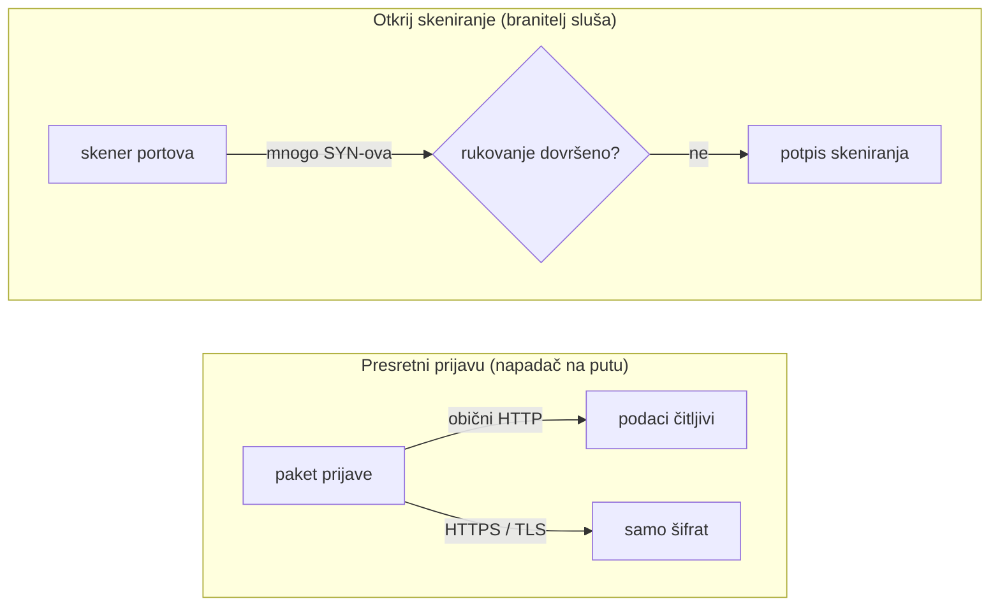

**Jezik:** [English](README.md) · Hrvatski

<!-- kicker: Vježba 03 · napadni pa obrani · Sigurnost informacijskih sustava -->
# Vježba 03 — Mrežni promet: presretanje i detekcija

*Na nešifriranoj vezi ništa nije privatno. Presretni tuđu prijavu, pa nauči prepoznati napadača u vlastitom prometu.*

`~90 min` · `Kali · Wireshark · nmap` · `razina: početna` · `predaja: Merlin`

> [!WARNING]
> **Etika i opseg.** Snimaj i analiziraj isključivo promet prema meti u svom lab okruženju. Presretanje tuđeg prometa na stvarnim mrežama je kazneno djelo.

**Scenarij.** Flicker je pustio internu aplikaciju na običnom HTTP-u "jer je samo interno". Ti si na istoj mreži: prvo **napadač** koji iz prometa čita prijave, a onda **branitelj** koji u snimci prepoznaje skeniranje i predlaže zaštitu.

## Ishodi učenja

- Snimiti i filtrirati mrežni promet Wiresharkom/tsharkom.
- Iz nešifriranog HTTP prometa izvući prijavne podatke.
- Prepoznati potpis skeniranja portova u snimci.
- Objasniti kako TLS i mrežni nadzor mijenjaju ishod.

## Preduvjeti

- [ ] [Vježba 00](../lab-00-setup/README.hr.md) odrađena — Kali + Docker rade.
- [ ] Alati `wireshark`, `tshark`, `tcpdump`, `nmap`, `curl` (na Kaliju su).
- [ ] Tvoj **matični broj** (koristiš ga kao biljeg u prometu).

## Priprema · ~10 min

Preuzmi datoteke vježbe u Kali. Repozitorij kloniraš samo jednom: od Vježbe 04 nadalje pokreni `cd ~/Information-System-Security && git pull` i uđi u mapu nove vježbe.

```bash
sudo apt update && sudo apt install -y git asciinema
git clone https://github.com/aprojic/Information-System-Security.git ~/Information-System-Security
cd ~/Information-System-Security/lab-03-network
```

Pokreni snimanje svog rada (obavezno za predaju). Sve što upišeš u ovaj terminal snima se dok na kraju vježbe ne pritisneš `Ctrl-D`, pa radi u njemu:

```bash
asciinema rec vjezba.cast
```

Meta je **DVWA** (*Damn Vulnerable Web Application*), web aplikacija namjerno napravljena nesigurnom da na njoj možeš legalno vježbati napade. Ovdje glumi Flickerovu internu aplikaciju: stranicu za prijavu posluženu preko običnog HTTP-a. Radi u Docker kontejneru opisanom u `compose.yml` u ovoj mapi. Pokreni je:

```bash
docker compose up -d
```

Otvori `http://localhost:4280` u Firefoxu. Pri prvom pokretanju DVWA mora napraviti svoju bazu: prijavi se s `admin` / `password`, pa na stranici za postavljanje klikni **Create / Reset Database** pri dnu. Kad javi uspjeh, idi na `http://localhost:4280/login.php` i ostavi stranicu za prijavu otvorenom — ponovno ćeš se prijaviti u 1.1, ovaj put dok Wireshark snima.

> [!TIP]
> **Čest problem.** `no configuration file provided: not found` znači da nisi u mapi vježbe: `cd ~/Information-System-Security/lab-03-network` pa pokušaj ponovno.

**Wireshark** snima svaki paket koji prođe kroz mrežno sučelje i omogućuje ti da svaki otvoriš i pročitaš što je unutra. Otvori **drugi terminal** (prvi snima) i pokreni ga:

```bash
wireshark
```

Ako je popis sučelja prazan ili Wireshark javi grešku s dozvolama, zatvori ga i pokreni `sudo wireshark`.

U popisu sučelja dvaput klikni **Loopback: lo** — snimanje kreće. `lo` je mreža unutar tvog računala: preglednik, `curl` i `nmap` do DVWA kontejnera dolaze preko `localhost`, pa sav promet ove vježbe prolazi kroz `lo`. U traku za filtar na vrhu upiši `http || tcp.flags.syn==1` i pritisni Enter. To je **filtar prikaza**: samo skriva pakete koji te ne zanimaju (ovdje sve osim HTTP-a i otvaranja veza); Wireshark ih u pozadini i dalje sve snima.

## Pozadina — mrežni promet u minuti

Mreža je zajednička infrastruktura: tvoji paketi putuju kroz switcheve, routere i pristupne točke do odredišta, a na zajedničkoj ili otvorenoj vezi svatko tko je na tom putu može snimiti svaki paket koji prođe. Obični **HTTP** sve nosi kao čitljiv tekst — uključujući korisničko ime i lozinku iz obrasca za prijavu — pa pasivni slušatelj tvoje podatke pročita ravno sa žice, bez ikakvog razbijanja ili trika. **TLS** (ono `S` u HTTPS-u) iste bajtove zamota u enkripciju, pa sniffer vidi samo šifrat i prijava prestaje biti čitljiva. Nije teoretski: poznati Firefox dodatak **Firesheep** to je pretvorio u salonski trik — na otvorenom Wi-Fiju pokupio bi session cookieje ljudi na istoj mreži i omogućio da se prijaviš kao oni, jer su stranice šifrirale samo korak prijave pa se za ostatak sesije vraćale na obični HTTP. Rješenje je bilo cijelu sesiju držati na HTTPS-u, što je danas norma.

Kad već slušaš mrežu, u njoj vidiš i napadača. TCP veza se otvara trosmjernim **rukovanjem** (handshake) — SYN → SYN-ACK → ACK — a skener portova to zloupotrebljava: odapne SYN na stotine portova i rukovanje nikad ne dovrši, pa se snimka napuni samim SYN paketima bez ijedne dovršene veze, **potpisom** koji branitelj jednostavno prebroji. Cijela vježba vrti se oko jedne poluge: enkripcija odlučuje je li tvoja prijava uopće čitljiva, a nadzor odlučuje hoće li se skeniranje ikad primijetiti.



Igraš obje uloge: u Dijelu 1 pročitaš prijavu koju je obični HTTP ostavio na vidjelu, a u Dijelu 2 prebrojiš osamljene SYN-ove koji odaju skeniranje.

## Dio 1 — Ofenzivno: presretanje · ~40 min

### 1.1 Presretni prijavu
Dok Wireshark snima, prijavi se u DVWA s `admin` / `password` (ako si već prijavljen, prvo klikni **Logout**). Sad pronađi tu prijavu u snimci:

1. U traku za filtar upiši `http.request.method == "POST"` i pritisni Enter. Obrazac za prijavu šalje se poslužitelju kao HTTP **POST** zahtjev, pa ostane tek nekoliko redaka.
2. Klikni redak u kojem stupac Info glasi `POST /login.php`.
3. U srednjem oknu (detalji paketa) rasklopi **HTML Form URL Encoded**: tamo su polja `username` i `password` s točno onim što si upisao.
4. Za cijeli zahtjev kao običan tekst: desni klik na redak → **Follow → HTTP Stream**. Crveno je ono što je poslao preglednik, plavo odgovor poslužitelja. Kad zatvoriš prozor, filtar ostane postavljen na tu jednu vezu; obriši ga da opet vidiš sve.

To je cijeli problem u jednom paketu. HTTP stavlja polja obrasca ravno u tijelo zahtjeva, pa je lozinka izložena čim napusti preglednik — nema se što dešifrirati ni razbijati, jer nikad nije ni bila zaštićena.

> [!NOTE]
> **Očekivano.** POST s tijelom poput `username=admin&password=password`. Čitljivo jer HTTP nije šifriran.

### 1.2 Tvoj osobni biljeg
Pošalji zahtjev koji nosi tvoj matični broj i pronađi ga u snimci:

```bash
curl "http://localhost:4280/?student=<MB>"
```

Da ga pronađeš, u traku za filtar upiši `http.request.uri contains "student"` i pritisni Enter. Redak koji ostane je tvoj zahtjev — stupac Info pokazuje `GET /?student=<MB>`.

Matični broj u query stringu daje ti jedinstveni token za pretragu snimke, pa možeš dokazati koji su od mnogih `lo` paketa baš tvoji. Usput pokazuje i da cijeli URL putuje u čistom tekstu — ne samo tijela obrazaca, nego i query stringovi, zaglavlja i cookieji.

**U izvještaj:** screenshot presretnute prijave i paketa u kojem se vidi tvoj matični broj — dokaz da si snimio vlastiti promet.

### 1.3 Skeniranje mete
**nmap** je skener portova: provjerava koji portovi na računalu primaju veze, što je napadaču obično prvi korak da vidi što je izloženo. Ostavi Wireshark da snima, a skeniranje pokreni u terminalu koji snima:

```bash
sudo nmap -sS -p 1-1000 localhost
```

`-sS` je SYN (half-open) skeniranje: nmap pošalje SYN na svaki port i iz odgovora razluči otvoreno od zatvorenog, ali nikad ne pošalje završni ACK da dovrši vezu. To ga čini brzim i tišim prema osnovnom logiranju — ali ostavlja točno onaj otisak koji loviš u Dijelu 2: rafal SYN-ova bez ijednog dovršenog rukovanja.

> [!TIP]
> **Čest problem.** Ne vidiš promet prema `localhost:4280` na `lo`? Provjeri da snimaš baš `lo`. `tcp.flags.syn==1 && tcp.flags.ack==0` izdvoji SYN pakete.

## Dio 2 — Defenzivno: detekcija i zaštita · ~30 min

### 2.1 Prepoznaj skeniranje
Zaustavi snimanje (crveni kvadrat **Stop** u alatnoj traci) i spremi snimku: **File → Save As…**, a kao naziv datoteke upiši cijelu putanju `/home/kali/Information-System-Security/lab-03-network/cap.pcapng` (ako tvoj korisnik na Kaliju nije `kali`, upiši svoje korisničko ime). `tshark` je Wireshark za terminal: čita istu datoteku i ispisuje polja koja zatražiš, pa ih možeš prebrojiti običnim alatima ljuske. U terminalu koji snima ispiši SYN pakete po izvoru i portu, najčešće prvo:

```bash
tshark -r cap.pcapng -Y 'tcp.flags.syn==1 && tcp.flags.ack==0' -T fields -e ip.src -e tcp.dstport | sort | uniq -c | sort -rn | head
```

Zatim prebroji na koliko je različitih portova stigao SYN:

```bash
tshark -r cap.pcapng -Y 'tcp.flags.syn==1 && tcp.flags.ack==0' -T fields -e tcp.dstport | sort -u | wc -l
```

Filtar zadržava samo pakete sa SYN zastavicom i bez ACK-a — prvi paket svake veze. Na vrhu prvog popisa je tvoj vlastiti promet: nekoliko veza prema portu 4280 (redak s praznim izvorom je isti promet preko IPv6, `::1`). Ispod se proteže dugačak rep portova koji su dobili po jedan SYN, a druga naredba mjeri taj rep. Na `lo` sve dolazi s istog računala, pa adresa ne razlikuje skener od preglednika; broj portova razlikuje — normalan klijent razgovara sa šačicom portova, skener sa stotinama.

> [!NOTE]
> **Očekivano.** Druga naredba ispiše oko 1000: jedan izvor poslao je SYN na stotine portova u kratkom vremenu, bez dovršenih rukovanja — potpis SYN skeniranja.

### 2.2 Zašto obrana radi
Kratko (3–5 rečenica): zašto bi **TLS** učinio prijavu iz 1.1 nečitljivom, i kako bi **IDS/vatrozid** primijetio skeniranje.

### 2.3 Preporuke
**U izvještaj:** 3 konkretne preporuke za Flicker (npr. TLS + HSTS svugdje, segmentacija, nadzor/IDS s pragom na broj SYN-ova).

### Za brze — bonus
- Usporedi `nmap -sS` i `nmap -sT` u snimci na razini paketa.
- Napiši jedno `tshark` pravilo koje javlja izvor s > 100 SYN-ova.

## Predaja

- `vjezba03_<MB>.pdf` — screenshotovi presretanja i paketa s matičnim brojem, izlaz `tshark` brojanja, obrambeni osvrt.
- Snimka `cap.pcapng` (ili isječak).
- **[asciinema](https://asciinema.org/) snimka** rada (`asciinema rec vjezba.cast`, zaustavi s `Ctrl-D`) — obavezna; matični broj u prometu samo pokazuje čiji je rad, ova snimka je dokaz da je odrađen.

## Bodovanje

| Stavka | Bodovi |
|---|:-:|
| Presretnuta prijava + osobni biljeg u prometu | 3 |
| Skeniranje izvedeno i vidljivo u snimci | 2 |
| Detekcija skeniranja (tshark brojanje) | 3 |
| Obrambeni osvrt i preporuke | 2 |
| Bonus | +1 |
