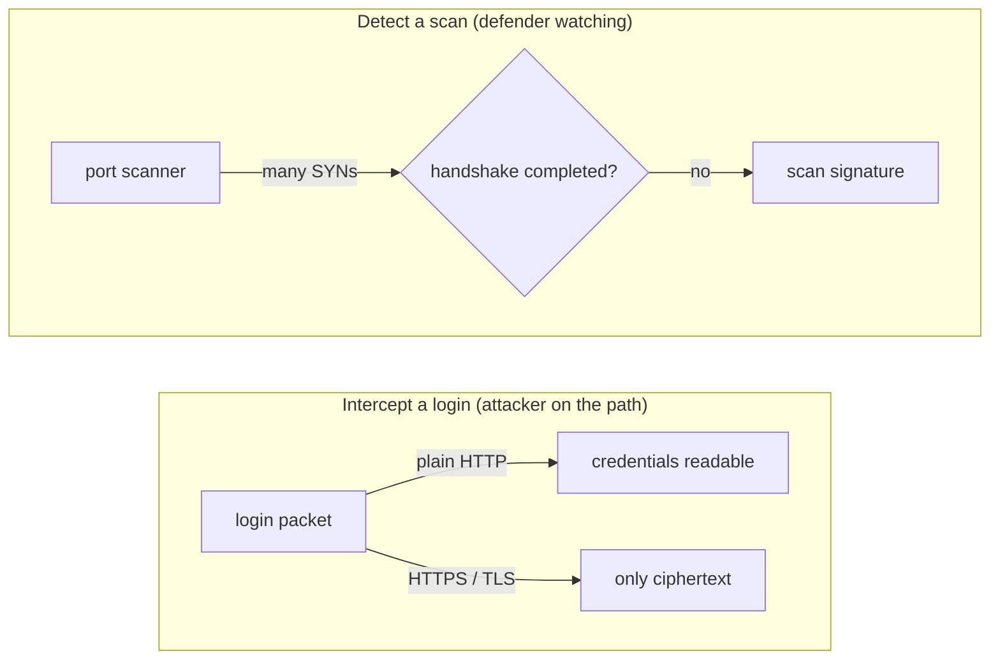

**Language:** English · [Hrvatski](README.hr.md)

<!-- kicker: Lab 03 · attack then defend · Information System Security -->
# Lab 03 — Network Traffic: Interception & Detection

*On an unencrypted connection nothing is private. Intercept someone's login, then learn to spot the attacker in your own traffic.*

`~90 min` · `Kali · Wireshark · nmap` · `level: intro` · `submit: Merlin`

> [!WARNING]
> **Ethics & scope.** Capture and analyse only traffic to the target in your lab environment. Intercepting other people's traffic on real networks is a criminal offence.

**Scenario.** Flicker shipped an internal app over plain HTTP "because it's internal only". You're on the same network: first the **attacker** who reads logins off the wire, then the **defender** who spots a scan and proposes protection.

## Learning outcomes

- Capture and filter network traffic with Wireshark/tshark.
- Extract login credentials from unencrypted HTTP traffic.
- Recognise the signature of a port scan in a capture.
- Explain how TLS and network monitoring change the outcome.

## Prerequisites

- [ ] [Lab 00](../lab-00-setup/README.md) completed — Kali + Docker working.
- [ ] Tools `wireshark`, `tshark`, `tcpdump`, `nmap`, `curl` (present on Kali).
- [ ] Your **student ID** (you'll use it as a marker in the traffic).

## Setup · ~10 min

Bring up the target and open it (`http://localhost:4280`, login `admin` / `password`, then *Create / Reset Database*):

```bash
docker compose up -d
```

Start Wireshark capturing on interface **`lo`**, display filter: `http || tcp.flags.syn==1`.

## Background — network traffic in one minute

A network is shared infrastructure: your packets travel through switches, routers and access points on the way to their destination, and on a shared or open link anyone sitting on that path can capture every packet that passes. Plain **HTTP** carries everything as readable text — including the username and password in a login form — so a passive listener reads your credentials straight off the wire, with no cracking or trickery involved. **TLS** (the `S` in HTTPS) wraps those same bytes in encryption, so a sniffer sees only ciphertext and the login stops being readable. This is not theoretical: a well-known Firefox extension, **Firesheep**, turned it into a party trick — on open Wi-Fi it quietly grabbed the session cookies of people on the same network and let you log in as them, because sites encrypted only the login step and then fell back to plain HTTP for the rest of the session. The fix was to keep the whole session on HTTPS, which is now the norm.

Once you are already listening to the network, you also see the attacker. A TCP connection opens with a three-way **handshake** — SYN → SYN-ACK → ACK — and a port scanner abuses that: it fires a SYN at hundreds of ports and never completes the handshake, so the capture fills with lone SYNs and no finished connections, a **signature** a defender can simply count. The whole lab turns on one lever: encryption decides whether your login is readable at all, and monitoring decides whether the scan is ever noticed.



You play both roles: in Part 1 you read a login that plain HTTP left in the open, then in Part 2 you count the lone SYNs that give the scan away.

## Part 1 — Offensive: interception · ~40 min

### 1.1 Intercept the login
While capturing, log in to DVWA. Find the login POST and read the credentials in cleartext.

This is the whole problem in a single packet. HTTP places the form fields directly in the request body, so the password is exposed the moment it leaves the browser — there is nothing to decrypt or crack, because it was never protected in the first place.

> [!NOTE]
> **Expected.** A POST with a body like `username=admin&password=password`. Readable because HTTP is not encrypted.

### 1.2 Your personal marker
Send a request carrying your student ID and find it in the capture:

```bash
curl "http://localhost:4280/?student=<ID>"
```

Putting your ID in the query string gives you a unique token to search the capture for, so you can prove which of the many `lo` packets are yours. It also makes the point that the whole URL travels in cleartext too — not just form bodies, but query strings, headers and cookies.

**In the report:** a screenshot of the intercepted login and of the packet showing your ID — proof you captured your own traffic.

### 1.3 Scan the target
```bash
sudo nmap -sS -p 1-1000 localhost
```

`-sS` is a SYN (half-open) scan: nmap sends a SYN to each port, reads the reply to tell open from closed, but never sends the final ACK to complete the connection. That makes it fast and stealthier against basic logging — but it also leaves exactly the fingerprint you will hunt in Part 2: a burst of SYNs with no completed handshakes.

> [!TIP]
> **Common pitfall.** No traffic to `localhost:4280` on `lo`? Make sure you capture `lo`. `tcp.flags.syn==1 && tcp.flags.ack==0` isolates SYN packets.

## Part 2 — Defensive: detection & protection · ~30 min

### 2.1 Spot the scan
Save the capture (`cap.pcapng`) and count SYNs per source and port:

```bash
tshark -r cap.pcapng -Y 'tcp.flags.syn==1 && tcp.flags.ack==0' -T fields -e ip.src -e tcp.dstport | sort | uniq -c | sort -rn | head
```

The filter keeps only packets with SYN set and ACK clear — the opening packet of a connection — then tallies them per source and destination port. A normal client opens a handful of connections; a scanner stands out as one source touching hundreds of ports, which is why sorting by count makes it obvious at a glance.

> [!NOTE]
> **Expected.** One source sends SYNs to hundreds of ports in a short time, with no completed handshakes — the signature of a SYN scan.

### 2.2 Why the defence works
Briefly (3–5 sentences): why **TLS** would make the login from 1.1 unreadable, and how an **IDS/firewall** would notice the scan.

### 2.3 Recommendations
**In the report:** 3 concrete recommendations for Flicker (e.g. TLS + HSTS everywhere, segmentation, monitoring/IDS with a SYN-count threshold).

### Bonus
- Compare `nmap -sS` and `nmap -sT` at the packet level in the capture.
- Write one `tshark` rule that flags a source with > 100 SYNs.

## Submission

- `lab03_<ID>.pdf` — screenshots of the interception and the ID packet, the `tshark` count output, the defensive write-up.
- The capture `cap.pcapng` (or an excerpt).
- An **[asciinema](https://asciinema.org/) recording** of your work (`asciinema rec lab.cast`, stop with `Ctrl-D`) — required; the flag only identifies you, this recording is the proof of work.

## Grading

| Item | Points |
|---|:-:|
| Intercepted login + personal ID in traffic | 3 |
| Scan performed and visible in the capture | 2 |
| Scan detection (tshark count) | 3 |
| Defensive write-up and recommendations | 2 |
| Bonus | +1 |
