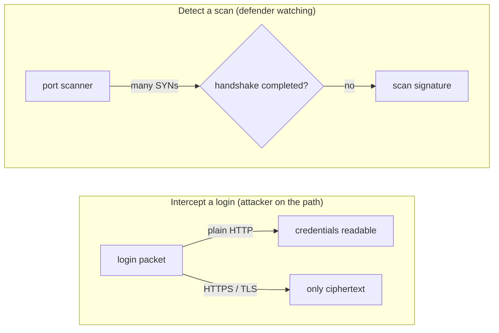

**Language:** English · [Hrvatski](README.hr.md)

<!-- kicker: Lab 03 · attack then defend · Information System Security -->
# Lab 03 — Network Traffic: Interception & Detection

*On an unencrypted connection nothing is private. Intercept someone's login, then learn to spot the attacker in your own traffic.*

`~90 min` · `Kali · Wireshark · nmap` · `level: intro` · `submit: Merlin`

> [!WARNING]
> **Ethics & scope.** Capture and analyse only traffic to the target in your lab environment. Intercepting other people's traffic on real networks is a criminal offence.

**Scenario.** Flicker shipped an internal app over plain HTTP "because it's internal only". You're on the same network: first the **attacker** who reads logins off the wire, then the **defender** who spots a scan and proposes protection.

## Learning outcomes

- Capture and filter network traffic with Wireshark/tshark.
- Extract login credentials from unencrypted HTTP traffic.
- Recognise the signature of a port scan in a capture.
- Explain how TLS and network monitoring change the outcome.

## Prerequisites

- [ ] [Lab 00](../lab-00-setup/README.md) completed — Kali + Docker working.
- [ ] Tools `wireshark`, `tshark`, `tcpdump`, `nmap`, `curl` (present on Kali).
- [ ] Your **student ID** (you'll use it as a marker in the traffic).

## Setup · ~10 min

Get the lab files into Kali. You clone the repository only once: from Lab 04 on, run `cd ~/Information-System-Security && git pull` and go into the new lab's folder.

```bash
sudo apt update && sudo apt install -y git asciinema
git clone https://github.com/aprojic/Information-System-Security.git ~/Information-System-Security
cd ~/Information-System-Security/lab-03-network
```

Start recording your work (required for the submission). Everything you type in this terminal is recorded until you press `Ctrl-D` at the end of the lab, so keep working in it:

```bash
asciinema rec lab.cast
```

The target is **DVWA** (*Damn Vulnerable Web Application*), a web app built to be insecure on purpose so you can practise attacks on it legally. Here it plays Flicker's internal app: a login page served over plain HTTP. It runs in a Docker container described in this folder's `compose.yml`. Start it:

```bash
docker compose up -d
```

Open `http://localhost:4280` in Firefox. On first start DVWA has to create its database: log in with `admin` / `password`, then on the setup page click **Create / Reset Database** at the bottom. When it reports success, go to `http://localhost:4280/login.php` and leave the login page open — you will log in again in 1.1, this time while Wireshark is capturing.

> [!TIP]
> **Common pitfall.** `no configuration file provided: not found` means you are not in the lab folder: `cd ~/Information-System-Security/lab-03-network` and try again.

**Wireshark** records every packet that crosses a network interface and lets you open each one and read what is inside. Open a **second terminal** (the first one is recording) and start it:

```bash
wireshark
```

If the interface list is empty or Wireshark reports a permission error, close it and run `sudo wireshark` instead.

In the list of interfaces double-click **Loopback: lo** — capturing starts. `lo` is the network inside your own machine: the browser, `curl` and `nmap` reach the DVWA container through `localhost`, so all of this lab's traffic passes through `lo`. In the filter bar at the top type `http || tcp.flags.syn==1` and press Enter. That is a **display filter**: it only hides the packets you don't care about (here everything except HTTP and connection openings); Wireshark keeps recording all of them in the background.

## Background — network traffic in one minute

A network is shared infrastructure: your packets travel through switches, routers and access points on the way to their destination, and on a shared or open link anyone sitting on that path can capture every packet that passes. Plain **HTTP** carries everything as readable text — including the username and password in a login form — so a passive listener reads your credentials straight off the wire, with no cracking or trickery involved. **TLS** (the `S` in HTTPS) wraps those same bytes in encryption, so a sniffer sees only ciphertext and the login stops being readable. This is not theoretical: a well-known Firefox extension, **Firesheep**, turned it into a party trick — on open Wi-Fi it quietly grabbed the session cookies of people on the same network and let you log in as them, because sites encrypted only the login step and then fell back to plain HTTP for the rest of the session. The fix was to keep the whole session on HTTPS, which is now the norm.

Once you are already listening to the network, you also see the attacker. A TCP connection opens with a three-way **handshake** — SYN → SYN-ACK → ACK — and a port scanner abuses that: it fires a SYN at hundreds of ports and never completes the handshake, so the capture fills with lone SYNs and no finished connections, a **signature** a defender can simply count. The whole lab turns on one lever: encryption decides whether your login is readable at all, and monitoring decides whether the scan is ever noticed.



You play both roles: in Part 1 you read a login that plain HTTP left in the open, then in Part 2 you count the lone SYNs that give the scan away.

## Part 1 — Offensive: interception · ~40 min

### 1.1 Intercept the login
While Wireshark is capturing, log in to DVWA with `admin` / `password` (if you are already logged in, click **Logout** first). Now find that login in the capture:

1. In the filter bar type `http.request.method == "POST"` and press Enter. A login form is sent to the server as an HTTP **POST** request, so only a few lines remain.
2. Click the line whose Info column says `POST /login.php`.
3. In the middle pane (packet details) expand **HTML Form URL Encoded**: the `username` and `password` fields are there with exactly what you typed.
4. To see the whole request as plain text, right-click the line → **Follow → HTTP Stream**. Red is what the browser sent, blue is the server's reply. Closing the window leaves the filter set to that one connection; clear it to see everything again.

This is the whole problem in a single packet. HTTP places the form fields directly in the request body, so the password is exposed the moment it leaves the browser — there is nothing to decrypt or crack, because it was never protected in the first place.

> [!NOTE]
> **Expected.** A POST with a body like `username=admin&password=password`. Readable because HTTP is not encrypted.

### 1.2 Your personal marker
Send a request carrying your student ID and find it in the capture:

```bash
curl "http://localhost:4280/?student=<ID>"
```

To find it, type `http.request.uri contains "student"` in the filter bar and press Enter. The line that remains is your request — its Info column shows `GET /?student=<ID>`.

Putting your ID in the query string gives you a unique token to search the capture for, so you can prove which of the many `lo` packets are yours. It also makes the point that the whole URL travels in cleartext too — not just form bodies, but query strings, headers and cookies.

**In the report:** a screenshot of the intercepted login and of the packet showing your ID — proof you captured your own traffic.

### 1.3 Scan the target
**nmap** is a port scanner: it checks which ports on a machine accept connections, which is usually an attacker's first step to see what is exposed. Leave Wireshark capturing and run the scan in the recording terminal:

```bash
sudo nmap -sS -p 1-1000 localhost
```

`-sS` is a SYN (half-open) scan: nmap sends a SYN to each port, reads the reply to tell open from closed, but never sends the final ACK to complete the connection. That makes it fast and stealthier against basic logging — but it also leaves exactly the fingerprint you will hunt in Part 2: a burst of SYNs with no completed handshakes.

> [!TIP]
> **Common pitfall.** No traffic to `localhost:4280` on `lo`? Make sure you capture `lo`. `tcp.flags.syn==1 && tcp.flags.ack==0` isolates SYN packets.

## Part 2 — Defensive: detection & protection · ~30 min

### 2.1 Spot the scan
Stop the capture (the red square **Stop** button in the toolbar) and save it: **File → Save As…**, and as the file name type the full path `/home/kali/Information-System-Security/lab-03-network/cap.pcapng` (if your Kali user isn't `kali`, use your own user name). `tshark` is Wireshark for the terminal: it reads the same file and prints the fields you ask for, so you can count them with ordinary shell tools. In the recording terminal, list the SYNs per source and port, busiest first:

```bash
tshark -r cap.pcapng -Y 'tcp.flags.syn==1 && tcp.flags.ack==0' -T fields -e ip.src -e tcp.dstport | sort | uniq -c | sort -rn | head
```

Then count how many different ports received a SYN:

```bash
tshark -r cap.pcapng -Y 'tcp.flags.syn==1 && tcp.flags.ack==0' -T fields -e tcp.dstport | sort -u | wc -l
```

The filter keeps only packets with SYN set and ACK clear — the opening packet of a connection. The top of the first list is your own browsing: a few connections to port 4280 (a line with an empty source is the same traffic over IPv6, `::1`). Below it runs a long tail of ports that got a single SYN each, and the second command measures that tail. On `lo` everything comes from the same machine, so the address can't separate the scanner from your browser; the number of ports can — a normal client talks to a handful, a scanner to hundreds.

> [!NOTE]
> **Expected.** The second command prints about 1000: one source sent SYNs to hundreds of ports in a short time, with no completed handshakes — the signature of a SYN scan.

### 2.2 Why the defence works
Briefly (3–5 sentences): why **TLS** would make the login from 1.1 unreadable, and how an **IDS/firewall** would notice the scan.

### 2.3 Recommendations
**In the report:** 3 concrete recommendations for Flicker (e.g. TLS + HSTS everywhere, segmentation, monitoring/IDS with a SYN-count threshold).

### Bonus
- Compare `nmap -sS` and `nmap -sT` at the packet level in the capture.
- Write one `tshark` rule that flags a source with > 100 SYNs.

## Submission

- `lab03_<ID>.pdf` — screenshots of the interception and the ID packet, the `tshark` count output, the defensive write-up.
- The capture `cap.pcapng` (or an excerpt).
- An **[asciinema](https://asciinema.org/) recording** of your work (`asciinema rec lab.cast`, stop with `Ctrl-D`) — required; your ID in the traffic only shows whose work it is, this recording is the proof of work.

## Grading

| Item | Points |
|---|:-:|
| Intercepted login + personal ID in traffic | 3 |
| Scan performed and visible in the capture | 2 |
| Scan detection (tshark count) | 3 |
| Defensive write-up and recommendations | 2 |
| Bonus | +1 |
