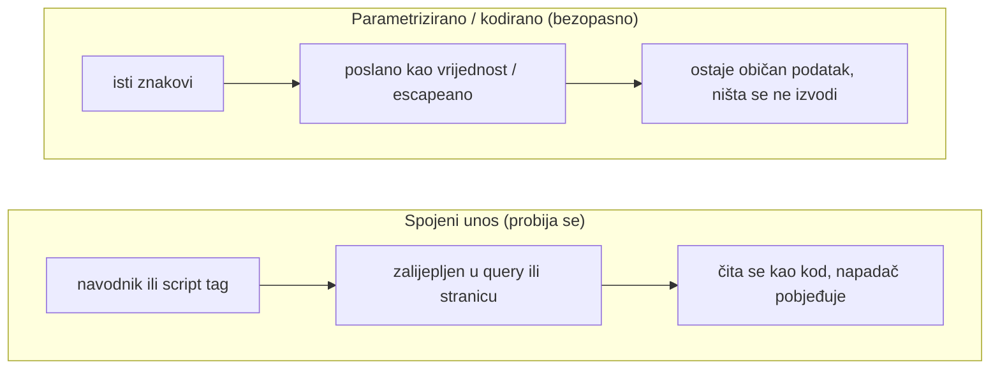

**Jezik:** [English](README.md) · Hrvatski

<!-- kicker: Vježba 04 · napadni pa obrani · Sigurnost informacijskih sustava -->
# Vježba 04 — Web napadi I: injection i XSS

*Dva najstarija web napada koja i danas rade: izvući bazu kroz polje za pretragu i oteti sesiju kroz polje za komentar.*

`~90 min` · `Kali · DVWA · preglednik` · `razina: srednja` · `predaja: Merlin`

> [!WARNING]
> **Etika i opseg.** Napadaj isključivo DVWA metu u svom lab okruženju. Isti postupci na tuđem webu su kazneno djelo.

**Scenarij.** Flickerova web aplikacija vjeruje korisničkom unosu. Ti si prvo **napadač** koji kroz SQL injection čita cijelu bazu i kroz XSS krade sesiju, a onda **programer** koji popravlja kod tako da isti unos postane bezopasan.

## Ishodi učenja

- Izvesti SQL injection i izvući podatke iz baze.
- Izvesti reflektirani i pohranjeni XSS te oteti kolačić sesije.
- U ranjivom kodu prepoznati uzrok (spajanje unosa u upit / neizlazno ispisivanje).
- Popraviti ranjivost parametriziranim upitom i izlaznim kodiranjem.

## Preduvjeti

- [ ] [Vježba 00](../lab-00-setup/README.hr.md) odrađena — Kali + Docker rade.
- [ ] Osnove HTTP-a i HTML-a; pojam "sesija / kolačić".
- [ ] (Korisno) Burp Suite ili preglednikov DevTools.

## Priprema · ~10 min

```bash
docker compose up -d
```

Otvori `http://localhost:4280`, prijavi se (`admin`/`password`), *Create / Reset Database*, pa **DVWA Security → Low**.

## Pozadina — injection u minuti

Web aplikacija neprestano sastavlja rečenice koje će neki drugi stroj protumačiti — SQL query za bazu, HTML stranicu za preglednik — tako što tvoj unos zalijepi u predložak. Injection se događa kad se taj unos umiješa ravno u rečenicu: jedan navodnik zatvori string literal u queryju, pa se sve iza čita kao *SQL* umjesto kao podatak, a `<script>` tag se čita kao *markup*, pa ga preglednik pokrene kao kod. Program tada radi ono što kažu napadačevi znakovi, a ne ono što je programer mislio. **SQL injection** cilja na bazu — uvjet koji je uvijek istinit ili `UNION SELECT` pretvore jedno dohvaćanje u dump svih korisnika i hasheva lozinki. **XSS** cilja na tuđe preglednike — pohranjeni komentar ili reflektirani parametar nosi script koji se izvrši u sesiji sljedećeg posjetitelja i može mu ukrasti cookie. Isti korijenski uzrok, samo se otima druga vrsta rečenice.

Rješenje je oba puta ista ideja: drži **podatke** i **kod** odvojeno da unos nikad ne može prijeći granicu ni u jedno ni u drugo. Za SQL to znači **parametrizirane (prepared) upite** — struktura upita je fiksirana unaprijed, a tvoj unos ide zasebno kao vrijednost, pa je navodnik samo navodnik. Za HTML to znači **izlazno kodiranje / escaping po kontekstu** — `<` postane `&lt;` u trenutku ispisa, pa se script tag prikaže kao vidljiv tekst umjesto da se izvrši. Nije riječ o rubnom bugu: injection godinama stoji na vrhu ili pri vrhu OWASP Top 10 liste, toliko središnji da je cross-site scripting danas uvršten u istu kategoriju. I skalira se — Samy worm bio je pohranjeni XSS koji se proširio na preko milijun MySpace profila za manje od dana, a svaki zaraženi profil ponovno je posluživao script svakome tko ga pogleda.



Igraš obje strane: u Dijelu 1 probiješ se iz queryja i iz stranice, a u Dijelu 2 isti unos zadržiš bezopasnim — prepared statement za SQL, izlazno kodiranje za HTML.

## Dio 1 — Ofenzivno: injection i XSS · ~45 min

### 1.1 SQL injection — izvuci bazu
U *SQL Injection* modulu (polje `User ID`) ubaci payload koji vraća sve retke (uvjet koji je uvijek istinit, pa `UNION SELECT` za korisnička imena i hasheve lozinki).

Polje `User ID` ne postavlja bazi pitanje — nego ga *gradi* lijepeći tvoj tekst u string `SELECT ... WHERE id = '<unos>'`. Zatvoriš taj string navodnikom i ostatak retka čita se kao SQL, a ne kao ID: uvjet koji je uvijek istinit otvori vrata, a `UNION SELECT` zavari drugi, tvoj upit na prvi pa ti biraš koji se stupci vrate.

> [!NOTE]
> **Očekivano.** Umjesto jednog korisnika, aplikacija ispiše sve — uključujući korisnička imena i hasheve iz tablice `users`.

**U izvještaj:** payload, popis izvučenih korisnika i hasheva. **Razbij jedan hash** (hashcat, kao u Vježbi 01) i priloži rezultat.

### 1.2 XSS — otmi sesiju
U *XSS (Reflected)* ubaci skriptu koja ispisuje `document.cookie`. Zatim u *XSS (Stored)* spremi payload koji kolačić šalje na tvoj slušatelj; uključi i svoj matični broj u payload:

```bash
nc -lvnp 8000     # na Kaliju, slušatelj za ukradeni kolačić
```

Server nikad ne pokreće tvoj script — samo ga pohrani ili vrati, a onda ga *preglednik drugog korisnika* pokrene dok je prijavljen kao on. U tome je cijela opasnost XSS-a: posuđuje žrtvinu sesiju, pa je `document.cookie` njezin cookie, a pohranjeni payload okine se svakome tko otvori stranicu. **Reflektirani** XSS živi u URL-u na koji žrtvu moraš navesti da klikne; **pohranjeni** je spremljen na serveru i čeka.

**U izvještaj:** reflektirani XSS koji ispiše kolačić (screenshot) i pohranjeni XSS koji ga pošalje na tvoj `nc` (screenshot s vidljivim matičnim brojem).

### 1.3 Podigni razinu
Prebaci **DVWA Security → Medium** i ponovi. Objasni što je filtar blokirao i kako si ga zaobišao.

Medium ne popravlja bug — filtrira unos, ovdje izbaci ključnu riječ, ondje escapea znak, i zato je *čišćenje lošeg unosa* izgubljena igra. Uvijek postoji još jedno kodiranje, veliko/malo slovo ili struktura koju je filtar zaboravio; tek odvajanje koda od podataka (2.2) zatvara rupu zauvijek.

> [!TIP]
> **Čest problem.** Medium čisti neke znakove/ključne riječi — promijeni velika/mala slova, kodiranje ili strukturu. Nema kolačića na `nc`? XSS se izvodi u **tvom pregledniku**, pa on (ne DVWA kontejner) mora doseći tvoj slušatelj — u payload stavi svoj Kali IP, ne `localhost`.

## Dio 2 — Defenzivno: popravi kod · ~30 min

### 2.1 Pronađi uzrok
U DVWA-u klikni **View Source** za oba modula. Pokaži točan redak gdje se unos **spaja u SQL upit** i gdje se **ispisuje bez kodiranja** u HTML.

### 2.2 Popravi

Oba popravka su isti potez — vrati granicu između koda i podataka koju je spajanje izbrisalo. **Parametrizirani upit** šalje SQL i vrijednosti odvojenim kanalima, pa baza tvoj unos tretira kao vrijednost, a nikad kao sintaksu, bez obzira na znakove u njemu. **Izlazno kodiranje** escapea opasne znakove (`<`, `>`, `&`, navodnike) za kontekst u koji padaju, pa ih preglednik prikaže umjesto da po njima postupi; **Content-Security-Policy** je zaštitna mreža koja odbija pokrenuti ubačeni inline script i ako jedan promakne.

**U izvještaj:**
- **SQL:** ispravljeni upit kao **parametrizirani / prepared statement** (isječak).
- **XSS:** izlazno kodiranje/escaping unosa (spomeni ulaznu validaciju i `Content-Security-Policy`).

### 2.3 Preporuke
3 konkretne preporuke za siguran razvoj (parametrizirani upiti svugdje, kodiranje po kontekstu izlaza, CSP, najmanje ovlasti za DB korisnika).

### Za brze — bonus
- Automatiziraj 1.1 sa `sqlmap` (`-u` + kolačić sesije) i izvuci imena tablica.
- Postavi minimalni CSP header koji bi zaustavio tvoj pohranjeni XSS i obrazloži zašto.

## Predaja

- `vjezba04_<MB>.pdf` — payloadi, izvučeni podaci, screenshot XSS-a s matičnim brojem, ispravljeni isječci koda, osvrt.
- **[asciinema](https://asciinema.org/) snimka** rada (`asciinema rec vjezba.cast`, zaustavi s `Ctrl-D`) — obavezna; flag samo pokazuje čiji je rad, snimka je dokaz da je odrađen.

## Bodovanje

| Stavka | Bodovi |
|---|:-:|
| SQL injection (izvučeni podaci + razbijen hash) | 3 |
| XSS (reflektirani + pohranjeni, kolačić na slušatelj) | 3 |
| Ispravljeni kod (parametrizirani upit + kodiranje) | 3 |
| Medium razina i preporuke | 1 |
| Bonus | +1 |
