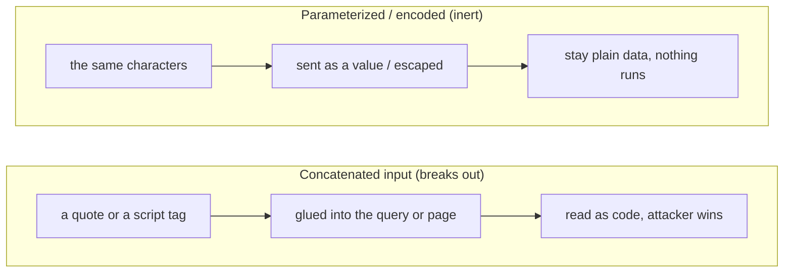

**Language:** English · [Hrvatski](README.hr.md)

<!-- kicker: Lab 04 · attack then defend · Information System Security -->
# Lab 04 — Web Attacks I: Injection & XSS

*The two oldest web attacks that still work today: dump a database through a search field, and steal a session through a comment box.*

`~90 min` · `Kali · DVWA · browser` · `level: intermediate` · `submit: Merlin`

> [!WARNING]
> **Ethics & scope.** Attack only the DVWA target in your lab environment. The same techniques against someone else's website are a criminal offence.

**Scenario.** Flicker's web app trusts user input. You're first the **attacker** who reads the whole database via SQL injection and steals a session via XSS, then the **developer** who fixes the code so the same input becomes harmless.

## Learning outcomes

- Perform SQL injection and extract data from a database.
- Perform reflected and stored XSS and steal a session cookie.
- Identify the root cause in vulnerable code (input concatenated into a query / unescaped output).
- Fix the vulnerability with a parameterized query and output encoding.

## Prerequisites

- [ ] [Lab 00](../lab-00-setup/README.md) completed — Kali + Docker working.
- [ ] HTTP and HTML basics; the idea of "session / cookie".
- [ ] (Useful) Burp Suite or the browser's DevTools.

## Setup · ~10 min

```bash
docker compose up -d
```

Open `http://localhost:4280`, log in (`admin`/`password`), *Create / Reset Database*, then **DVWA Security → Low**.

## Background — injection in one minute

A web app is constantly building sentences for some other machine to interpret — an SQL query for the database, an HTML page for the browser — by pasting your input into a template string. Injection happens when that input is mixed straight into the sentence: a single quote closes the query's string literal, so whatever follows is read as *SQL* instead of data, and a `<script>` tag is read as *markup*, so the browser runs it as code. The program then does what the attacker's characters say, not what the developer meant. **SQL injection** aims at the database — an always-true condition or a `UNION SELECT` turns one lookup into a dump of every user and password hash. **XSS** aims at other people's browsers — a stored comment or a reflected parameter carries a script that runs in the next visitor's session and can steal their cookie. Same root cause, two different sentences being hijacked.

The fix is the same idea both times: keep **data** and **code** apart so input can never cross the line into either. For SQL that means **parameterized (prepared) queries** — the query structure is fixed up front and your input is sent separately as a value, so a quote is just a quote. For HTML it means **output encoding / context-aware escaping** — `<` becomes `&lt;` at the moment of printing, so a script tag renders as visible text instead of executing. This is not a fringe bug: injection has sat at or near the top of the OWASP Top 10 for years, so central that cross-site scripting is now folded into the same category. And it scales — the Samy worm was a stored XSS that spread to over a million MySpace profiles in under a day, each infected profile re-serving the script to everyone who viewed it.



You play both sides: in Part 1 you break out of a query and out of a page, then in Part 2 you keep the exact same input inert — a prepared statement for SQL, output encoding for HTML.

## Part 1 — Offensive: injection & XSS · ~45 min

### 1.1 SQL injection — dump the database
In the *SQL Injection* module (`User ID` field), inject a payload that returns every row (an always-true condition, then a `UNION SELECT` for usernames and password hashes).

The `User ID` box doesn't ask the database a question — it *builds* one by pasting your text into a `SELECT ... WHERE id = '<input>'` string. Close that string with a `'` and the rest of the line is read as SQL, not as an ID: an always-true condition opens the gate, and `UNION SELECT` welds a second query of your own onto the first so you choose which columns come back.

> [!NOTE]
> **Expected.** Instead of one user, the app prints all of them — including usernames and password hashes from the `users` table.

**In the report:** the payload, the extracted users and hashes. **Crack one hash** (hashcat, as in Lab 01) and attach the result.

### 1.2 XSS — steal a session
In *XSS (Reflected)* inject a script that prints `document.cookie`. Then in *XSS (Stored)* save a payload that sends the cookie to your listener; include your student ID in the payload:

```bash
nc -lvnp 8000     # on Kali, listener for the stolen cookie
```

The server never runs your script — it only stores or echoes it, and then *another user's browser* runs it while logged in as them. That is the whole danger of XSS: it borrows the victim's session, so `document.cookie` is their cookie and a stored payload fires for everyone who opens the page. **Reflected** XSS lives in a URL you must get the victim to click; **stored** XSS is saved on the server and waits.

**In the report:** a reflected XSS printing the cookie (screenshot) and a stored XSS sending it to your `nc` (screenshot with your ID visible).

### 1.3 Raise the bar
Switch **DVWA Security → Medium** and repeat. Explain what the filter blocked and how you bypassed it.

Medium doesn't fix the bug — it filters the input, stripping a keyword here and escaping a character there, which is why *sanitising bad input* is a losing game. There is always another encoding, case or structure the filter forgot; only separating code from data (2.2) closes the hole for good.

> [!TIP]
> **Common pitfall.** Medium strips some characters/keywords — change case, encoding or structure. No cookie at `nc`? The XSS runs in **your browser**, so it (not the DVWA container) must reach your listener — put your Kali IP, not `localhost`, in the payload.

## Part 2 — Defensive: fix the code · ~30 min

### 2.1 Find the root cause
In DVWA click **View Source** for both modules. Point to the exact line where input is **concatenated into the SQL query** and where it is **printed without encoding** into HTML.

### 2.2 Fix it

Both fixes are the same move — put back the boundary between code and data that concatenation erased. A **parameterized query** ships the SQL and the values on separate channels, so the database treats your input as a value and never as syntax, whatever characters it holds. **Output encoding** escapes the dangerous characters (`<`, `>`, `&`, quotes) for the context they land in, so the browser shows them instead of acting on them; a **Content-Security-Policy** is the backstop that refuses to run injected inline script even if one slips through.

**In the report:**
- **SQL:** the fixed query as a **parameterized / prepared statement** (snippet).
- **XSS:** output encoding/escaping of the user input (mention input validation and `Content-Security-Policy`).

### 2.3 Recommendations
3 concrete secure-development recommendations (parameterized queries everywhere, context-aware output encoding, CSP, least privilege for the DB user).

### Bonus
- Automate 1.1 with `sqlmap` (`-u` + the session cookie) and extract the table names.
- Define a minimal CSP header that would stop your stored XSS, and explain why.

## Submission

- `lab04_<ID>.pdf` — payloads, extracted data, XSS screenshot with your ID, fixed code snippets, write-up.
- An **[asciinema](https://asciinema.org/) recording** of your work (`asciinema rec lab.cast`, stop with `Ctrl-D`) — required; the flag only identifies you, this recording is the proof of work.

## Grading

| Item | Points |
|---|:-:|
| SQL injection (extracted data + cracked hash) | 3 |
| XSS (reflected + stored, cookie to listener) | 3 |
| Fixed code (parameterized query + encoding) | 3 |
| Medium level and recommendations | 1 |
| Bonus | +1 |
