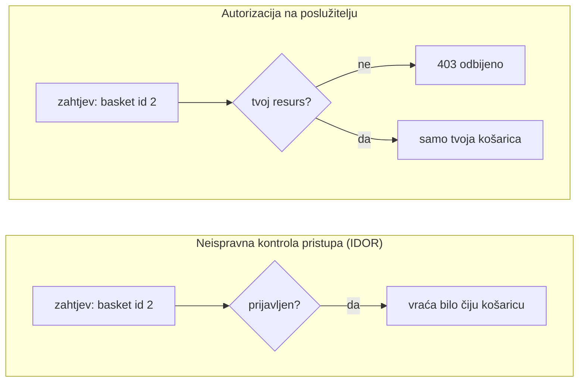

**Jezik:** [English](README.md) · Hrvatski

<!-- kicker: Vježba 05 · napadni pa obrani · Sigurnost informacijskih sustava -->
# Vježba 05 — Web napadi II: autentifikacija i pristup

*Prijavljen si kao ti — ali vidiš li tuđe podatke? Napadi na kontrolu pristupa i tokene često ne traže nijedan exploit, samo znatiželju.*

`~90 min` · `Kali · Juice Shop · DevTools/Burp` · `razina: srednja` · `predaja: Merlin`

> [!WARNING]
> **Etika i opseg.** Isključivo na Juice Shop meti u lab okruženju.

**Scenarij.** Flicker je preuzeo web trgovinu. Provjeri kontrolu pristupa: prvo kao **napadač** dođeš do tuđih podataka i poigraš se tokenom, a onda kao **inženjer** objasniš kako se to provjerava na poslužitelju.

## Ishodi učenja

- Pronaći skrivene funkcije i razumjeti kako SPA razgovara s API-jem.
- Iskoristiti neispravnu kontrolu pristupa (IDOR) za tuđe podatke.
- Analizirati i izmijeniti JWT token sesije.
- Objasniti ispravnu autorizaciju i provjeru tokena na poslužitelju.

## Preduvjeti

- [ ] [Vježba 00](../lab-00-setup/README.hr.md) odrađena — Kali + Docker rade.
- [ ] Preglednikov DevTools (Network i Application) ili Burp Suite.
- [ ] Pojmovi: sesija, token, Base64, JSON.

## Priprema · ~10 min

```bash
docker compose up -d
```

Otvori `http://localhost:3000`. **Registriraj račun s e-mailom koji sadrži tvoj matični broj** (npr. `<MB>@flicker.test`) — tako je sve povezano s tobom.

## Pozadina — kontrola pristupa u minuti

Svaki prijavljeni zahtjev čuvaju dva odvojena pitanja: **autentifikacija** pita *tko si ti?*, a **autorizacija** *smiješ li baš ovo?* Login odgovara samo na prvo. Neispravna kontrola pristupa nastaje kad se poslužitelj tu zaustavi — potvrdi da imaš valjanu sesiju, pa izruči resurs koji zahtjev imenuje a da ne provjeri je li taj resurs tvoj. Najčešći oblik je **IDOR** (insecure direct object reference): id stvari koju tražiš putuje u URL-u ili tijelu zahtjeva, pa promjena `basket/1` u `basket/2` traži tuđe podatke, a poslužitelj koji provjerava samo „jesi li prijavljen?" rado ih vrati. Neispravna kontrola pristupa na vrhu je OWASP Top 10 kao najrašireniji web rizik. Curenje First American Financiala bilo je upravo to: do 885 milijuna dokumenata iz prometa nekretninama mogao je pročitati svatko tko je promijenio redni broj u URL-u, bez ikakvog logina.

Sama sesija je obično **JWT**: token koji ti poslužitelj izda pri loginu i vjeruje mu na svakom kasnijem zahtjevu. Njegova tri Base64 dijela (zaglavlje, payload, potpis) samo su *kodirana*, ne šifrirana, pa payload može pročitati svatko — sigurnost je u cijelosti u **potpisu**, koji dokazuje da je token izdao poslužitelj i da ga nitko nije mijenjao. Zaglavlje `alg` kaže kojim algoritmom provjeriti potpis, i tu je slaba točka: biblioteke koje su prihvaćale `alg: none` ili dale tokenu da sam izabere algoritam prihvatile bi krivotvoren, nepotpisan token kao pravi. Zato obrana ima dvije polovice. Za pristup: na **svakom** zahtjevu poslužitelj iz provjerenog tokena iznova utvrdi tko si i provjeri da si vlasnik baš tog resursa (`resource.owner == current_user`), uz „deny by default". Za token: provjeri potpis jakom tajnom, fiksiraj **allowlist algoritama** (nikad ne vjeruj klijentskom `alg`, odbij `none`) te provjeri istek i izdavatelja.



Lijeva strana je cijeli napad iz Dijela 1; desna je ta jedna provjera na poslužitelju koju braniš u Dijelu 2 — a radi samo ako je token koji dokazuje tko si prvo bio provjeren.

## Dio 1 — Ofenzivno: pristup i tokeni · ~45 min

### 1.1 Pronađi skrivenu funkciju
Pronađi skrivenu *Score Board* stranicu (Juice Shop prati riješene izazove). Objasni kako si je našao (pregled klijentskog koda / rute).

Single-page aplikacija šalje cijelu tablicu ruta u preglednik, pa svaka stranica — i one koje izbornik nigdje ne vodi — već je u JavaScriptu koji si skinuo. „Skriveno" ovdje znači *neizlistano*, ne *zaštićeno*: pregled klijentskog koda otkrije rutu, a poslužitelj te ničim ne spriječi da je posjetiš.

### 1.2 Neispravna kontrola pristupa (IDOR)
Prijavljen kao svoj korisnik, kroz API dođi do podataka koji nisu tvoji (npr. tuđa košarica) mijenjajući identifikator u zahtjevu.

Id u zahtjevu je jedino što bira resurs, a dolazi od tebe — klijenta. To je cijela ranjivost: poslužitelj je potvrdio tko si, ali ništa nije autorizirao, pa te promjena id-a odvede ravno u tuđi račun. Login je dokazao *tko* si; nikad nije pitao *smiješ li baš ovaj zapis*.

> [!NOTE]
> **Očekivano.** Poslužitelj vraća tuđe podatke jer provjerava samo da si prijavljen, a ne da je resurs tvoj.

### 1.3 JWT token sesije
U DevToolsu (Application → Storage) nađi JWT. Dekodiraj tri dijela (Base64) i pokaži zaglavlje i `payload`. Objasni polje `alg` i zašto je potpis ključan.

Pročitati token je trivijalno, ali to nije napad. Pravi rizik je u tome *kako* ga poslužitelj provjerava: zaglavlje `alg` najavljuje kojim algoritmom provjeriti potpis, pa poslužitelj koji tom polju slijepo vjeruje može dobiti token koji tvrdi `alg: none` — bez ikakvog potpisa — i propustiti ga. Zato ispravan verifikator fiksira vlastiti algoritam umjesto da vjeruje napadaču na riječ.

> [!TIP]
> **Čest problem.** JWT nije šifriran — Base64 nije tajna. Svatko ga može *pročitati*; sigurnost je u **potpisu**. Ne pokušavaj probiti kriptografiju; pokaži razumijevanje strukture i rizika slabog/izostavljenog potpisa.

**U izvještaj:** kako si našao Score Board, dokaz IDOR-a (zahtjev + tuđi podaci), dekodirani JWT s objašnjenjem polja, i screenshot Score Boarda s tvojim računom.

## Dio 2 — Defenzivno: ispravna autorizacija · ~30 min

### 2.1 Zašto je prošlo
Objasni (3–5 rečenica) zašto IDOR radi (autorizacija se oslanja na klijentski identifikator) i ispravan pristup: **poslužitelj provjerava smije li prijavljeni korisnik baš taj resurs**.

### 2.2 Popravak
**U izvještaj:**
- **Pristup:** provjera vlasništva resursa na poslužitelju (npr. `resource.owner == current_user`); ne vjeruj ID-u iz zahtjeva.
- **Token:** ispravne provjere JWT-a (potpis, `alg` allowlist, istek, izdavatelj) i zašto tajna mora biti jaka.

### 2.3 Preporuke
3 konkretne preporuke (autorizacija po svakom zahtjevu, "deny by default", kratki rok tokena + rotacija, nikad osjetljivi podaci u tokenu).

### Za brze — bonus
- Riješi još jedan Score Board izazov i opiši ranjivost.
- Pokaži kako bi se promjena `alg` na "none" zaustavila ispravnom allowlistom.

## Predaja

- `vjezba05_<MB>.pdf` — nalazi, dekodirani JWT, screenshot Score Boarda s tvojim računom, obrambeni osvrt.
- **[asciinema](https://asciinema.org/) snimka** rada (`asciinema rec vjezba.cast`, zaustavi s `Ctrl-D`) — obavezna; flag samo pokazuje čiji je rad, snimka je dokaz da je odrađen.

## Bodovanje

| Stavka | Bodovi |
|---|:-:|
| Skrivena funkcija + razumijevanje API-ja | 2 |
| IDOR do tuđih podataka | 3 |
| Analiza JWT tokena | 2 |
| Obrambeni osvrt (autorizacija + token) i preporuke | 2 |
| Bonus | +1 |
