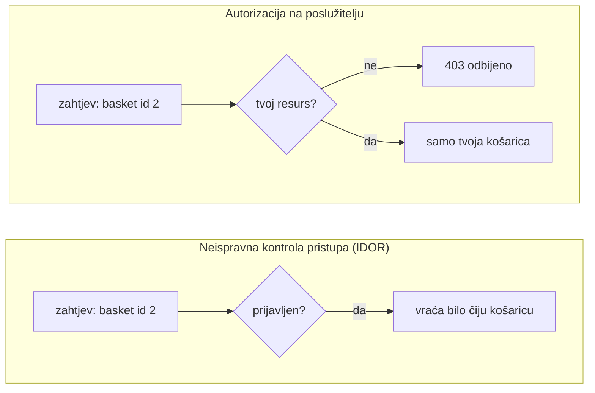

**Jezik:** [English](README.md) · Hrvatski

<!-- kicker: Vježba 05 · napadni pa obrani · Sigurnost informacijskih sustava -->
# Vježba 05 — Web napadi II: autentifikacija i pristup

*Prijavljen si kao ti — ali vidiš li tuđe podatke? Napadi na kontrolu pristupa i tokene često ne traže nijedan exploit, samo znatiželju.*

`~90 min` · `Kali · Juice Shop · Firefox DevTools` · `razina: srednja` · `predaja: Merlin`

> [!WARNING]
> **Etika i opseg.** Isključivo na Juice Shop meti u lab okruženju.

**Scenarij.** Flicker je preuzeo web trgovinu. Provjeri kontrolu pristupa: prvo kao **napadač** dođeš do tuđih podataka i poigraš se tokenom, a onda kao **inženjer** objasniš kako se to provjerava na poslužitelju.

## Ishodi učenja

- Pronaći skrivene funkcije i razumjeti kako SPA razgovara s API-jem.
- Iskoristiti neispravnu kontrolu pristupa (IDOR) za tuđe podatke.
- Pročitati i analizirati JWT token sesije.
- Objasniti ispravnu autorizaciju i provjeru tokena na poslužitelju.

## Preduvjeti

- [ ] [Vježba 00](../lab-00-setup/README.hr.md) odrađena — Kali + Docker rade.
- [ ] Repozitorij kolegija kloniran u `~/Information-System-Security` (to si napravio u [Vježbi 03](../lab-03-network/README.hr.md)).
- [ ] Pojmovi: sesija, token, Base64, JSON.

## Priprema · ~10 min

Radiš u istom repozitoriju kao u Vježbi 04. Ažuriraj ga, uđi u mapu ove vježbe i zaustavi metu iz Vježbe 04 — više ti ne treba, a gašenjem oslobađaš memoriju u VM-u:

```bash
cd ~/Information-System-Security && git pull
cd lab-05-web-auth
docker compose -f ../lab-04-web-injection/compose.yml down
```

Pokreni snimanje svog rada (obavezno za predaju). Sve što upišeš u ovaj terminal snima se dok na kraju vježbe ne pritisneš `Ctrl-D`; nakon toga zaustavi metu s `docker compose down`:

```bash
asciinema rec vjezba.cast
```

Podigni metu, **OWASP Juice Shop** — web trgovinu namjerno napravljenu nesigurnom za vježbanje sigurnosti. Kao većina modernih web aplikacija, to je single-page aplikacija: preglednik skine jednu JavaScript aplikaciju, koja zatim razgovara s REST API-jem poslužitelja (`/api/...`, `/rest/...`). Ima više od stotinu ugrađenih izazova; svaki koji riješiš bilježi na skrivenoj stranici *Score Board* i najavi zelenom porukom.

```bash
docker compose up -d
```

Pričekaj desetak sekundi, pa otvori `http://localhost:3000` u Firefoxu. Zatvori prozor dobrodošlice (**Dismiss**) i obavijest o kolačićima (**Me want it!**). Registriraj račun vezan uz sebe: **Account → Login → Not yet a customer?**, kao e-mail upiši `<MB>@flicker.test` (tvoj matični broj), bilo koju lozinku i sigurnosno pitanje, klikni **Register**, pa se prijavi (**Log in**) istim e-mailom.

Radit ćeš u alatima za razvojne programere u pregledniku: pritisni **F12**. Trebaju ti tri kartice: **Debugger** (JavaScript datoteke koje je stranica učitala), **Network** (svaki zahtjev koji stranica šalje poslužitelju) i **Storage** (što stranica drži u tvom pregledniku: Local Storage, Session Storage, Cookies).

> [!TIP]
> **Čest problem.** `no configuration file provided` znači da nisi u mapi `lab-05-web-auth`. Ako se stranica ne učita, Juice Shop se još pokreće: pričekaj nekoliko sekundi i osvježi.

## Pozadina — kontrola pristupa u minuti

Svaki prijavljeni zahtjev čuvaju dva odvojena pitanja: **autentifikacija** pita *tko si ti?*, a **autorizacija** *smiješ li baš ovo?* Login odgovara samo na prvo. Neispravna kontrola pristupa nastaje kad se poslužitelj tu zaustavi — potvrdi da imaš valjanu sesiju, pa izruči resurs koji zahtjev imenuje a da ne provjeri je li taj resurs tvoj. Najčešći oblik je **IDOR** (insecure direct object reference): id stvari koju tražiš putuje u URL-u ili tijelu zahtjeva, pa promjena `basket/1` u `basket/2` traži tuđe podatke, a poslužitelj koji provjerava samo „jesi li prijavljen?" rado ih vrati. Neispravna kontrola pristupa na vrhu je OWASP Top 10 kao najrašireniji web rizik. Curenje First American Financiala bilo je upravo to: do 885 milijuna dokumenata iz prometa nekretninama mogao je pročitati svatko tko je promijenio redni broj u URL-u, bez ikakvog logina.

Sama sesija je obično **JWT**: token koji ti poslužitelj izda pri loginu i vjeruje mu na svakom kasnijem zahtjevu. Njegova tri Base64 dijela (zaglavlje, payload, potpis) samo su *kodirana*, ne šifrirana, pa payload može pročitati svatko — sigurnost je u cijelosti u **potpisu**, koji dokazuje da je token izdao poslužitelj i da ga nitko nije mijenjao. Zaglavlje `alg` kaže kojim algoritmom provjeriti potpis, i tu je slaba točka: biblioteke koje su prihvaćale `alg: none` ili dale tokenu da sam izabere algoritam prihvatile bi krivotvoren, nepotpisan token kao pravi. Zato obrana ima dvije polovice. Za pristup: na **svakom** zahtjevu poslužitelj iz provjerenog tokena iznova utvrdi tko si i provjeri da si vlasnik baš tog resursa (`resource.owner == current_user`), uz „deny by default". Za token: provjeri potpis jakom tajnom, fiksiraj **allowlist algoritama** (nikad ne vjeruj klijentskom `alg`, odbij `none`) te provjeri istek i izdavatelja.



Lijeva strana je cijeli napad iz Dijela 1; desna je ta jedna provjera na poslužitelju koju braniš u Dijelu 2 — a radi samo ako je token koji dokazuje tko si prvo bio provjeren.

## Dio 1 — Ofenzivno: pristup i tokeni · ~45 min

### 1.1 Pronađi skrivenu funkciju
Pronađi skrivenu stranicu *Score Board* — izbornik ne vodi na nju.

1. U DevToolsu otvori **Debugger** i pod `localhost:3000` klikni `main.js`. Minificiran je u nekoliko vrlo dugih redaka; klikni **{ }** (Pretty print) pri dnu koda da postane čitljiv.
2. Pritisni `Ctrl+F` u kodu i potraži `score`. Među rutama naći ćeš `/score-board`.
3. Otvori `http://localhost:3000/#/score-board`.

Single-page aplikacija šalje cijelu tablicu ruta u preglednik, pa svaka stranica — i one koje izbornik nigdje ne vodi — već je u JavaScriptu koji si skinuo. „Skriveno" ovdje znači *neizlistano*, ne *zaštićeno*: pregled klijentskog koda otkrije rutu, a poslužitelj te ničim ne spriječi da je posjetiš.

> [!NOTE]
> **Očekivano.** Zelena poruka *You successfully solved a challenge: Score Board* i stranica s popisom svih izazova i tvojim napretkom.

### 1.2 Neispravna kontrola pristupa (IDOR)
Prijavljen kao svoj korisnik, dođi do tuđe košarice promjenom jednog identifikatora.

1. Otvori DevTools **Network**, pa klikni **Your Basket** (gore desno). Među zahtjevima nađi `GET /rest/basket/<n>` — `<n>` je id *tvoje* košarice (mali broj, npr. `6`). Klikni zahtjev i pogledaj **Response**: tvoja vlastita košarica.
2. Otvori **Storage → Session Storage → `http://localhost:3000`**. Ključ `bid` sadrži isti broj: tu aplikacija drži id tvoje košarice i čita ga pri svakom zahtjevu za košaricu.
3. Dvoklikni vrijednost ključa `bid`, promijeni je u `1`, pritisni Enter, pa osvježi stranicu (**F5**).

Id u zahtjevu je jedino što bira resurs, a dolazi od tebe — klijenta. To je cijela ranjivost: poslužitelj je potvrdio tko si, ali ništa nije autorizirao, pa te promjena id-a odvede ravno u tuđi račun. Login je dokazao *tko* si; nikad nije pitao *smiješ li baš ovaj zapis*.

> [!NOTE]
> **Očekivano.** Naslov i dalje glasi *Your Basket (`<MB>@flicker.test`)*, ali proizvodi su tuđi (za košaricu `1`: Apple Juice, Orange Juice, Eggfruit Juice), zelena poruka najavi *View Basket*, a **Network** pokazuje da je `GET /rest/basket/1` odgovoren s `200`. Poslužitelj je vratio tuđe podatke jer je provjerio samo da si prijavljen, a ne da je košarica tvoja.

### 1.3 JWT token sesije
Pročitaj token sesije koji ti je Juice Shop dao pri prijavi.

1. Otvori **Storage → Local Storage → `http://localhost:3000`** i klikni ključ `token`. Vrijednost je tvoj JWT: tri Base64 dijela odvojena točkama (`zaglavlje.payload.potpis`). Dvoklikni vrijednost, pa je kopiraj s `Ctrl+A`, `Ctrl+C`.
2. U terminalu ga spremi i dekodiraj prva dva dijela (zalijepi svoj token između navodnika):

```bash
TOKEN='<ovdje zalijepi token>'
python3 -c 'import sys,base64,json; t=sys.argv[1].split("."); [print(json.dumps(json.loads(base64.urlsafe_b64decode(p+"="*(-len(p)%4))),indent=2)) for p in t[:2]]' "$TOKEN"
```

> [!NOTE]
> **Očekivano.** Zaglavlje je `{"typ": "JWT", "alg": "RS256"}`. Payload sadrži `data` (tvoj `id`, `email`, `role` …), `bid` (id tvoje košarice) i `iat` (kad je izdan). Pogledaj pažljivo `data.password`: to je tvoja lozinka kao nesoljeni **MD5** hash — ista vrsta hasha koju si razbijao u Vježbi 01 — i svatko tko vidi token može je pročitati. Primijeti i da nema polja `exp` (istek).

Objasni polje `alg` i zašto je potpis ključan. `RS256` znači da poslužitelj potpisuje token svojim privatnim ključem i provjerava ga odgovarajućim javnim, pa nitko bez tog privatnog ključa ne može napraviti valjan potpis.

Pročitati token je trivijalno, ali to nije napad. Pravi rizik je u tome *kako* ga poslužitelj provjerava: zaglavlje `alg` najavljuje kojim algoritmom provjeriti potpis, pa poslužitelj koji tom polju slijepo vjeruje može dobiti token koji tvrdi `alg: none` — bez ikakvog potpisa — i propustiti ga. Zato ispravan verifikator fiksira vlastiti algoritam umjesto da vjeruje napadaču na riječ.

> [!TIP]
> **Čest problem.** JWT nije šifriran — Base64 nije tajna. Svatko ga može *pročitati*; sigurnost je u **potpisu**. Ne pokušavaj probiti kriptografiju; pokaži razumijevanje strukture i rizika slabog/izostavljenog potpisa.

**U izvještaj:** kako si našao Score Board, dokaz IDOR-a (zahtjev `GET /rest/basket/1` i screenshot tuđe košarice pod tvojim naslovom `<MB>@flicker.test`), dekodirani JWT s objašnjenjem polja, i screenshot Score Boarda.

## Dio 2 — Defenzivno: ispravna autorizacija · ~30 min

### 2.1 Zašto je prošlo
Objasni (3–5 rečenica) zašto IDOR radi (autorizacija se oslanja na klijentski identifikator) i ispravan pristup: **poslužitelj provjerava smije li prijavljeni korisnik baš taj resurs**.

### 2.2 Popravak
**U izvještaj:**
- **Pristup:** provjera vlasništva resursa na poslužitelju (npr. `resource.owner == current_user`); ne vjeruj ID-u iz zahtjeva.
- **Token:** ispravne provjere JWT-a (potpis, `alg` allowlist, istek, izdavatelj) i zašto ključ za potpisivanje mora ostati tajan i jak (duga nasumična tajna za HS256, privatni ključ za RS256 kao ovdje).

### 2.3 Preporuke
3 konkretne preporuke (autorizacija po svakom zahtjevu, "deny by default", kratki rok tokena + rotacija, nikad osjetljivi podaci u tokenu). Iskoristi ono što si našao u 1.3: token nosi hash lozinke i nema `exp`.

### Za brze — bonus
- Riješi još jedan Score Board izazov i opiši ranjivost.
- Pokaži kako bi se promjena `alg` na "none" zaustavila ispravnom allowlistom.

## Predaja

- `vjezba05_<MB>.pdf` — nalazi, screenshot IDOR-a s matičnim brojem, dekodirani JWT, screenshot Score Boarda, obrambeni osvrt.
- **[asciinema](https://asciinema.org/) snimka** rada (`asciinema rec vjezba.cast`, zaustavi s `Ctrl-D`) — obavezna; matični broj na screenshotu IDOR-a samo pokazuje čiji je rad, ova snimka je dokaz da je odrađen.

## Bodovanje

| Stavka | Bodovi |
|---|:-:|
| Skrivena funkcija + razumijevanje API-ja | 2 |
| IDOR do tuđih podataka | 3 |
| Analiza JWT tokena | 2 |
| Obrambeni osvrt (autorizacija + token) i preporuke | 2 |
| Bonus | +1 |
