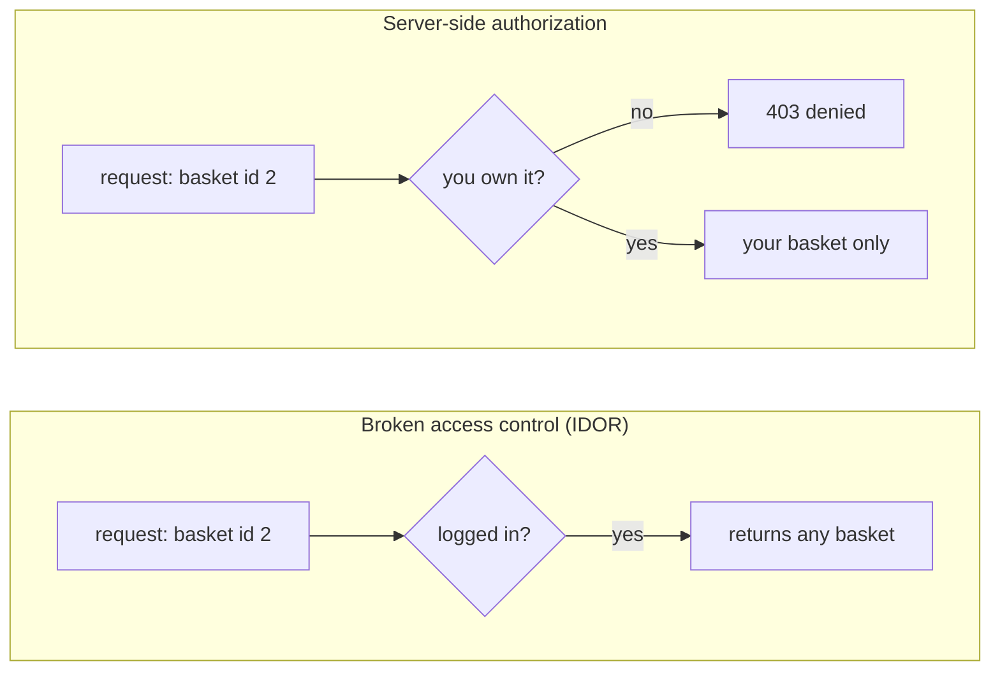

**Language:** English · [Hrvatski](README.hr.md)

<!-- kicker: Lab 05 · attack then defend · Information System Security -->
# Lab 05 — Web Attacks II: Authentication & Access

*You're logged in as you — but can you see other people's data? Attacks on access control and tokens often need no exploit, just curiosity.*

`~90 min` · `Kali · Juice Shop · DevTools/Burp` · `level: intermediate` · `submit: Merlin`

> [!WARNING]
> **Ethics & scope.** Only against the Juice Shop target in the lab environment.

**Scenario.** Flicker acquired a web shop. Test its access control: first as the **attacker** who reaches other users' data and plays with the session token, then as the **engineer** who explains how this is checked on the server.

## Learning outcomes

- Find hidden functionality and understand how a SPA talks to its API.
- Exploit broken access control (IDOR) to reach other users' data.
- Analyse and modify a JWT session token.
- Explain correct authorization and token verification on the server.

## Prerequisites

- [ ] [Lab 00](../lab-00-setup/README.md) completed — Kali + Docker working.
- [ ] Browser DevTools (Network and Application tabs) or Burp Suite.
- [ ] Concepts: session, token, Base64, JSON.

## Setup · ~10 min

```bash
docker compose up -d
```

Open `http://localhost:3000`. **Register an account with an email containing your student ID** (e.g. `<ID>@flicker.test`) — so everything you do is tied to you.

## Background — access control in one minute

Two separate questions guard every logged-in request: **authentication** asks *who are you?* and **authorization** asks *are you allowed this particular thing?* Logging in answers only the first. Broken access control is what happens when the server stops there — it confirms you hold a valid session, then hands over whatever resource the request names without checking that the resource is yours. The most common form is **IDOR** (insecure direct object reference): the id of the thing you want travels in the URL or request body, so changing `basket/1` to `basket/2` asks for someone else's data, and a server that only checks "logged in?" happily returns it. Broken access control sits at the top of the OWASP Top 10 as the most widespread web-application risk. The First American Financial leak was exactly this: as many as 885 million real-estate transaction documents were readable by anyone who changed a sequential number in the URL, with no login at all.

The session itself is usually a **JWT**: a token the server hands you at login and trusts on every later request. Its three Base64 parts (header, payload, signature) are only *encoded*, not encrypted, so anyone can read the payload — the security lives entirely in the **signature**, which proves the server minted the token and nobody edited it. The `alg` header says which algorithm to verify with, and that is the soft spot: libraries that honoured `alg: none`, or let the token choose its own algorithm, would accept a forged, unsigned token as genuine. So the defence has two halves. For access: on **every** request the server re-derives who you are from the verified token and checks that you own the specific resource (`resource.owner == current_user`), denying by default. For the token: verify the signature against a strong secret, pin an **algorithm allowlist** (never trust the client's `alg`, reject `none`), and check expiry and issuer.



The left side is the whole attack in Part 1; the right side is the single server-side check you argue for in Part 2 — and it only works if the token proving who you are was verified first.

## Part 1 — Offensive: access & tokens · ~45 min

### 1.1 Find the hidden function
Find the hidden *Score Board* page (Juice Shop tracks solved challenges). Explain how you found it (inspecting the client-side code / routes).

A single-page app ships its entire routing table to the browser, so every page — including ones the menu never links to — is sitting in the JavaScript you already downloaded. "Hidden" here means *unlisted*, not *protected*: reading the client code reveals the route, and nothing on the server stops you from visiting it.

### 1.2 Broken access control (IDOR)
Logged in as your user, use the API to reach data that isn't yours (e.g. another user's basket) by changing an identifier in the request.

The id in the request is the only thing that selects the resource, and it comes from you — the client. That is the whole vulnerability: the server authenticated you but authorized nothing, so changing the id walks you straight into another account's data. Logging in proved *who* you are; it never asked *whether you may have this specific record*.

> [!NOTE]
> **Expected.** The server returns someone else's data because it only checks that you're logged in, not that the resource is yours.

### 1.3 The JWT session token
In DevTools (Application → Storage) find the JWT. Decode its three parts (Base64) and show the header and `payload`. Explain the `alg` field and why the signature is critical.

Reading the token is trivial, but that is not the attack. The real risk is in *how* the server verifies it: the `alg` header announces which algorithm to check the signature with, so a server that trusts that field blindly can be handed a token claiming `alg: none` — no signature at all — and wave it through. That is why a correct verifier pins its own algorithm instead of taking the attacker's word for it.

> [!TIP]
> **Common pitfall.** A JWT is not encrypted — Base64 is not a secret. Anyone can *read* a token; the security is in the **signature**. Don't try to break cryptography; show you understand the structure and the risk of a weak/omitted signature.

**In the report:** how you found the Score Board, proof of IDOR (request + other user's data), the decoded JWT with field explanations, and a Score Board screenshot showing your ID account.

## Part 2 — Defensive: correct authorization · ~30 min

### 2.1 Why it worked
Explain (3–5 sentences) why IDOR works (authorization relies on a client-supplied identifier) and the correct approach: **the server checks the logged-in user is allowed that specific resource**.

### 2.2 The fix
**In the report:**
- **Access:** a server-side resource-ownership check (e.g. `resource.owner == current_user`); never trust the ID from the request.
- **Token:** the correct JWT checks (signature, `alg` allowlist, expiry, issuer) and why the secret must be strong.

### 2.3 Recommendations
3 concrete recommendations (authorize on every request, "deny by default", short token lifetime + rotation, never put sensitive data in the token).

### Bonus
- Solve one more Score Board challenge and describe the vulnerability.
- Show how switching `alg` to "none" is stopped by a proper algorithm allowlist.

## Submission

- `lab05_<ID>.pdf` — findings, decoded JWT, Score Board screenshot with your ID account, defensive write-up.
- An **[asciinema](https://asciinema.org/) recording** of your work (`asciinema rec lab.cast`, stop with `Ctrl-D`) — required; the flag only identifies you, this recording is the proof of work.

## Grading

| Item | Points |
|---|:-:|
| Hidden function + API understanding | 2 |
| IDOR to other users' data | 3 |
| JWT token analysis | 2 |
| Defensive write-up (authorization + token) and recommendations | 2 |
| Bonus | +1 |
