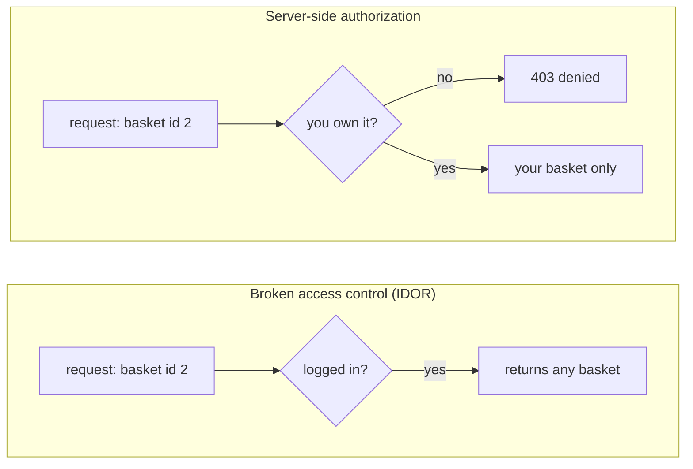

**Language:** English · [Hrvatski](README.hr.md)

<!-- kicker: Lab 05 · attack then defend · Information System Security -->
# Lab 05 — Web Attacks II: Authentication & Access

*You're logged in as you — but can you see other people's data? Attacks on access control and tokens often need no exploit, just curiosity.*

`~90 min` · `Kali · Juice Shop · Firefox DevTools` · `level: intermediate` · `submit: Merlin`

> [!WARNING]
> **Ethics & scope.** Only against the Juice Shop target in the lab environment.

**Scenario.** Flicker acquired a web shop. Test its access control: first as the **attacker** who reaches other users' data and plays with the session token, then as the **engineer** who explains how this is checked on the server.

## Learning outcomes

- Find hidden functionality and understand how a SPA talks to its API.
- Exploit broken access control (IDOR) to reach other users' data.
- Read and analyse a JWT session token.
- Explain correct authorization and token verification on the server.

## Prerequisites

- [ ] [Lab 00](../lab-00-setup/README.md) completed — Kali + Docker working.
- [ ] The course repository cloned into `~/Information-System-Security` (you did this in [Lab 03](../lab-03-network/README.md)).
- [ ] Concepts: session, token, Base64, JSON.

## Setup · ~10 min

You work in the same repository as in Lab 04. Update it, go into this lab's folder and stop the Lab 04 target — you no longer need it, and stopping it frees memory in the VM:

```bash
cd ~/Information-System-Security && git pull
cd lab-05-web-auth
docker compose -f ../lab-04-web-injection/compose.yml down
```

Start recording your work (required for the submission). Everything you type in this terminal is recorded until you press `Ctrl-D` at the end of the lab; after that, stop the target with `docker compose down`:

```bash
asciinema rec lab.cast
```

Bring up the target, **OWASP Juice Shop** — a deliberately insecure online shop built for security training. Like most modern web apps it is a single-page app: the browser downloads one JavaScript application, which then talks to the server's REST API (`/api/...`, `/rest/...`). It has over a hundred built-in challenges; it records every one you solve on a hidden *Score Board* page and announces it with a green banner.

```bash
docker compose up -d
```

Wait about 10 seconds, then open `http://localhost:3000` in Firefox. Close the welcome window (**Dismiss**) and the cookie notice (**Me want it!**). Register an account tied to you: **Account → Login → Not yet a customer?**, use the email `<ID>@flicker.test` (your student ID), any password and security question, click **Register**, then **Log in** with the same email.

You'll work in the browser's developer tools: press **F12**. You need three tabs: **Debugger** (the JavaScript files the page loaded), **Network** (every request the page sends to the server) and **Storage** (what the site keeps in your browser: Local Storage, Session Storage, Cookies).

> [!TIP]
> **Common pitfall.** `no configuration file provided` means you are not in `lab-05-web-auth`. If the page doesn't load, Juice Shop is still starting: wait a few seconds and reload.

## Background — access control in one minute

Two separate questions guard every logged-in request: **authentication** asks *who are you?* and **authorization** asks *are you allowed this particular thing?* Logging in answers only the first. Broken access control is what happens when the server stops there — it confirms you hold a valid session, then hands over whatever resource the request names without checking that the resource is yours. The most common form is **IDOR** (insecure direct object reference): the id of the thing you want travels in the URL or request body, so changing `basket/1` to `basket/2` asks for someone else's data, and a server that only checks "logged in?" happily returns it. Broken access control sits at the top of the OWASP Top 10 as the most widespread web-application risk. The First American Financial leak was exactly this: as many as 885 million real-estate transaction documents were readable by anyone who changed a sequential number in the URL, with no login at all.

The session itself is usually a **JWT**: a token the server hands you at login and trusts on every later request. Its three Base64 parts (header, payload, signature) are only *encoded*, not encrypted, so anyone can read the payload — the security lives entirely in the **signature**, which proves the server minted the token and nobody edited it. The `alg` header says which algorithm to verify with, and that is the soft spot: libraries that honoured `alg: none`, or let the token choose its own algorithm, would accept a forged, unsigned token as genuine. So the defence has two halves. For access: on **every** request the server re-derives who you are from the verified token and checks that you own the specific resource (`resource.owner == current_user`), denying by default. For the token: verify the signature against a strong secret, pin an **algorithm allowlist** (never trust the client's `alg`, reject `none`), and check expiry and issuer.



The left side is the whole attack in Part 1; the right side is the single server-side check you argue for in Part 2 — and it only works if the token proving who you are was verified first.

## Part 1 — Offensive: access & tokens · ~45 min

### 1.1 Find the hidden function
Find the hidden *Score Board* page — the menu doesn't link to it.

1. In DevTools open **Debugger** and, under `localhost:3000`, click `main.js`. It is minified into a few very long lines; click **{ }** (Pretty print) at the bottom of the source to make it readable.
2. Press `Ctrl+F` in the source and search for `score`. Among the routes you'll find `/score-board`.
3. Open `http://localhost:3000/#/score-board`.

A single-page app ships its entire routing table to the browser, so every page — including ones the menu never links to — is sitting in the JavaScript you already downloaded. "Hidden" here means *unlisted*, not *protected*: reading the client code reveals the route, and nothing on the server stops you from visiting it.

> [!NOTE]
> **Expected.** A green banner *You successfully solved a challenge: Score Board*, and a page listing all challenges with your progress.

### 1.2 Broken access control (IDOR)
Logged in as your user, reach another user's shopping basket by changing one identifier.

1. Open DevTools **Network**, then click **Your Basket** (top right). Among the requests find `GET /rest/basket/<n>` — `<n>` is the id of *your* basket (a small number, e.g. `6`). Click the request and look at the **Response**: your own basket.
2. Open **Storage → Session Storage → `http://localhost:3000`**. The key `bid` holds the same number: this is where the app keeps your basket id and reads it back on every basket request.
3. Double-click the value of `bid`, change it to `1`, press Enter, then reload the page (**F5**).

The id in the request is the only thing that selects the resource, and it comes from you — the client. That is the whole vulnerability: the server authenticated you but authorized nothing, so changing the id walks you straight into another account's data. Logging in proved *who* you are; it never asked *whether you may have this specific record*.

> [!NOTE]
> **Expected.** The heading still reads *Your Basket (`<ID>@flicker.test`)*, but the products are someone else's (for basket `1`: Apple Juice, Orange Juice, Eggfruit Juice), a green banner announces *View Basket*, and **Network** shows `GET /rest/basket/1` answered with `200`. The server returned someone else's data because it only checked that you're logged in, not that the basket is yours.

### 1.3 The JWT session token
Read the session token Juice Shop gave you at login.

1. Open **Storage → Local Storage → `http://localhost:3000`** and click the key `token`. The value is your JWT: three Base64 parts separated by dots (`header.payload.signature`). Double-click the value, then copy it with `Ctrl+A`, `Ctrl+C`.
2. In the terminal, store it and decode the first two parts (paste your token between the quotes):

```bash
TOKEN='<paste the token here>'
python3 -c 'import sys,base64,json; t=sys.argv[1].split("."); [print(json.dumps(json.loads(base64.urlsafe_b64decode(p+"="*(-len(p)%4))),indent=2)) for p in t[:2]]' "$TOKEN"
```

> [!NOTE]
> **Expected.** The header is `{"typ": "JWT", "alg": "RS256"}`. The payload holds `data` (your `id`, `email`, `role` …), `bid` (your basket id) and `iat` (when it was issued). Look closely at `data.password`: it is your password as an unsalted **MD5** hash — the kind you cracked in Lab 01 — and anyone who sees the token can read it. Notice too that there is no `exp` (expiry) claim.

Explain the `alg` field and why the signature is critical. `RS256` means the server signs the token with its private key and verifies it with the matching public key, so nobody without that private key can produce a valid signature.

Reading the token is trivial, but that is not the attack. The real risk is in *how* the server verifies it: the `alg` header announces which algorithm to check the signature with, so a server that trusts that field blindly can be handed a token claiming `alg: none` — no signature at all — and wave it through. That is why a correct verifier pins its own algorithm instead of taking the attacker's word for it.

> [!TIP]
> **Common pitfall.** A JWT is not encrypted — Base64 is not a secret. Anyone can *read* a token; the security is in the **signature**. Don't try to break cryptography; show you understand the structure and the risk of a weak/omitted signature.

**In the report:** how you found the Score Board, proof of IDOR (the `GET /rest/basket/1` request and a screenshot of the other user's basket under your `<ID>@flicker.test` heading), the decoded JWT with field explanations, and a Score Board screenshot.

## Part 2 — Defensive: correct authorization · ~30 min

### 2.1 Why it worked
Explain (3–5 sentences) why IDOR works (authorization relies on a client-supplied identifier) and the correct approach: **the server checks the logged-in user is allowed that specific resource**.

### 2.2 The fix
**In the report:**
- **Access:** a server-side resource-ownership check (e.g. `resource.owner == current_user`); never trust the ID from the request.
- **Token:** the correct JWT checks (signature, `alg` allowlist, expiry, issuer) and why the signing key must stay secret and strong (a long random secret for HS256, a private key for RS256 as here).

### 2.3 Recommendations
3 concrete recommendations (authorize on every request, "deny by default", short token lifetime + rotation, never put sensitive data in the token). Use what you found in 1.3: the token carries a password hash and has no `exp`.

### Bonus
- Solve one more Score Board challenge and describe the vulnerability.
- Show how switching `alg` to "none" is stopped by a proper algorithm allowlist.

## Submission

- `lab05_<ID>.pdf` — findings, IDOR screenshot with your ID, decoded JWT, Score Board screenshot, defensive write-up.
- An **[asciinema](https://asciinema.org/) recording** of your work (`asciinema rec lab.cast`, stop with `Ctrl-D`) — required; your ID in the IDOR screenshot only shows whose work it is, this recording is the proof of work.

## Grading

| Item | Points |
|---|:-:|
| Hidden function + API understanding | 2 |
| IDOR to other users' data | 3 |
| JWT token analysis | 2 |
| Defensive write-up (authorization + token) and recommendations | 2 |
| Bonus | +1 |
