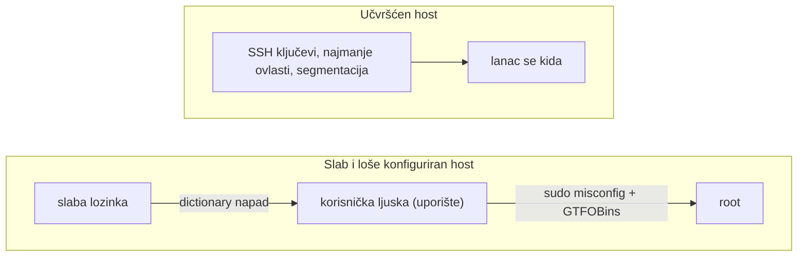

**Jezik:** [English](README.md) · Hrvatski

<!-- kicker: Vježba 06 · napadni pa obrani · Sigurnost informacijskih sustava -->
# Vježba 06 — Eksploatacija i eskalacija privilegija

*Od slabe lozinke do roota u tri koraka. Rijetko je u pitanju genijalni exploit — češće slaba lozinka i jedna loša konfiguracija.*

`~90 min` · `Kali · nmap · hydra · SSH` · `razina: srednja` · `predaja: Merlin`

> [!WARNING]
> **Etika i opseg.** Isključivo na ovoj namjerno ranjivoj meti u lab okruženju. Dictionary napadi i eskalacija na stvarnim sustavima bez pisanog dopuštenja su kazneno djelo.

**Scenarij.** Flicker ima zaboravljeni poslužitelj na mreži. Ti si prvo **napadač** koji probija slabu lozinku, ulazi i postaje root, a onda **administrator** koji zatvara svaki korak tog lanca.

## Ishodi učenja

- Otkriti servis i izvesti dictionary napad na prijavu.
- Dobiti pristup i enumerirati mogućnosti eskalacije privilegija.
- Iskoristiti sudo pogrešku u konfiguraciji za root i pročitati zaštićeni flag.
- Objasniti kako se svaki korak lanca sprječava.

## Preduvjeti

- [ ] [Vježba 00](../lab-00-setup/README.hr.md) odrađena — Kali + Docker rade.
- [ ] Alati `nmap`, `hydra`, `ssh` (na Kaliju su).
- [ ] Osnove Linuxa i pojam SUID/sudo.

## Priprema · ~10 min

Kopiraj `.env.example` u `.env` te upiši **svoj matični broj** i `ISS_SECRET` (daje nastavnik), pa sagradi metu:

```bash
cp .env.example .env     # uredi: MB=<tvoj matični broj>, ISS_SECRET=<od nastavnika>
docker compose up -d --build
```

SSH meta sluša na `localhost:2222`. Priložena je mala lista lozinki `passwords.txt`. Flag u `/root/flag.txt` izveden je iz tvog matičnog broja — zato je tvoj.

## Pozadina — eksploatacija u minuti

Eksploatacija je korak u kojem *propust* postaje *kontrola*: napadač nešto što nikad nije smjelo biti dostupno — slabu lozinku, nemarnu konfiguraciju ili nezakrpanu ranjivost (katkad poznati **CVE**) — pretvara u mogućnost da na stroju pokreće vlastite naredbe. Na ovoj meti propust nije egzotičan: prijava s lozinkom koja se da pogoditi stoji izložena na mreži, pa alat poput **hydre** jednostavno isprobava lozinku za lozinkom dok ne uđe, a framework poput **Metasploita** isti bi napad spakirao u modul od jedne linije. Automatizacija je ono što to čini toliko opasnim — napadaču ne trebaju ni vještina ni sreća, nego samo dostupan service i slaba tajna. Da je jedna izložena prijava dovoljna nije teorija: botnet **Mirai** narastao je na stotine tisuća uređaja ne radeći ništa pametnije od isprobavanja kratke liste od otprilike šezdeset tvorničkih parova korisničko ime/lozinka na otvorenim Telnet prijavama.

Uporište je rijetko kraj. Kad uđe kao običan korisnik, napadač traži **eskalaciju privilegija** — put od tog računa do `root`a. Ovdje je to `sudo` pogreška u konfiguraciji: korisnik smije pokrenuti jedan program kao root bez lozinke, a ako taj program može pokrenuti ljusku (vidi **GTFOBins**), ljuska koju pokrene vrti se *kao root*. To je cijeli lanac — slaba lozinka → korisničko uporište → loše dodijeljena ovlast → potpuna kontrola — a obrana kida svaku kariku: SSH ključevi umjesto lozinki koje se pogađaju, najmanje ovlasti da nijedan račun ne može tiho postati root, te krpanje ili segmentacija servisa koji uopće ne moraju biti okrenuti prema mreži.



Lijevi put je Dio 1: jedna lozinka koja se da pogoditi i jedan nemaran `sudo` redak povezuju se sve do roota. Desni put je Dio 2 — prekini bilo koju kariku i lanac stane: ključevi umjesto lozinki, najmanje ovlasti umjesto `sudo` pravila koje pokreće ljusku, service koji nije bespotrebno izložen.

## Dio 1 — Ofenzivno: od lozinke do roota · ~45 min

### 1.1 Otkrij servis
```bash
nmap -sV -p 2222 localhost
```
Ne možeš napasti servis koji ne vidiš, zato otkrivanje ide prvo: potvrda da je to OpenSSH na `2222` napadaču kaže točno koju prijavu da gađa, a `-sV` iščita verziju za slučaj da za nju već postoji poznata ranjivost.
> [!NOTE]
> **Očekivano.** Port `2222` otvoren, servis OpenSSH.

### 1.2 Dictionary napad na prijavu
Korisnik je `flicker`. Probij lozinku ciljanom listom:
```bash
hydra -l flicker -P passwords.txt -t 4 -s 2222 ssh://localhost
```
Ovo je cijelo uporište u jednoj naredbi: hydra automatizira pogađanje, pa snaga prijave ovisi isključivo o lozinci — slaba padne za vrijeme potrebno da se pročita lista, bez obzira koliko softver bio ažuran.
> [!TIP]
> **Čest problem.** Napad preko mreže je spor — zato koristiš malu, ciljanu listu, ne cijeli rockyou. Ako hydra javi više pogodaka, provjeri ručno sa `ssh`.

### 1.3 Uđi i enumeriraj
```bash
ssh flicker@localhost -p 2222
sudo -l
```
Dobiti ljusku nije cilj — običan korisnik ne može pročitati `/root/flag.txt`. Zato je prvi potez nakon ulaska enumeracija, a `sudo -l` je najvrjedniji od svih: bez pogađanja ti kaže točno što ovaj račun smije pokrenuti kao root.
> [!NOTE]
> **Očekivano.** `sudo -l` pokazuje da `flicker` smije pokrenuti jedan program kao root bez lozinke (`NOPASSWD`).

### 1.4 Eskalacija do roota
Taj program (vidi [GTFOBins](https://gtfobins.github.io/)) može pokrenuti ljusku. Iskoristi ga da dobiješ root ljusku i pročitaš `/root/flag.txt`.

Pouka je najmanje ovlasti: `sudo` pokreće program *kao root*, pa ako taj program može pokrenuti ljusku ili izvršiti proizvoljne naredbe, napadač nasljeđuje root — jedno preširoko `sudo` pravilo briše razliku između računa `flicker` i potpune kontrole. [GTFOBins](https://gtfobins.github.io/) je naprosto popis toga koji se svakodnevni programi mogu tako iskriviti.

**U izvještaj:** pronađena lozinka, izlaz `sudo -l`, naredba kojom si dobio root, sadržaj `/root/flag.txt`, i `id` koji pokazuje `uid=0(root)`.

## Dio 2 — Defenzivno: zatvori lanac · ~30 min

### 2.1 Zašto je svaki korak prošao
Za svaki korak (slaba lozinka → SSH → sudo misconfig) objasni u jednoj rečenici zašto je uspio.

### 2.2 Popravak
**U izvještaj:**
- **Prijava:** SSH ključevi umjesto lozinki (ili jake lozinke + `fail2ban` + rate-limiting).
- **Ovlasti:** ukloni `NOPASSWD` i ne dopuštaj preko `sudo` programe koji pokreću ljusku; najmanje ovlasti.
- **Nadzor:** logiranje `sudo`/prijava i upozorenja.

### 2.3 Preporuke
3 konkretne preporuke za Flicker, poredane po učinku.

### Za brze — bonus
- Izvedi isti ulazak preko Metasploita (`ssh_login` modul) i usporedi s hydrom.
- Napiši minimalni ispravan `sudoers` redak koji i dalje daje `flickeru` potrebnu funkciju, ali bez puta do roota.

## Predaja

- `vjezba06_<MB>.pdf` — cijeli lanac s izlazima, `/root/flag.txt`, `id` kao root, obrambeni osvrt.
- **[asciinema](https://asciinema.org/) snimka** rada (`asciinema rec vjezba.cast`, zaustavi s `Ctrl-D`) — obavezna; flag samo pokazuje čiji je rad, snimka je dokaz da je odrađen.

## Bodovanje

| Stavka | Bodovi |
|---|:-:|
| Otkrivanje servisa + probijena lozinka | 3 |
| Eskalacija do roota + pročitan flag | 3 |
| Obrana svakog koraka lanca | 3 |
| Preporuke po učinku | 1 |
| Bonus | +1 |
