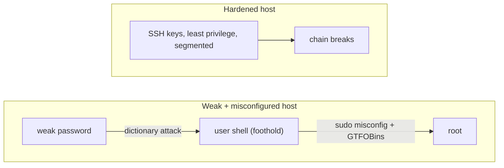

**Language:** English · [Hrvatski](README.hr.md)

<!-- kicker: Lab 06 · attack then defend · Information System Security -->
# Lab 06 — Exploitation & Privilege Escalation

*From a weak password to root in three steps. It's rarely a brilliant exploit — more often a weak password and one bad configuration.*

`~90 min` · `Kali · nmap · hydra · SSH` · `level: intermediate` · `submit: Merlin`

> [!WARNING]
> **Ethics & scope.** Only against this deliberately vulnerable target in the lab environment. Dictionary attacks and escalation against real systems without written permission are a criminal offence.

**Scenario.** Flicker has a forgotten server on the network. You're first the **attacker** who cracks a weak password, gets in and becomes root, then the **administrator** who closes every step of that chain.

## Learning outcomes

- Discover a service and run a dictionary attack against its login.
- Gain access and enumerate privilege-escalation options.
- Exploit a sudo misconfiguration to get root and read a protected flag.
- Explain how each step of the chain is prevented.

## Prerequisites

- [ ] [Lab 00](../lab-00-setup/README.md) completed — Kali + Docker working.
- [ ] Tools `nmap`, `hydra`, `ssh` (present on Kali).
- [ ] Linux basics and the concept of SUID/sudo.

## Setup · ~10 min

Copy `.env.example` to `.env` and set **your student ID** and `ISS_SECRET` (from the instructor), then build the target:

```bash
cp .env.example .env     # edit: MB=<your student ID>, ISS_SECRET=<from instructor>
docker compose up -d --build
```

The SSH target listens on `localhost:2222`. A small password list `passwords.txt` is included. The flag in `/root/flag.txt` is derived from your student ID — so it's yours.

## Background — exploitation in one minute

Exploitation is the step where a *flaw* becomes *control*: an attacker turns something that should never have been reachable — a weak password, a careless configuration, or an unpatched vulnerability (sometimes a known **CVE**) — into the ability to run their own commands on the machine. On this target the flaw is ordinary: a login with a guessable password sits exposed on the network, so a tool like **hydra** just tries one password after another until it gets in, and a framework like **Metasploit** would package the same attack into a one-line module. Automation is what makes this so dangerous — the attacker needs neither skill nor luck, only a reachable service and a weak secret. That a single exposed login is enough is not theoretical: the **Mirai** botnet grew to hundreds of thousands of devices by doing nothing cleverer than trying a short list of around sixty default username/password pairs against open Telnet logins.

A foothold is rarely the end. Landed as an ordinary user, the attacker hunts for a **privilege escalation** — a way from that account up to `root`. Here it is a `sudo` misconfiguration: the user may run one program as root without a password, and if that program can spawn a shell (see **GTFOBins**), the shell it spawns runs *as root*. That is the whole chain — weak password → user foothold → misconfigured privilege → full control — and the defence breaks each link: SSH keys instead of guessable passwords, least privilege so no account can quietly become root, and patching or segmenting services that need not face the network at all.



The left path is Part 1: one guessable password and one careless `sudo` line chain all the way to root. The right path is Part 2 — break any single link and the chain stops: keys instead of passwords, least privilege instead of a shell-spawning `sudo` rule, a service that isn't needlessly exposed.

## Part 1 — Offensive: from password to root · ~45 min

### 1.1 Discover the service
```bash
nmap -sV -p 2222 localhost
```
You can't attack a service you can't see, so discovery comes first: confirming it is OpenSSH on `2222` tells the attacker exactly which login to target, and `-sV` reads the version in case a known vulnerability already exists for it.
> [!NOTE]
> **Expected.** Port `2222` open, service OpenSSH.

### 1.2 Dictionary attack on the login
The user is `flicker`. Crack the password with the targeted list:
```bash
hydra -l flicker -P passwords.txt -t 4 -s 2222 ssh://localhost
```
This is the whole foothold in one command: hydra automates the guessing, so the strength of the login comes down entirely to the password — a weak one falls in the time it takes to read the list, no matter how up to date the software is.
> [!TIP]
> **Common pitfall.** Attacking over the network is slow — that's why you use a small, targeted list, not all of rockyou. If hydra reports more than one hit, verify with `ssh`.

### 1.3 Get in and enumerate
```bash
ssh flicker@localhost -p 2222
sudo -l
```
Getting a shell is not the goal — an ordinary user can't read `/root/flag.txt`. So the first move after landing is enumeration, and `sudo -l` is the single most valuable check: it tells you, without guessing, exactly what this account is permitted to run as root.
> [!NOTE]
> **Expected.** `sudo -l` shows that `flicker` may run one program as root without a password (`NOPASSWD`).

### 1.4 Escalate to root
That program (see [GTFOBins](https://gtfobins.github.io/)) can spawn a shell. Use it to get a root shell and read `/root/flag.txt`.

The lesson is least privilege: `sudo` runs the program *as root*, so if that program can start a shell or run arbitrary commands, the attacker inherits root — one over-broad `sudo` rule erases the gap between the `flicker` account and full control. [GTFOBins](https://gtfobins.github.io/) is simply a catalogue of which everyday binaries can be bent this way.

**In the report:** the cracked password, the `sudo -l` output, the command you used to get root, the contents of `/root/flag.txt`, and `id` showing `uid=0(root)`.

## Part 2 — Defensive: close the chain · ~30 min

### 2.1 Why each step worked
For each step (weak password → SSH → sudo misconfig) explain in one sentence why it succeeded.

### 2.2 The fix
**In the report:**
- **Login:** SSH keys instead of passwords (or strong passwords + `fail2ban` + rate-limiting).
- **Privileges:** remove `NOPASSWD` and never allow shell-spawning programs via `sudo`; least privilege.
- **Monitoring:** log `sudo`/logins and alert.

### 2.3 Recommendations
3 concrete recommendations for Flicker, ordered by impact.

### Bonus
- Perform the same access via Metasploit (`ssh_login` module) and compare with hydra.
- Write a minimal correct `sudoers` line that still gives `flicker` the needed function but no path to root.

## Submission

- `lab06_<ID>.pdf` — the whole chain with outputs, `/root/flag.txt`, `id` as root, defensive write-up.
- An **[asciinema](https://asciinema.org/) recording** of your work (`asciinema rec lab.cast`, stop with `Ctrl-D`) — required; the flag only identifies you, this recording is the proof of work.

## Grading

| Item | Points |
|---|:-:|
| Service discovery + cracked password | 3 |
| Escalation to root + flag read | 3 |
| Defence for each step of the chain | 3 |
| Recommendations by impact | 1 |
| Bonus | +1 |
