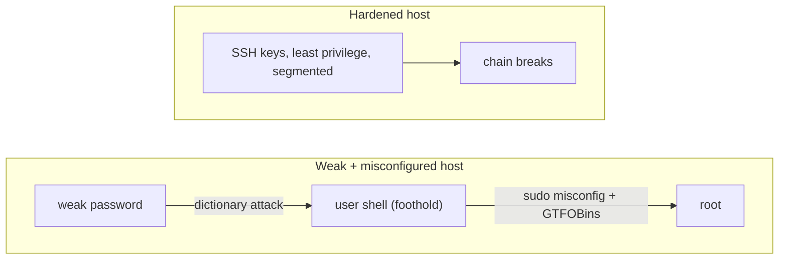

**Language:** English · [Hrvatski](README.hr.md)

<!-- kicker: Lab 06 · attack then defend · Information System Security -->
# Lab 06 — Exploitation & Privilege Escalation

*From a weak password to root in three steps. It's rarely a brilliant exploit — more often a weak password and one bad configuration.*

`~90 min` · `Kali · nmap · hydra · SSH` · `level: intermediate` · `submit: Merlin`

> [!WARNING]
> **Ethics & scope.** Only against this deliberately vulnerable target in the lab environment. Dictionary attacks and escalation against real systems without written permission are a criminal offence.

**Scenario.** Flicker has a forgotten server on the network. You're first the **attacker** who cracks a weak password, gets in and becomes root, then the **administrator** who closes every step of that chain.

## Learning outcomes

- Discover a service and run a dictionary attack against its login.
- Gain access and enumerate privilege-escalation options.
- Exploit a sudo misconfiguration to get root and read a protected flag.
- Close each step of the chain on the target and prove it by repeating the attack.

## Prerequisites

- [ ] [Lab 00](../lab-00-setup/README.md) completed — Kali + Docker working.
- [ ] The course repository cloned into `~/Information-System-Security` (you did this in [Lab 03](../lab-03-network/README.md)).
- [ ] Your student ID and the `ISS_SECRET` value (the instructor gives it to you).
- [ ] Linux basics: users, `root`, file permissions.

## Setup · ~10 min

You work in the same repository as in Lab 05. Update it, go into this lab's folder and stop the Lab 05 target — you no longer need it, and stopping it frees memory in the VM:

```bash
cd ~/Information-System-Security && git pull
cd lab-06-exploitation
docker compose -f ../lab-05-web-auth/compose.yml down
```

Start recording your work (required for the submission). Everything you type in this terminal is recorded until you press `Ctrl-D` at the end of the lab; after that, stop the target with `docker compose down`. This whole lab happens in the terminal, so do all of it in this one window:

```bash
asciinema rec lab.cast
```

The target needs two values from you. Copy the example file and open the copy in the `nano` text editor:

```bash
cp .env.example .env
nano .env
```

Set `MB=` to your student ID (*MB* stands for *matični broj*, the Croatian term for it) and `ISS_SECRET=` to the value from the instructor. Save with `Ctrl-O`, then `Enter`, and leave the editor with `Ctrl-X`.

Build and start the target: a small Linux server in a container, vulnerable on purpose. It runs **SSH**, the service administrators use to log in to a remote command line, published on `localhost:2222`:

```bash
docker compose up -d --build
```

When it starts, the target computes a flag from your student ID and stores it in `/root/flag.txt`, a file only the `root` user can read. Reading it proves that you became root. A short list of candidate passwords, `passwords.txt`, is in this folder.

> [!TIP]
> **Common pitfall.** `required variable MB is missing a value` (or the same for `ISS_SECRET`) means there is no `.env` in this folder or that line in it is empty. `no configuration file provided` means you are not in `lab-06-exploitation`. Typed the wrong ID? Correct `.env` and run `docker compose up -d` again: the flag is recomputed every time the target starts.

## Background — exploitation in one minute

Exploitation is the step where a *flaw* becomes *control*: an attacker turns something that should never have been reachable — a weak password, a careless configuration, or an unpatched vulnerability (sometimes a known **CVE**) — into the ability to run their own commands on the machine. On this target the flaw is ordinary: a login with a guessable password sits exposed on the network, so a tool like **hydra** just tries one password after another until it gets in, and a framework like **Metasploit** would package the same attack into a one-line module. Automation is what makes this so dangerous — the attacker needs neither skill nor luck, only a reachable service and a weak secret. That a single exposed login is enough is not theoretical: the **Mirai** botnet grew to hundreds of thousands of devices by doing nothing cleverer than trying a short list of around sixty default username/password pairs against open Telnet logins.

A foothold is rarely the end. Landed as an ordinary user, the attacker hunts for a **privilege escalation** — a way from that account up to `root`. Here it is a `sudo` misconfiguration: the user may run one program as root without a password, and if that program can spawn a shell (see **GTFOBins**), the shell it spawns runs *as root*. That is the whole chain — weak password → user foothold → misconfigured privilege → full control — and the defence breaks each link: SSH keys instead of guessable passwords, least privilege so no account can quietly become root, and patching or segmenting services that need not face the network at all.



The left path is Part 1: one guessable password and one careless `sudo` line chain all the way to root. The right path is Part 2 — break any single link and the chain stops: keys instead of passwords, least privilege instead of a shell-spawning `sudo` rule, a service that isn't needlessly exposed.

## Part 1 — Offensive: from password to root · ~35 min

### 1.1 Discover the service
**nmap** is the port scanner from Lab 03. Ask it what listens on port 2222; `-sV` also probes the service for the name and version of the software behind it:

```bash
nmap -sV -p 2222 localhost
```

You can't attack a service you can't see, so discovery comes first: confirming it is OpenSSH on `2222` tells the attacker exactly which login to target, and `-sV` reads the version in case a known vulnerability already exists for it.

> [!NOTE]
> **Expected.** One result line: `2222/tcp open  ssh  OpenSSH 9.2p1 Debian …`. The port is open and the software answering on it is OpenSSH.

### 1.2 Dictionary attack on the login
The username is `flicker`, the company's own name: attackers try the obvious first. For the password you have `passwords.txt`, the kind of short list an attacker builds for one specific company (its name, seasons, years, keyboard classics). Look at it:

```bash
cat passwords.txt
```

**hydra** is a login cracker: it opens real connections to a network service and tries one password after another. Point it at the SSH login:

```bash
hydra -l flicker -P passwords.txt -t 4 -s 2222 ssh://localhost
```

`-l` is the one username to try, `-P` the file of passwords and `-s` the port. `-t 4` limits hydra to four connections at a time, because an SSH server starts refusing clients that open too many at once.

This is the whole foothold in one command: hydra automates the guessing, so the strength of the login comes down entirely to the password — a weak one falls in the time it takes to read the list, no matter how up to date the software is.

> [!NOTE]
> **Expected.** After a few seconds hydra prints a line that starts with `[2222][ssh] host: localhost` and ends with `login: flicker   password: …` (the cracked password), followed by `1 of 1 target successfully completed, 1 valid password found`.

> [!TIP]
> **Common pitfall.** Attacking over the network is slow — that's why you use a small, targeted list, not all of rockyou. `[ERROR] could not connect to ssh://…:2222 - Connection refused` means the target is not running: check with `docker compose ps` and start it again with `docker compose up -d`.

### 1.3 Get in and enumerate
Log in over SSH with the password hydra found. The first time, `ssh` shows the server's key fingerprint and asks whether to continue: type `yes`. The password stays invisible while you type it.

```bash
ssh flicker@localhost -p 2222
```

The prompt changes to `flicker@…:~$`. From here on your commands run on the target, not on Kali. Check who you are and try to read the flag:

```bash
id
cat /root/flag.txt
```

> [!NOTE]
> **Expected.** `uid=1000(flicker) gid=1000(flicker) groups=1000(flicker)`, then `cat: /root/flag.txt: Permission denied`. You are in, but only as an ordinary user.

Getting a shell is not the goal — an ordinary user can't read `/root/flag.txt`. So the first move after landing is enumeration. **sudo** runs a single command as another user, usually root, and `sudo -l` is the single most valuable check: it tells you, without guessing, exactly what this account is permitted to run that way.

```bash
sudo -l
```

> [!NOTE]
> **Expected.** The last two lines read `User flicker may run the following commands on …:` and `(root) NOPASSWD: /usr/bin/find`. The account may run one program, `find`, as root, and `NOPASSWD` means it is not even asked for a password.

### 1.4 Escalate to root
`find` looks harmless: it searches for files. But it can also run a command on what it finds (`-exec`), and under `sudo` that command runs as root. [GTFOBins](https://gtfobins.org/) is a catalogue of everyday programs that can be bent this way. Look the technique up instead of guessing:

1. Open `https://gtfobins.org/` in Firefox, type `find` into the search box and open the `find` page.
2. In the **Shell** section choose the **Sudo** tab. It shows the command that makes `find` start a shell.
3. Run that command on the target with `sudo` in front. The page lists it without `sudo`, because there `sudo` is the situation you are in, not part of the trick:

```bash
sudo find . -exec /bin/sh \; -quit
```

`-exec /bin/sh \;` tells `find` to start a shell for the first file it meets, and `-quit` stops the search after that one. The prompt becomes `#`: a root shell. Prove it and read your flag:

```bash
id
cat /root/flag.txt
```

> [!NOTE]
> **Expected.** `uid=0(root) gid=0(root) groups=0(root)` and your flag, `ASPIRA{sis06_…}` with six hexadecimal characters.

The lesson is least privilege: `sudo` runs the program *as root*, so if that program can start a shell or run arbitrary commands, the attacker inherits root — one over-broad `sudo` rule erases the gap between the `flicker` account and full control.

Leave the root shell and then the SSH session, so that you are back at the Kali prompt for Part 2:

```bash
exit
exit
```

> [!TIP]
> **Common pitfall.** Leave these shells with `exit`. `Ctrl-D` closes a shell too, and one press too many closes the Kali shell and ends your recording. `WARNING: REMOTE HOST IDENTIFICATION HAS CHANGED!` at the `ssh` step means the target was rebuilt and has a new key: run `ssh-keygen -R "[localhost]:2222"` and connect again.

**In the report:** the cracked password, the `sudo -l` output, the command you used to get root, the contents of `/root/flag.txt`, and `id` showing `uid=0(root)`.

## Part 2 — Defensive: close the chain · ~40 min

Now you are Flicker's administrator. The attack needed three things: a password that could be guessed, a login that accepts passwords at all, and a `sudo` rule that hands out root. You'll fix the last two on the target itself, then repeat your own attack to prove that each link is closed.

### 2.1 Why each step worked
For each step (weak password → SSH → sudo misconfig) explain in one sentence why it succeeded.

### 2.2 Apply the fix
**Keys instead of passwords.** An SSH key pair replaces the password with a secret that never travels to the server and is far too long to guess. Create a pair for this lab and install its public half for `flicker`. This is the last time the cracked password is needed:

```bash
ssh-keygen -t ed25519 -f ~/.ssh/lab06 -N ""
ssh-copy-id -i ~/.ssh/lab06.pub -p 2222 flicker@localhost
```

`ssh-keygen` writes the private key to `~/.ssh/lab06` and the public key to `~/.ssh/lab06.pub`; `-N ""` leaves the key without a passphrase, which is acceptable only in a lab. `ssh-copy-id` adds the public key to `~/.ssh/authorized_keys` on the target. Check that the key works **before** you switch passwords off, so you can't lock yourself out:

```bash
ssh -i ~/.ssh/lab06 -p 2222 flicker@localhost id
```

> [!NOTE]
> **Expected.** `uid=1000(flicker) …`, with no password prompt.

**Change the server.** An administrator has console access to the server. Here that is `docker compose exec target …`, which runs a command as root inside the target without going through SSH. Switch off password logins, delete the careless `sudo` rule and restart the target:

```bash
docker compose exec target sed -i 's/^PasswordAuthentication yes/PasswordAuthentication no/' /etc/ssh/sshd_config
docker compose exec target rm /etc/sudoers.d/flicker
docker compose restart target
```

The first command edits the SSH server's configuration: `sed -i` replaces text inside a file, which is how you edit on a server with no text editor installed. The second removes the file that gave `flicker` the program `find` as root. The SSH server reads its configuration only when it starts, hence the restart; on a real server you would run `sudo systemctl reload ssh`.

> [!TIP]
> **Common pitfall.** Use `restart` here, not `up --build` or `down`: your changes live inside the running container, and a re-created one starts vulnerable again. That is also your reset button: `docker compose up -d --force-recreate` brings back the original target if you want to start Part 2 over.

### 2.3 Attack it again
Repeat Part 1 against the fixed target:

```bash
hydra -l flicker -P passwords.txt -t 4 -s 2222 ssh://localhost
ssh flicker@localhost -p 2222
```

> [!NOTE]
> **Expected.** hydra stops with `[ERROR] target ssh://…:2222/ does not support password authentication`, and `ssh` answers `Permission denied (publickey).` without ever asking for a password. The cracked password is now worthless at the door.

Log in with the key and check `sudo` again. This time `sudo` asks for a password: type the one you cracked.

```bash
ssh -i ~/.ssh/lab06 -p 2222 flicker@localhost
sudo -l
exit
```

> [!NOTE]
> **Expected.** `Sorry, user flicker may not run sudo on …`. Even someone who knows the password gets no root. The last line, `exit`, takes you back to Kali.

**In the report:** the three results after the fix (hydra's error, the refused password login, the `sudo -l` refusal) and, for each, one sentence on which link of the chain it closes.

### 2.4 Recommendations
3 concrete recommendations for Flicker, ordered by impact. You closed two links by hand; say what is still missing (for example strong passwords or a second factor where passwords remain, `fail2ban` or rate limiting, logging and alerts for `sudo` and failed logins, not exposing SSH to networks that don't need it).

### Bonus
- Before the fix, or after a reset: perform the same access via Metasploit (`ssh_login` module) and compare with hydra.
- Write a minimal correct `sudoers` line that still gives `flicker` the needed function but no path to root.

## Submission

- `lab06_<ID>.pdf` — the whole chain with outputs, `/root/flag.txt`, `id` as root, the repeated attack after the fix, recommendations.
- An **[asciinema](https://asciinema.org/) recording** of your work (`asciinema rec lab.cast`, stop with `Ctrl-D`) — required; the flag only identifies you, this recording is the proof of work.

## Grading

| Item | Points |
|---|:-:|
| Service discovery + cracked password | 3 |
| Escalation to root + flag read | 3 |
| Fix applied and proven by the repeated attack | 3 |
| Recommendations by impact | 1 |
| Bonus | +1 |
