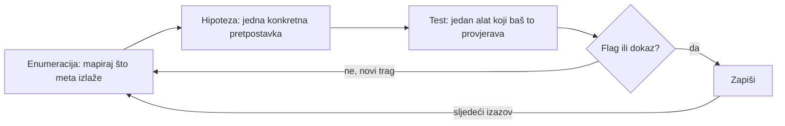

**Jezik:** [English](README.md) · Hrvatski

<!-- kicker: Vježba 07 · capstone · crveni i plavi tim · Sigurnost informacijskih sustava -->
# Vježba 07 — Napad i istraga (capstone)

*Spoji sve: prvo probij trgovinu kao crveni tim, pa iz logova rekonstruiraj tuđi napad kao plavi tim.*

`~90 min` · `Kali · Juice Shop · analiza logova` · `razina: završna` · `predaja: Merlin`

> [!WARNING]
> **Etika i opseg.** CTF isključivo na Juice Shop meti u lab okruženju. Analiza se radi na generiranom zapisniku.

**Scenarij.** Flicker te zove na dvije uloge u istom danu. Ujutro si **crveni tim** koji probija trgovinu i skuplja bodove. Popodne je bila provala kod partnera, pa si **plavi tim** koji iz zapisnika rekonstruira što se dogodilo.

## Ishodi učenja

- Samostalno riješiti više web izazova različitih kategorija (CTF).
- Rekonstruirati vremenski slijed napada iz zapisnika poslužitelja.
- Prepoznati indikatore kompromitacije (IOC) i izvući skriveni trag.
- Predložiti odgovor na incident (zadržavanje, čišćenje, oporavak).

## Preduvjeti

- [ ] Odrađene Vježbe 00–05.
- [ ] `make_incident.py` (u ovoj mapi) i `ISS_SECRET` (daje nastavnik) — generiraš svoj `incident.log`.
- [ ] Alati za tekst (`grep`, `awk`, `sort`, `base64`) i preglednik.

## Priprema · ~5 min

```bash
docker compose up -d
```

Otvori `http://localhost:3000` i **registriraj račun s e-mailom koji sadrži tvoj matični broj**.

## Pozadina — kako pristupiti u minuti

CTF (Capture The Flag) je standardni praktični format za vježbanje ofenzivne sigurnosti: dobiješ namjerno pokvaren sustav i dokazuješ da razumiješ propust tako da ga stvarno iskoristiš i izvučeš skriveni token — flag. Istraga incidenta je zrcalna slika: umjesto da ti postaviš propust, rekonstruiraš što je napadač već napravio, iz tragova koje je ostavio. Ova završna vježba spaja obje uloge u isti dan jer stvarni sigurnosni posao točno tako i izgleda — crveni tim, pa plavi tim. Ništa ovdje nije posve nova tehnika: svaki je izazov varijacija vještine iz ranijih vježbi — hashiranje i kriptografija, čitanje mrežnog prometa, web injection i broken access control, exploitation. Teško više nije „kako ovaj napad radi", nego „koja od stvari koje već znam ovdje pali". Upravo to prepoznavanje, sam, provjerava ova završna vježba.

Razliku između rješavanja i lupanja naslijepo čini metoda, a metoda je kratka petlja koju ponavljaš. Prvo enumeracija: mapiraj sve što meta izlaže — stranice, parametre, portove, retke zapisnika — jer ne možeš iskoristiti ni objasniti ono što nisi primijetio. Iz onoga što vidiš složi jednu konkretnu hipotezu („ovo polje izgleda nefiltrirano", „ovaj jedan IP radi nesrazmjerno mnogo zahtjeva"), pa posegni za jednim alatom koji testira baš to i ništa više. Što god se vrati — flag, greška ili novi trag — zapiši odmah, zajedno s naredbom koja ga je dala, da izvještaj bude nusprodukt rada, a ne mučna rekonstrukcija poslije. Pogrešna hipoteza i dalje sužava prostor, pa se vrati na enumeraciju s onim što si upravo naučio. Zato struktura pobjeđuje pogađanje: nasumično bockanje se ne zbraja, a svaka dokumentirana runda nešto isključuje i pretraga se stvarno smanjuje — plavi tim vrti istu petlju i završava zadržavanjem, čišćenjem i oporavkom koje opisuješ na kraju.



## Dio 1 — Crveni tim: CTF · ~40 min

Pronađi *Score Board* i riješi **najmanje 4 izazova iz barem 3 kategorije** (npr. injection, XSS, broken access control, sensitive data). Za svaki: naziv, kategorija, kratak opis. **U izvještaj:** screenshot Score Boarda s riješenim izazovima i tvojim računom.

> [!TIP]
> Ne moraš provaliti sve — biraj izazove iz područja koja smo radili (Vježbe 03 i 04). Kreni od lakših.

## Dio 2 — Plavi tim: analiza incidenta · ~40 min

Prvo generiraj **svoj** zapisnik (flag je vezan uz tvoj matični broj):

```bash
ISS_SECRET=<od nastavnika> python make_incident.py <tvoj matični broj>
```

### 2.1 Tko i odakle
```bash
awk '{print $1}' incident.log | sort | uniq -c | sort -rn | head
```
Odredi IP napadača (nesrazmjerno mnogo zahtjeva, puno grešaka 4xx/5xx).

### 2.2 Faze napada
Poredaj kronološki: izviđanje (skeniranje putanja), pokušaji injectiona, uspješan pristup, iznošenje podataka. Za svaku fazu navedi primjer retka.

### 2.3 Skriveni trag
Zahtjev kojim su podaci izneseni nosi zakodiran parametar — dekodiraj ga:
```bash
grep 'export' incident.log
echo '<zakodirana_vrijednost>' | base64 -d
```
> [!NOTE]
> **Očekivano.** Base64 vrijednost dekodira se u flag oblika `ASPIRA{sis_incident_...}`.

**U izvještaj:** IP napadača, tablica faza s primjerima redaka, dekodirani flag, i popis **IOC-ova**.

### 2.4 Odgovor na incident
Kratko (5–7 rečenica): **zadržavanje, čišćenje, oporavak**, te što bi spriječilo ponavljanje.

### Za brze — bonus
- Napiši jedno `grep`/`awk` pravilo koje bi ovaj napad označilo u stvarnom vremenu.
- Procijeni je li iznošenje bilo prije ili nakon uspješne prijave i obrazloži iz zapisnika.

## Predaja

- `vjezba06_<MB>.pdf` — CTF izazovi + Score Board screenshot, analiza incidenta (faze, IOC-ovi, flag, plan odgovora).
- **[asciinema](https://asciinema.org/) snimka** rada (`asciinema rec vjezba.cast`, zaustavi s `Ctrl-D`) — obavezna; flag samo pokazuje čiji je rad, snimka je dokaz da je odrađen.

## Bodovanje

| Stavka | Bodovi |
|---|:-:|
| CTF: ≥ 4 izazova iz ≥ 3 kategorije (s opisima) | 4 |
| Analiza: IP napadača + faze napada | 3 |
| Dekodiran flag + popis IOC-ova | 2 |
| Plan odgovora na incident | 1 |
| Bonus | +1 |
