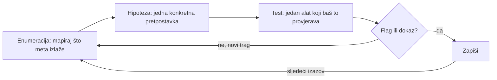

**Jezik:** [English](README.md) · Hrvatski

<!-- kicker: Vježba 07 · capstone · crveni i plavi tim · Sigurnost informacijskih sustava -->
# Vježba 07 — Napad i istraga (capstone)

*Spoji sve: prvo probij trgovinu kao crveni tim, pa iz logova rekonstruiraj tuđi napad kao plavi tim.*

`~90 min` · `Kali · Juice Shop · analiza logova` · `razina: završna` · `predaja: Merlin`

> [!WARNING]
> **Etika i opseg.** CTF isključivo na Juice Shop meti u lab okruženju. Analiza se radi na generiranom zapisniku.

**Scenarij.** Flicker te zove na dvije uloge u istom danu. Ujutro si **crveni tim** koji probija trgovinu i skuplja bodove. Popodne je bila provala kod partnera, pa si **plavi tim** koji iz zapisnika rekonstruira što se dogodilo.

## Ishodi učenja

- Samostalno riješiti više web izazova različitih kategorija (CTF).
- Rekonstruirati vremenski slijed napada iz zapisnika poslužitelja.
- Prepoznati indikatore kompromitacije (IOC) i izvući skriveni trag.
- Predložiti odgovor na incident (zadržavanje, čišćenje, oporavak).

## Preduvjeti

- [ ] Odrađene Vježbe 00–06.
- [ ] `make_incident.py` (u ovoj mapi) i `ISS_SECRET` (daje nastavnik) — generiraš svoj `incident.log`.
- [ ] Alati za tekst (`grep`, `awk`, `sort`, `base64`) i preglednik.

## Priprema · ~5 min

Radiš u istom repozitoriju kao u Vježbi 06. Ažuriraj ga i uđi u mapu ove vježbe. Ako trgovina iz Vježbe 05 još radi, zaustavi je: ova vježba pokreće vlastitu kopiju na istom portu 3000.

```bash
cd ~/Information-System-Security && git pull
cd lab-07-ctf
docker compose -f ../lab-05-web-auth/compose.yml down
```

Pokreni snimanje svog rada (obavezno za predaju). Sve što upišeš u ovaj terminal snima se dok na kraju vježbe ne pritisneš `Ctrl-D`; nakon toga zaustavi metu s `docker compose down`:

```bash
asciinema rec vjezba.cast
```

Podigni metu, isti **OWASP Juice Shop** kao u Vježbi 05:

```bash
docker compose up -d
```

Pričekaj desetak sekundi, otvori `http://localhost:3000` u Firefoxu i **registriraj račun s e-mailom `<MB>@flicker.test`** (tvoj matični broj), kao u Vježbi 05, pa se prijavi.

> [!TIP]
> **Čest problem.** `port is already allocated` znači da još radi neki drugi Juice Shop: ponovno pokreni redak `docker compose -f ../lab-05-web-auth/compose.yml down`. `no configuration file provided` znači da nisi u mapi `lab-07-ctf`.

## Pozadina — kako pristupiti u minuti

CTF (Capture The Flag) je standardni praktični format za vježbanje ofenzivne sigurnosti: dobiješ namjerno pokvaren sustav i dokazuješ da razumiješ propust tako da ga stvarno iskoristiš i izvučeš skriveni token — flag. Istraga incidenta je zrcalna slika: umjesto da ti postaviš propust, rekonstruiraš što je napadač već napravio, iz tragova koje je ostavio. Ova završna vježba spaja obje uloge u isti dan jer stvarni sigurnosni posao točno tako i izgleda — crveni tim, pa plavi tim. Ništa ovdje nije posve nova tehnika: svaki je izazov varijacija vještine iz ranijih vježbi — hashiranje i kriptografija, čitanje mrežnog prometa, web injection i broken access control, exploitation. Teško više nije „kako ovaj napad radi", nego „koja od stvari koje već znam ovdje pali". Upravo to prepoznavanje, sam, provjerava ova završna vježba.

Razliku između rješavanja i lupanja naslijepo čini metoda, a metoda je kratka petlja koju ponavljaš. Prvo enumeracija: mapiraj sve što meta izlaže — stranice, parametre, portove, retke zapisnika — jer ne možeš iskoristiti ni objasniti ono što nisi primijetio. Iz onoga što vidiš složi jednu konkretnu hipotezu („ovo polje izgleda nefiltrirano", „ovaj jedan IP radi nesrazmjerno mnogo zahtjeva"), pa posegni za jednim alatom koji testira baš to i ništa više. Što god se vrati — flag, greška ili novi trag — zapiši odmah, zajedno s naredbom koja ga je dala, da izvještaj bude nusprodukt rada, a ne mučna rekonstrukcija poslije. Pogrešna hipoteza i dalje sužava prostor, pa se vrati na enumeraciju s onim što si upravo naučio. Zato struktura pobjeđuje pogađanje: nasumično bockanje se ne zbraja, a svaka dokumentirana runda nešto isključuje i pretraga se stvarno smanjuje — plavi tim vrti istu petlju i završava zadržavanjem, čišćenjem i oporavkom koje opisuješ na kraju.



## Dio 1 — Crveni tim: CTF · ~40 min

Pronađi *Score Board* i riješi **najmanje 4 nova izazova iz barem 3 kategorije** (npr. injection, XSS, broken access control, sensitive data). Za svaki: naziv, kategorija, kratak opis. **U izvještaj:** screenshot Score Boarda s riješenim izazovima i tvojim računom.

Juice Shop pamti napredak u kolačiću preglednika, pa izazovi iz Vježbe 05 mogu već biti označeni kao riješeni kad otvoriš trgovinu. Oni se ovdje ne broje: *Score Board*, *View Basket* i sve ostalo iz tvog izvještaja za Vježbu 05. Četiri nova navedi poimence.

> [!TIP]
> Ne moraš provaliti sve — biraj izazove iz područja koja smo radili (Vježbe 04 i 05). Kreni od lakših.

## Dio 2 — Plavi tim: analiza incidenta · ~40 min

Flickerovom partneru provaljeno je u sustav, pa ti je poslao jednodnevni pristupni zapisnik (access log) svoje web trgovine. Generiraj **svoj** primjerak: adresa napadača, broj pokušaja, vremena i flag u njemu vezani su uz tvoj matični broj. Zamijeni oba placeholdera; tajna je ista kao u Vježbi 06.

```bash
ISS_SECRET=<od nastavnika> python3 make_incident.py <tvoj matični broj>
head -3 incident.log
```

> [!NOTE]
> **Očekivano.** `OK: incident.log written (… lines)`, nekoliko tisuća redaka, a zatim prva tri.

Svaki redak je jedan zahtjev. Slijeva nadesno: IP adresa klijenta, vrijeme, zahtjev (metoda i putanja), **statusni kod** kojim je poslužitelj odgovorio (`200` u redu, `302` preusmjeravanje, `401` pogrešna prijava, `403` zabranjeno, `404` nije pronađeno, `500` greška poslužitelja), veličina odgovora u bajtovima i softver klijenta. `awk` dijeli redak po razmacima, pa je adresa polje `$1`, putanja `$7`, status `$9`, a veličina `$10`.

### 2.1 Tko i odakle
Prebroji zahtjeve po adresi:

```bash
awk '{print $1}' incident.log | sort | uniq -c | sort -rn | head
```

Najaktivnije adrese nisu napadač: servis za nadzor i crawler tražilice šalju više zahtjeva nego ijedna osoba. Napad je glasan na drugi način, proizvodi greške. Prebroji samo zahtjeve na koje je odgovoreno statusom 4xx ili 5xx:

```bash
awk '$9 >= 400 {print $1}' incident.log | sort | uniq -c | sort -rn | head
```

> [!NOTE]
> **Očekivano.** Dvije adrese odskaču daleko iznad svih ostalih. To su tvoji osumnjičenici.

Za svakog osumnjičenika ispiši statusne kodove koje je dobio (`<IP>` zamijeni adresom):

```bash
grep '^<IP> ' incident.log | awk '{print $9}' | sort | uniq -c
```

> [!NOTE]
> **Očekivano.** Jedan je dobivao samo `404` i `403`: skener koji je pokucao na sva vrata i nijedna nisu bila otvorena. Drugi ima i `401`, `302` i `200`: taj je ušao i to je tvoj napadač.

### 2.2 Faze napada
Zahtjeve napadača izdvoji u zasebnu datoteku i čitaj ih odozgo prema dolje; zapisnik je poredan po vremenu. U `less` se krećeš strelicama, a izlaziš s `q`:

```bash
grep '^<IP> ' incident.log > attacker.log
wc -l attacker.log
less attacker.log
```

Pronađi četiri faze i zabilježi kad koja počinje: **izviđanje** (mnogo različitih putanja, gotovo sve s odgovorom `404`), **pokušaji injectiona** (`/search?q=` s `%27`, URL-kodiranim jednostrukim navodnikom iz Vježbe 04; prati kako status prelazi iz `500` u `200`), **pogađanje lozinke** (`POST /login` s odgovorom `401` iznova i iznova, a zatim jedan `302`) i **pristup s iznošenjem podataka** (stranice s odgovorom `200` nakon te prijave).

Prebroji neuspjele prijave:

```bash
grep -c '"POST /login HTTP/1.1" 401' attacker.log
```

> [!NOTE]
> **Očekivano.** Više od pet; točan broj je u zapisniku svakog studenta drukčiji.

### 2.3 Skriveni trag
Nakon prijave napadač je iznio podatke. Iznošenje se vidi kao neobično velik odgovor, zato napadačeve uspješne zahtjeve poredaj po veličini:

```bash
awk '$9 == 200 {print $10, $7}' attacker.log | sort -rn | head -3
```

> [!NOTE]
> **Očekivano.** Daleko najveći je zahtjev na `/export` s dugom vrijednošću `data=`. I zaposlenici koriste `/export`, ali s `format=csv`.

Ta je vrijednost Base64. Dekodiraj je (zalijepi je između navodnika):

```bash
echo '<zakodirana_vrijednost>' | base64 -d
```

> [!NOTE]
> **Očekivano.** Flag oblika `ASPIRA{sis_incident_...}`.

**U izvještaj:** IP napadača, drugi osumnjičenik i zašto si ga isključio, tablica faza s vremenom početka i po jednim primjerom retka, broj neuspjelih prijava, dekodirani flag i popis **IOC-ova** (indikatori kompromitacije: konkretni tragovi koje bi drugi branitelj mogao potražiti u svojim zapisnicima, poput adrese, softvera klijenta, putanja i vremena).

### 2.4 Odgovor na incident
Kratko (5–7 rečenica): **zadržavanje, čišćenje, oporavak**, te što bi spriječilo ponavljanje.

### Za brze — bonus
- Napiši jedno `grep`/`awk` pravilo koje bi ovaj napad označilo u stvarnom vremenu.
- Procijeni je li iznošenje bilo prije ili nakon uspješne prijave i obrazloži iz zapisnika.

## Predaja

- `vjezba07_<MB>.pdf` — CTF izazovi + Score Board screenshot, analiza incidenta (faze, IOC-ovi, flag, plan odgovora).
- **[asciinema](https://asciinema.org/) snimka** rada (`asciinema rec vjezba.cast`, zaustavi s `Ctrl-D`) — obavezna; flag samo pokazuje čiji je rad, snimka je dokaz da je odrađen.

## Bodovanje

| Stavka | Bodovi |
|---|:-:|
| CTF: ≥ 4 nova izazova iz ≥ 3 kategorije (s opisima) | 4 |
| Analiza: IP napadača + faze napada | 3 |
| Dekodiran flag + popis IOC-ova | 2 |
| Plan odgovora na incident | 1 |
| Bonus | +1 |
