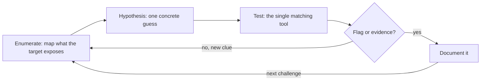

**Language:** English · [Hrvatski](README.hr.md)

<!-- kicker: Lab 07 · capstone · red & blue team · Information System Security -->
# Lab 07 — Attack and Investigate (Capstone)

*Put it all together: first break into the shop as the red team, then reconstruct someone else's attack from the logs as the blue team.*

`~90 min` · `Kali · Juice Shop · log analysis` · `level: capstone` · `submit: Merlin`

> [!WARNING]
> **Ethics & scope.** CTF only against the Juice Shop target in the lab environment. Analysis is on the generated log.

**Scenario.** Flicker calls you in for two roles in one day. In the morning you're the **red team** who breaks into their shop and scores points. In the afternoon a partner was breached, so you're the **blue team** who reconstructs from the logs what happened.

## Learning outcomes

- Independently solve several web challenges across categories (CTF).
- Reconstruct the timeline of an attack from server logs.
- Identify indicators of compromise (IOCs) and recover a hidden trace.
- Propose an incident response (containment, eradication, recovery).

## Prerequisites

- [ ] Labs 00–06 completed.
- [ ] `make_incident.py` (in this folder) and `ISS_SECRET` (from the instructor) — you generate your own `incident.log`.
- [ ] Text tools (`grep`, `awk`, `sort`, `base64`) and a browser.

## Setup · ~5 min

You work in the same repository as in Lab 06. Update it and go into this lab's folder. If the Lab 05 shop is still running, stop it: this lab starts its own copy on the same port 3000.

```bash
cd ~/Information-System-Security && git pull
cd lab-07-ctf
docker compose -f ../lab-05-web-auth/compose.yml down
```

Start recording your work (required for the submission). Everything you type in this terminal is recorded until you press `Ctrl-D` at the end of the lab; after that, stop the target with `docker compose down`:

```bash
asciinema rec lab.cast
```

Bring up the target, the same **OWASP Juice Shop** as in Lab 05:

```bash
docker compose up -d
```

Wait about 10 seconds, open `http://localhost:3000` in Firefox and **register an account with the email `<ID>@flicker.test`** (your student ID), as in Lab 05, then log in.

> [!TIP]
> **Common pitfall.** `port is already allocated` means another Juice Shop is still running: run the `docker compose -f ../lab-05-web-auth/compose.yml down` line again. `no configuration file provided` means you are not in `lab-07-ctf`.

## Background — how to approach this in one minute

A CTF — Capture The Flag — is a standard hands-on way to practise offensive security: you're put in front of a deliberately broken system and prove you understand a flaw by actually exploiting it to recover a hidden token, the flag. An incident investigation is the mirror image: instead of planting the flaw you reconstruct what an attacker already did, from the traces they left behind. This capstone runs both halves in one day because real security work is exactly that pairing — red team, then blue team. Nothing here is a brand-new technique; every challenge is a variation on a skill from an earlier lab — hashing and crypto, reading network traffic, web injection and broken access control, exploitation. The hard part is no longer "how does this attack work" but "which of the things I already know applies here". That recognition, done on your own, is what the capstone tests.

The difference between solving and flailing is method, and the method is a short loop you repeat. First enumerate: map everything the target exposes — pages, parameters, ports, log lines — because you can't exploit or explain what you haven't noticed. From what you see form one concrete hypothesis ("this field looks unsanitised", "this one IP makes far too many requests"), then reach for the single tool that tests exactly that and nothing more. Write down whatever comes back — a flag, an error, a new clue — with the command that produced it, so the report is a byproduct of the work instead of an afterthought. A wrong hypothesis still narrows the space, so loop back to enumerate with what you just learned. This is why structure beats guessing: random pokes don't accumulate, while each documented round rules something out and the search shrinks — and the blue-team half runs this same loop, ending in the containment, eradication and recovery you write up at the close.



## Part 1 — Red team: CTF · ~40 min

Find the *Score Board* and solve **at least 4 new challenges from at least 3 categories** (e.g. injection, XSS, broken access control, sensitive data). For each: name, category, short description. **In the report:** a Score Board screenshot showing the solved challenges and your student-ID account.

Juice Shop keeps your progress in a browser cookie, so challenges from Lab 05 may already be marked as solved when you open the shop. Those do not count here: *Score Board*, *View Basket* and anything else from your Lab 05 report. List the four new ones by name.

> [!TIP]
> You don't need to break everything — pick challenges from the areas we covered (Labs 04 & 05). Start with the lower-star ones.

## Part 2 — Blue team: incident analysis · ~40 min

A partner of Flicker's was breached and sent you one day of their web shop's access log. Generate **your** copy: the attacker's address, the number of attempts, the times and the flag in it are tied to your student ID. Replace both placeholders; the secret is the one from Lab 06.

```bash
ISS_SECRET=<from instructor> python3 make_incident.py <your ID>
head -3 incident.log
```

> [!NOTE]
> **Expected.** `OK: incident.log written (… lines)`, a few thousand of them, then the first three.

Each line is one request. From left to right: the client's IP address, the time, the request (method and path), the **status code** the server answered with (`200` OK, `302` redirect, `401` wrong login, `403` forbidden, `404` not found, `500` server error), the size of the answer in bytes and the client's software. `awk` splits a line on spaces, which makes the address field `$1`, the path `$7`, the status `$9` and the size `$10`.

### 2.1 Who and from where
Count the requests per address:

```bash
awk '{print $1}' incident.log | sort | uniq -c | sort -rn | head
```

The busiest addresses are not the attacker: a monitoring service and a search engine's crawler send more requests than any person. An attack is loud in a different way, it produces errors. Count only the requests that were answered with a 4xx or 5xx status:

```bash
awk '$9 >= 400 {print $1}' incident.log | sort | uniq -c | sort -rn | head
```

> [!NOTE]
> **Expected.** Two addresses stand far above all the others. They are your suspects.

For each suspect, list the status codes it received (replace `<IP>` with the address):

```bash
grep '^<IP> ' incident.log | awk '{print $9}' | sort | uniq -c
```

> [!NOTE]
> **Expected.** One suspect received nothing but `404` and `403`: a scanner that tried every door and found none open. The other one also has `401`, `302` and `200`: that one got in, and it is your attacker.

### 2.2 Attack phases
Put the attacker's requests into a file of their own and read them from top to bottom; the log is ordered by time. In `less`, scroll with the arrow keys and leave with `q`:

```bash
grep '^<IP> ' incident.log > attacker.log
wc -l attacker.log
less attacker.log
```

Find the four phases and note when each one starts: **reconnaissance** (many different paths, nearly all answered `404`), **injection attempts** (`/search?q=` with `%27`, the URL-encoded single quote from Lab 04; watch the status turn from `500` to `200`), **password guessing** (`POST /login` answered `401` again and again, then a single `302`) and **access with exfiltration** (pages answered `200` after that login).

Count the failed logins:

```bash
grep -c '"POST /login HTTP/1.1" 401' attacker.log
```

> [!NOTE]
> **Expected.** More than five; the exact number is different in every student's log.

### 2.3 The hidden trace
After logging in, the attacker took data out. Exfiltration shows up as an unusually large answer, so sort the attacker's successful requests by size:

```bash
awk '$9 == 200 {print $10, $7}' attacker.log | sort -rn | head -3
```

> [!NOTE]
> **Expected.** By far the largest is an `/export` request with a long `data=` value. Staff use `/export` too, but with `format=csv`.

That value is Base64. Decode it (paste it between the quotes):

```bash
echo '<encoded_value>' | base64 -d
```

> [!NOTE]
> **Expected.** A flag of the form `ASPIRA{sis_incident_...}`.

**In the report:** the attacker's IP, the other suspect and why you ruled it out, a table of the phases with start time and one example line each, the number of failed logins, the decoded flag, and a list of **IOCs** (indicators of compromise: the concrete traces another defender could search their own logs for, such as the address, the client software, the paths and the times).

### 2.4 Incident response
Briefly (5–7 sentences): **containment, eradication, recovery**, and what would prevent a recurrence.

### Bonus
- Write one `grep`/`awk` rule that would flag this attack in real time.
- Determine whether exfiltration happened before or after a successful login, and justify it from the log.

## Submission

- `lab07_<ID>.pdf` — CTF challenges + Score Board screenshot, incident analysis (phases, IOCs, flag, response plan).
- An **[asciinema](https://asciinema.org/) recording** of your work (`asciinema rec lab.cast`, stop with `Ctrl-D`) — required; the flag only identifies you, this recording is the proof of work.

## Grading

| Item | Points |
|---|:-:|
| CTF: ≥ 4 new challenges from ≥ 3 categories (with descriptions) | 4 |
| Analysis: attacker IP + attack phases | 3 |
| Decoded flag + IOC list | 2 |
| Incident response plan | 1 |
| Bonus | +1 |
