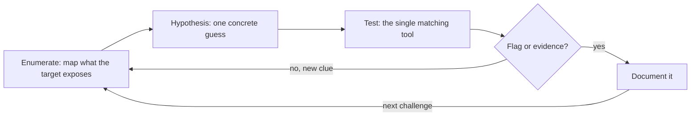

**Language:** English · [Hrvatski](README.hr.md)

<!-- kicker: Lab 07 · capstone · red & blue team · Information System Security -->
# Lab 07 — Attack and Investigate (Capstone)

*Put it all together: first break into the shop as the red team, then reconstruct someone else's attack from the logs as the blue team.*

`~90 min` · `Kali · Juice Shop · log analysis` · `level: capstone` · `submit: Merlin`

> [!WARNING]
> **Ethics & scope.** CTF only against the Juice Shop target in the lab environment. Analysis is on the generated log.

**Scenario.** Flicker calls you in for two roles in one day. In the morning you're the **red team** who breaks into their shop and scores points. In the afternoon a partner was breached, so you're the **blue team** who reconstructs from the logs what happened.

## Learning outcomes

- Independently solve several web challenges across categories (CTF).
- Reconstruct the timeline of an attack from server logs.
- Identify indicators of compromise (IOCs) and recover a hidden trace.
- Propose an incident response (containment, eradication, recovery).

## Prerequisites

- [ ] Labs 00–05 completed.
- [ ] `make_incident.py` (in this folder) and `ISS_SECRET` (from the instructor) — you generate your own `incident.log`.
- [ ] Text tools (`grep`, `awk`, `sort`, `base64`) and a browser.

## Setup · ~5 min

```bash
docker compose up -d
```

Open `http://localhost:3000` and **register an account with an email containing your student ID**.

## Background — how to approach this in one minute

A CTF — Capture The Flag — is a standard hands-on way to practise offensive security: you're put in front of a deliberately broken system and prove you understand a flaw by actually exploiting it to recover a hidden token, the flag. An incident investigation is the mirror image: instead of planting the flaw you reconstruct what an attacker already did, from the traces they left behind. This capstone runs both halves in one day because real security work is exactly that pairing — red team, then blue team. Nothing here is a brand-new technique; every challenge is a variation on a skill from an earlier lab — hashing and crypto, reading network traffic, web injection and broken access control, exploitation. The hard part is no longer "how does this attack work" but "which of the things I already know applies here". That recognition, done on your own, is what the capstone tests.

The difference between solving and flailing is method, and the method is a short loop you repeat. First enumerate: map everything the target exposes — pages, parameters, ports, log lines — because you can't exploit or explain what you haven't noticed. From what you see form one concrete hypothesis ("this field looks unsanitised", "this one IP makes far too many requests"), then reach for the single tool that tests exactly that and nothing more. Write down whatever comes back — a flag, an error, a new clue — with the command that produced it, so the report is a byproduct of the work instead of an afterthought. A wrong hypothesis still narrows the space, so loop back to enumerate with what you just learned. This is why structure beats guessing: random pokes don't accumulate, while each documented round rules something out and the search shrinks — and the blue-team half runs this same loop, ending in the containment, eradication and recovery you write up at the close.



## Part 1 — Red team: CTF · ~40 min

Find the *Score Board* and solve **at least 4 challenges from at least 3 categories** (e.g. injection, XSS, broken access control, sensitive data). For each: name, category, short description. **In the report:** a Score Board screenshot showing the solved challenges and your student-ID account.

> [!TIP]
> You don't need to break everything — pick challenges from the areas we covered (Labs 03 & 04). Start with the lower-star ones.

## Part 2 — Blue team: incident analysis · ~40 min

First generate **your** log (the flag is tied to your student ID):

```bash
ISS_SECRET=<from instructor> python make_incident.py <your ID>
```

### 2.1 Who and from where
```bash
awk '{print $1}' incident.log | sort | uniq -c | sort -rn | head
```
Determine the attacker's IP (disproportionately many requests, lots of 4xx/5xx).

### 2.2 Attack phases
Order them chronologically: reconnaissance (path scanning), injection attempts, successful access, data exfiltration. Cite an example line per phase.

### 2.3 The hidden trace
The exfiltration request carries an encoded parameter — decode it:
```bash
grep 'export' incident.log
echo '<encoded_value>' | base64 -d
```
> [!NOTE]
> **Expected.** The Base64 value decodes to a flag of the form `ASPIRA{sis_incident_...}`.

**In the report:** the attacker's IP, a table of phases with example lines, the decoded flag, and a list of **IOCs**.

### 2.4 Incident response
Briefly (5–7 sentences): **containment, eradication, recovery**, and what would prevent a recurrence.

### Bonus
- Write one `grep`/`awk` rule that would flag this attack in real time.
- Determine whether exfiltration happened before or after a successful login, and justify it from the log.

## Submission

- `lab07_<ID>.pdf` — CTF challenges + Score Board screenshot, incident analysis (phases, IOCs, flag, response plan).
- An **[asciinema](https://asciinema.org/) recording** of your work (`asciinema rec lab.cast`, stop with `Ctrl-D`) — required; the flag only identifies you, this recording is the proof of work.

## Grading

| Item | Points |
|---|:-:|
| CTF: ≥ 4 challenges from ≥ 3 categories (with descriptions) | 4 |
| Analysis: attacker IP + attack phases | 3 |
| Decoded flag + IOC list | 2 |
| Incident response plan | 1 |
| Bonus | +1 |
